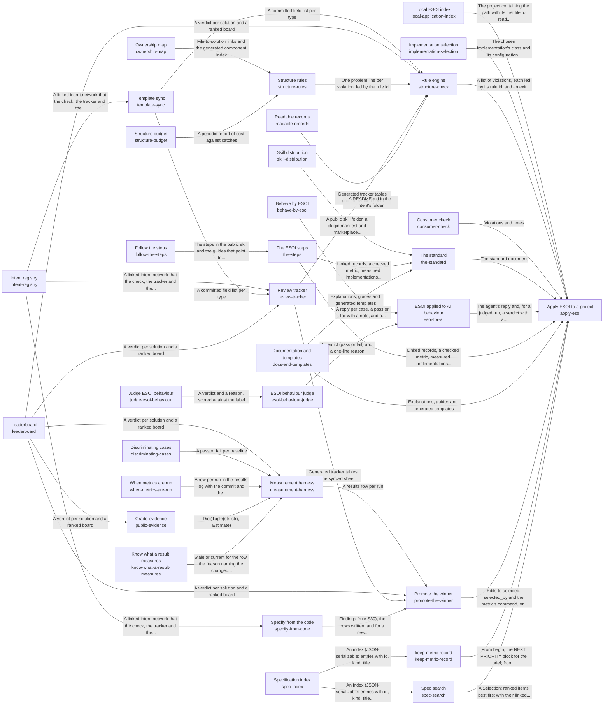

# Evolvable structure that optimizes intent (ESOI)

Every intention is turned into a structure that optimizes the fulfilling of that intent while supporting changes to it, and the intent and the structure evolve together in a continual feedback loop.

*ESOI records of this intent (evolvable structure that optimizes intent), generated from the CSV files beside this page by `esoi readmes`. Edit the CSV files, not this page.*

## How the solutions fit together

esoi turns an intention into a structure that keeps fulfilling it while both change, and apply-esoi is how a project takes that up: apply-esoi teaches people through the-standard, guides AI agents through esoi-for-ai, holds the records and the code to their rules through structure-check, measures alternatives and moves the selection to the winner through promote-the-winner, chooses the implementation that serves each call through implementation-selection, finds the records a request concerns through spec-search, records one piece of work's metric before and after through keep-metric-record, finds which projects apply ESOI through local-application-index, and checks a project built on a library through consumer-check. the-standard explains ESOI and its fill-in templates in docs-and-templates, gives the order of the work in the-steps and ships the author's skill as a public folder through skill-distribution; the-steps is written down for readers in follow-the-steps. esoi-for-ai gives an agent the skill as standing instructions, behave-by-esoi measures case by case whether its replies act by the principles, and esoi-behaviour-judge grades the replies a pattern cannot settle, through judge-esoi-behaviour. structure-check applies every rule it holds through structure-rules, each rule kept only while structure-budget says it still pays and with ownership-map tying every file to a component, keeps the record fields in step with the template through template-sync, regenerates the pages of readable-records and the review-tracker sheet, and reads standings from leaderboard; template-sync parses the template that the intent-registry records follow. review-tracker puts the intent-registry records, the leaderboard standings and the fields kept in step by template-sync in front of a reviewer. promote-the-winner switches a solution's selected implementation when leaderboard shows a clear winner among the rows measurement-harness recorded, then updates the review-tracker sheet and the declarations that specify-from-code keeps in step with the intent-registry records; measurement-harness runs each implementation on its solution's cases, proves through discriminating-cases that those cases fail a naive implementation, follows when-metrics-are-run for when a stage may run and what it may spend, consults public-evidence before it pays to measure a candidate others have measured, asks know-what-a-result-measures which changed files make a recorded row stale, and hands its rows to leaderboard, which public-evidence reads as well. implementation-selection chooses which implementation serves a solution by name, configuration or table default, and its declarations grow into the esoi-runtime sub-intent. spec-search ranks the records a request concerns over the narrowed set spec-index gives it. keep-metric-record reads the slice spec-index gives for the work it records. local-application-index says where to look first in each project. consumer-check scores a consumer's own implementations with the library's cases and shows its version lag.

## Diagram

An arrow runs from the solution that provides to the solution that builds on it; its label is what the provider outputs.

## Solutions at a glance

| Solution | Entry call | Selected implementation | Metric |
|---|---|---|---|
| `follow-the-steps` | `esoi.run("follow-the-steps", '.')` | `steps` | Steps trial |
| `local-application-index` | `esoi.run("local-application-index", '.')` | `live_index` | Local index lookup cases |
| `behave-by-esoi` | `esoi.run("behave-by-esoi", '.')` | `standing-instructions` | ESOI behaviour cases |
| `judge-esoi-behaviour` | `esoi.run("judge-esoi-behaviour", '.')` | `model-judge` | ESOI judge agreement cases |
| `apply-esoi` | `esoi.run("apply-esoi", '.')` | `documents-templates-and-tools` | Adoption effort, Intents whose solutions one paragraph and one diagram explain as the code builds them |
| `intent-registry` | `esoi.run("intent-registry", '.')` | `beside_code` | Navigable records, Record completeness |
| `template-sync` | `esoi.run("template-sync", '.')` | `template-parser` | Template agreement |
| `ownership-map` | `esoi.run("ownership-map", '.')` | `component-rows` | Trace completeness |
| `implementation-selection` | `esoi.run("implementation-selection", 'structure-check')` | `declarations` | Resolution correctness |
| `measurement-harness` | `esoi.run("measurement-harness", '.')` | `component-harness` | Provenance completeness |
| `leaderboard` | `esoi.run("leaderboard", '.')` | `margin-leaderboard` | Ranking correctness |
| `discriminating-cases` | `esoi.run("discriminating-cases", '.')` | `broken-baselines` | Case discrimination |
| `structure-check` | `esoi.run("structure-check", '.')` | `rule-script` | Check dependability |
| `structure-rules` | `esoi.run("structure-rules", '.')` | `rule-modules` | Violation detection |
| `review-tracker` | `esoi.run("review-tracker", '.')` | `tracker-and-sheet` | Review coverage |
| `consumer-check` | `esoi.run("consumer-check", 'esoi')` | `consumer-command` | Consumer soundness |
| `the-standard` | `esoi.run("the-standard", '.')` | `standard-document` | Adoption effort |
| `structure-budget` | `esoi.run("structure-budget", '.')` | `written-weighing-rule` | Structure cost against catches |
| `when-metrics-are-run` | `esoi.run("when-metrics-are-run", '.')` | `on-every-change` | Decisions backed by current results |
| `skill-distribution` | `esoi.run("skill-distribution", '.')` | `generated-public-copy` | Skill copy agreement and leaks |
| `esoi-for-ai` | `esoi.run("esoi-for-ai", '.')` | `skill-as-standing-instructions` | Behaviour adherence |
| `the-steps` | `esoi.run("the-steps", '.')` | `esoi-steps` | Steps followed |
| `docs-and-templates` | `esoi.run("docs-and-templates", '.')` | `documentation-folder` | Newcomer effort |
| `esoi-behaviour-judge` | `esoi.run("esoi-behaviour-judge", '.')` | `model-judge-on-the-rubric` | Judge agreement |
| `specify-from-code` | `esoi.run("specify-from-code", '.')` | `declarations-and-sync` | Declaration sync |
| `readable-records` | `esoi.run("readable-records", '.')` | `at_a_glance` | README glanceability, README fidelity |
| `promote-the-winner` | `esoi.run("promote-the-winner", '.')` | `margin-promotion` | Promotion correctness |
| `spec-index` | `esoi.run("spec-index", ...)` | `weighted-tfidf` | Specification recall at k |
| `keep-metric-record` | `esoi.run("keep-metric-record", '.')` | `library-modules` | Metric record kept |
| `spec-search` | `esoi.run("spec-search", ...)` | `lexical-vector-gated` | Spec search correctness |
| `public-evidence` | `esoi.run("public-evidence", {'evidence': []})` | `graded` | Public evidence graded |
| `know-what-a-result-measures` | `esoi stale --explain COMPONENT` | `repo-wide` | Staleness precision |

## Problems and ideals

**Problems**

- `prob-ai-behaviour-drifts-from-principles`: An AI agent asked to do work applies the principles inconsistently, and nothing shows how often.
- `prob-no-order-to-follow`: People who want to apply ESOI have the five record types and the principles but no order to follow.
- `prob-applied-structure-is-rediscovered`: Where ESOI is already applied, how those projects relate and where to look in each is rediscovered in every session.
- `prob-behaviour-verdicts-uncalibrated`: A model that grades whether a reply acts by the principles can disagree with the people whose intent the principles express, can favour its own phrasing when it wrote the reply, and can pass a reply...
- `prob-intent-lost-between-person-and-code`: What someone meant when they asked for a capability lives in their head, a chat or a task, and the code that answers it carries none of that meaning.
- `prob-best-alternative-unknown`: Most parts of a system can be done several ways (a model tier, a router, a retrieval method), and the one in use was chosen by whoever wrote it, not by evidence.
- `prob-measurements-untrusted`: A number recorded on uncommitted code, on a different case set, typed by hand, or copied into prose that is never updated looks like evidence but proves nothing.
- `prob-switching-means-editing-code`: Switching a provider, runner or backend means finding and editing the call sites, often an `if` chain, and an embedding system cannot switch without forking.
- `prob-purposeless-oversized-code`: Files no one can attribute to a purpose stay because deleting feels risky, and modules grow until no one reads them whole (one adapter file reached thousands of lines).
- `prob-structure-rules-decay`: Rules written in prose (where files go, which way imports point, what must be documented) are followed by whoever read them and broken by the next agent, and generated documents drift from what they...
- and 19 more: all 29 are in [problems](#problems) of the full record below

**Ideals**

- `ideal-principled-behaviour`, Principled behaviour: An AI agent acts by the principles in its own work, including holding back where structure costs more than it returns, and keeps every qualifier when it restates one.
- `ideal-followable-process`, Followable process: Anyone applying ESOI can follow one stated order from purpose to selection by metric, sized to the work, and knows where to return when something changes.
- `ideal-found-structure`, Found structure: Structure that already exists is found and reused instead of rediscovered.
- `ideal-calibrated-judging`, Calibrated judging: A judge's verdicts agree with the human verdicts they stand in for, and where they disagree is known.
- `ideal-explicit-intent`, Explicit intent: Every built part traces to the problems it addresses and the ideals it pursues.
- `ideal-metric-chosen-defaults`, Metric-chosen defaults: The implementation that runs is the one the solution's authoritative metric ranks best.
- `ideal-trustworthy-evidence`, Trustworthy evidence: Every number can be reproduced from a commit and a case set, and only like is compared with like.
- `ideal-effortless-substitution`, Effortless substitution: Switching the implementation of a solution is a change of data, not of code.
- `ideal-purposeful-code`, Purposeful code: Nothing exists that serves no solution, and every part is small enough to understand in one reading.
- `ideal-self-enforcing-structure`, Self-enforcing structure: A structural rule is enforced by the structure, at the moment it is broken.
- and 16 more: all 26 are in [ideals](#ideals) of the full record below

## Metrics and their leaders

- `metric-follow-the-steps`, Steps trial
- `metric-local-index-lookup`, Local index lookup cases: leader `live_index`, 10 of 10 cases
- `metric-behave-by-esoi`, ESOI behaviour cases: leader `reference_good`, 52 of 52 cases
- `metric-judge-esoi-behaviour`, ESOI judge agreement cases: leader `regex_only`, 100 of 100 cases
- `metric-trace-completeness`, Trace completeness: leader `live_checker`, 12 of 16 cases
- `metric-template-agreement`, Template agreement: leader `live_parser`, 11 of 11 cases
- `metric-resolution-correctness`, Resolution correctness
- `metric-provenance-completeness`, Provenance completeness: leader `live_harness`, 27 of 28 cases
- `metric-ranking-correctness`, Ranking correctness: leader `live_leaderboard`, 54 of 54 cases
- `metric-case-discrimination`, Case discrimination
- and 24 more: all 34 are in [metrics](#metrics) of the full record below

## Where to go next

- Sub-intent: [ESOI inside other people's running code](../implementations/python/esoi/esoi-runtime/README.md) (The esoi package is a dependency of other people's production code, which declares its alternatives gracefully and selects the best implementation while it runs.)
- Repository: [top README](../README.md)
- Records beside the code: [implementations/python/esoi](../implementations/python/esoi/README.md)
- Records: [intent.csv](intent.csv), [problems.csv](problems.csv), [ideals.csv](ideals.csv), [solutions.csv](solutions.csv), [implementations.csv](implementations.csv), [metrics.csv](metrics.csv)
- Diagram page: [diagram.md](diagram.md)

---

## The full record

### Problems

- `prob-ai-behaviour-drifts-from-principles`: An AI agent asked to do work applies the principles inconsistently, and nothing shows how often. It builds a framework for a one-off fix, treats a task as a problem, merges use cases whose best differs into one function, drops the qualifier from a rule it restates, or pastes a fifth copy, and the instructions meant to prevent this (a skill, a system prompt) are edited with no measure showing whether the behaviour got better or worse.
- `prob-no-order-to-follow`: People who want to apply ESOI have the five record types and the principles but no order to follow. They do not know what to do first, write implementations before deciding what best means, trust a metric nobody checked, skip the perspectives that would find gaps, and stop after the first build instead of looping back.
- `prob-applied-structure-is-rediscovered`: Where ESOI is already applied, how those projects relate and where to look in each is rediscovered in every session.
- `prob-behaviour-verdicts-uncalibrated`: A model that grades whether a reply acts by the principles can disagree with the people whose intent the principles express, can favour its own phrasing when it wrote the reply, and can pass a reply that uses the right words while doing the opposite. Nothing shows by how much, so a score built on its verdicts looks like evidence but may measure the judge.
- `prob-intent-lost-between-person-and-code`: What someone meant when they asked for a capability lives in their head, a chat or a task, and the code that answers it carries none of that meaning. Months later nobody, human or AI, can tell what a module was for, which use cases it must serve, or what "better" would mean for it.
- `prob-best-alternative-unknown`: Most parts of a system can be done several ways (a model tier, a router, a retrieval method), and the one in use was chosen by whoever wrote it, not by evidence. When a better alternative appears, nothing shows that it is better or makes it the default.
- `prob-measurements-untrusted`: A number recorded on uncommitted code, on a different case set, typed by hand, or copied into prose that is never updated looks like evidence but proves nothing. Two numbers from different conditions get compared as if they were alike.
- `prob-switching-means-editing-code`: Switching a provider, runner or backend means finding and editing the call sites, often an `if` chain, and an embedding system cannot switch without forking.
- `prob-purposeless-oversized-code`: Files no one can attribute to a purpose stay because deleting feels risky, and modules grow until no one reads them whole (one adapter file reached thousands of lines).
- `prob-structure-rules-decay`: Rules written in prose (where files go, which way imports point, what must be documented) are followed by whoever read them and broken by the next agent, and generated documents drift from what they describe.
- `prob-review-needs-implementations`: A person who wants to steer quality has to read implementations, because ideals, metrics and current results are not gathered anywhere they can read and correct.
- `prob-evaluation-detached-from-shipped-code`: Evaluations built beside production code test copies, stubs or scripts of their own, so their results describe something that does not run.
- `prob-embedding-soundness-unknown`: A system builds on a library's solutions with its own stores and prompts, but cannot see which library solution each of its parts serves, whether its parts meet the library's own cases, or how far its pinned version lags.
- `prob-template-copies-drift`: The intent template is being refined in the skill, and every registry and checker that copied its fields falls out of date.
- `prob-others-cannot-adopt`: There is no worked, checked example of evolvable structure in code, so each team that wants it designs its own from prose.
- `prob-structure-costs-more-than-it-returns`: Every rule, record and check adds work to each change, and past a point contributors spend more time satisfying the structure than improving the code.
- `prob-metrics-run-at-the-wrong-time`: Results are stale when a choice depends on them, or paid runs happen with no decision behind them, so people either decide on numbers that no longer describe the code or stop running the metrics at all.
- `prob-skill-cannot-be-reached-safely`: A person who wants to use the author's skill cannot get it in a form that is both complete and safe to publish. The skill lives in a private folder next to material that is not public, so it cannot simply be shared; a copy made by hand starts to drift on the first edit; and a leaked name, path or internal process cannot be taken back once published.
- `prob-records-copy-the-code`: The records repeat what the code already says: which alternatives of a solution exist, the file each lives in, and an interface's signature. Each repeated fact is kept in step by hand, or by a check that only reports the drift, so adding an alternative means editing the code and several records, and the two drift apart.
- `prob-winner-not-adopted`: A rival that clearly beats the selected implementation on the solution's own metric stays unadopted until someone notices and edits the selection, the metric's command and the record of why, by hand.
- `prob-records-unreadable-at-a-glance`: An intent's folder of CSV files states it completely, but what the intent is for cannot be seen without opening several files and following ids between them.
- `prob-simulated-arm-false-loss`: An arm that meters a deterministic stand-in for a model counts the calls a real model would make but spends nothing. It is recorded with an unknown model and cost, so the harness skips it as paid and the ranking rates a free baseline cheaper than a cost that is merely unknown, reporting a loss that is not real.
- `prob-rules-unjustified`: A rule is kept in code with no record of the mistake that justified it or of what it has caught since, so nobody can tell whether it still earns its place or why its limit has its value.
- `prob-intent-specs-not-found-for-new-input`: A new use case or input arrives, and nobody (human or AI) can tell which of a project's problems, ideals, solutions, implementations and metrics apply without reading all of them. The specifications exist, but finding the relevant few is left to whoever happens to remember them.
- `prob-metric-measures-a-stand-in`: A metric scores a scripted judge, a mocked model or a canned answer instead of the real thing, so its number measures the plumbing around the thing and not the thing. A perfect scripted judge passes everything, and a decision built on the number is backed by nothing.
- `prob-spec-search`: A system that finds a repository's records for a request, or finds them together with its own notes or documents, rebuilds the same stages inside its own code: lexical scoring, a semantic search, rank fusion, a confidence gate, one judging call and the way a ranked record brings its links. The copy in one product cannot be reused or improved by the next.
- `prob-intent-folder-not-glanceable`: A person clicking into an intent folder cannot tell at a glance what it is, how its parts fit or where to go next: the page lists the records but shows no picture of how the solutions connect, no call that tries a solution, and no link down to the sub-intents, up to the parent intent or out to the repository.
- `prob-spec-far-from-code`: A person reading the code of a solution cannot find its specification without leaving the code tree: the records sit in a separate folder, a code folder carries no page that says what it is for, and a change to the code and to its spec happen in two places.
- `prob-results-stale-when-nothing-measured-changed`: A recorded result is called stale when any file of the repository's measured code changed, so every component's metrics are re-run after every commit although what most of them measure did not change. The reruns cost time and money, and people learn to ignore the staleness test or to stop running metrics.

### Ideals

- `ideal-principled-behaviour`, Principled behaviour: An AI agent acts by the principles in its own work, including holding back where structure costs more than it returns, and keeps every qualifier when it restates one.
- `ideal-followable-process`, Followable process: Anyone applying ESOI can follow one stated order from purpose to selection by metric, sized to the work, and knows where to return when something changes.
- `ideal-found-structure`, Found structure: Structure that already exists is found and reused instead of rediscovered.
- `ideal-calibrated-judging`, Calibrated judging: A judge's verdicts agree with the human verdicts they stand in for, and where they disagree is known.
- `ideal-explicit-intent`, Explicit intent: Every built part traces to the problems it addresses and the ideals it pursues.
- `ideal-metric-chosen-defaults`, Metric-chosen defaults: The implementation that runs is the one the solution's authoritative metric ranks best.
- `ideal-trustworthy-evidence`, Trustworthy evidence: Every number can be reproduced from a commit and a case set, and only like is compared with like.
- `ideal-effortless-substitution`, Effortless substitution: Switching the implementation of a solution is a change of data, not of code.
- `ideal-purposeful-code`, Purposeful code: Nothing exists that serves no solution, and every part is small enough to understand in one reading.
- `ideal-self-enforcing-structure`, Self-enforcing structure: A structural rule is enforced by the structure, at the moment it is broken.
- `ideal-review-by-metric`, Review by metric: People can steer by reviewing problems, ideals, metrics and results alone, without needing to read implementations; anyone may still review or improve an implementation, and that still adds value.
- `ideal-faithful-measurement`, Faithful measurement: What is measured is what ships.
- `ideal-sound-integration`, Sound integration: A system built on a library meets the same standard as the library, through the library's own checks and cases.
- `ideal-living-template`, Living template: The template's author changes it in one place and every record follows.
- `ideal-adoptable-structure`, Adoptable structure: Another team can apply the same structure to its own code by following one standard and reusing this library's tools.
- `ideal-proportionate-structure`, Proportionate structure: The structure costs less than it returns, and a small change carries a small cost.
- `ideal-timely-affordable-evidence`, Timely affordable evidence: Every choice between alternatives is backed by a current result, and what it cost to get was proportionate to the choice and approved.
- `ideal-installable-skill`, Installable skill: A stranger gets the author's current skill, complete and public-safe, in one step, while the author keeps one source of truth.
- `ideal-declared-once`, Declared once: Each fact is stated once, where it belongs, and everything else is derived from it or measured; a second copy held in step by a check is upkeep, not structure.
- `ideal-readable-intent`, Readable intent: Anyone opening an intent's folder learns what it is for, and what it contains, from a page the records themselves produce.
- `ideal-rules-earn-their-place`, Rules earn their place: Every rule can say which mistake it prevents, and is removed when it stops catching any.
- `ideal-right-spec-at-the-right-time`, Right specification at the right time: For any new use case or input, the relevant specifications are found by looking at a small, cheap description first and reading in full only what was chosen.
- `ideal-spec-search`, One search, written once: The stages of finding the specifications a request concerns are written once, in the library, and a product supplies only its vector search and its judge.
- `ideal-glanceable-intent`, Glanceable intent: Anyone clicking into an intent folder sees on the first screen what the intent is, how its solutions fit together and where to go next.
- `ideal-navigable-records`, Navigable records: A person opening a code folder finds the specification of what it holds beside it, and a person opening a specification finds its code one folder away.
- `ideal-stale-only-when-measured-changed`, Stale only when what it measures changed: A recorded result goes stale if and only if the code, cases or circumstances it measures changed.

### Solutions

| Solution | Name | Selected | Metric |
|---|---|---|---|
| `follow-the-steps` | Follow the steps | steps | Steps trial |
| `local-application-index` | Local ESOI index | live_index | Local index lookup cases |
| `behave-by-esoi` | Behave by ESOI | standing-instructions | ESOI behaviour cases |
| `judge-esoi-behaviour` | Judge ESOI behaviour | model-judge | ESOI judge agreement cases |
| `apply-esoi` | Apply ESOI to a project | documents-templates-and-tools | Adoption effort, Intents whose solutions one paragraph and one diagram explain as the code builds them |
| `intent-registry` | Intent registry | beside_code | Navigable records, Record completeness |
| `template-sync` | Template sync | template-parser | Template agreement |
| `ownership-map` | Ownership map | component-rows | Trace completeness |
| `implementation-selection` | Implementation selection | declarations | Resolution correctness |
| `measurement-harness` | Measurement harness | component-harness | Provenance completeness |
| `leaderboard` | Leaderboard | margin-leaderboard | Ranking correctness |
| `discriminating-cases` | Discriminating cases | broken-baselines | Case discrimination |
| `structure-check` | Rule engine | rule-script | Check dependability |
| `structure-rules` | Structure rules | rule-modules | Violation detection |
| `review-tracker` | Review tracker | tracker-and-sheet | Review coverage |
| `consumer-check` | Consumer check | consumer-command | Consumer soundness |
| `the-standard` | The standard | standard-document | Adoption effort |
| `structure-budget` | Structure budget | written-weighing-rule | Structure cost against catches |
| `when-metrics-are-run` | When metrics are run | on-every-change | Decisions backed by current results |
| `skill-distribution` | Skill distribution | generated-public-copy | Skill copy agreement and leaks |
| `esoi-for-ai` | ESOI applied to AI behaviour | skill-as-standing-instructions | Behaviour adherence |
| `the-steps` | The ESOI steps | esoi-steps | Steps followed |
| `docs-and-templates` | Documentation and templates | documentation-folder | Newcomer effort |
| `esoi-behaviour-judge` | ESOI behaviour judge | model-judge-on-the-rubric | Judge agreement |
| `specify-from-code` | Specify from the code | declarations-and-sync | Declaration sync |
| `readable-records` | Readable records | at_a_glance | README glanceability, README fidelity |
| `promote-the-winner` | Promote the winner | margin-promotion | Promotion correctness |
| `spec-index` | Specification index | weighted-tfidf | Specification recall at k |
| `keep-metric-record` | keep-metric-record | library-modules | Metric record kept |
| `spec-search` | Spec search | lexical-vector-gated | Spec search correctness |
| `public-evidence` | Grade evidence | graded | Public evidence graded |
| `know-what-a-result-measures` | Know what a result measures | repo-wide | Staleness precision |

### Implementations

| Implementation | Name | Where | Sub-intent |
|---|---|---|---|
| `apply-esoi:documents-only` | Documents only, applied by hand |  |  |
| `intent-registry:sheet-as-source` | Sheet as source |  |  |
| `template-sync:hand-kept-field-list` | Hand-kept field list |  |  |
| `implementation-selection:entry-point-plugins` | Entry-point plugins |  |  |
| `measurement-harness:external-eval-platform` | External eval platform |  |  |
| `structure-rules:prose-rules` | Rules in prose |  |  |
| `when-metrics-are-run:on-a-schedule` | On a schedule |  |  |
| `when-metrics-are-run:on-a-decision` | On a decision |  |  |
| `when-metrics-are-run:on-drift` | On drift |  |  |
| `skill-distribution:hand-copied-folder` | Hand-copied folder |  |  |
| `skill-distribution:publish-the-private-folder` | Publish the private folder |  |  |
| `structure-budget:measured-cost-and-catches` | Measured cost and catches |  |  |
| `esoi-for-ai:skill-on-request` | Skill on request |  |  |
| `esoi-for-ai:no-skill` | No skill |  |  |
| `esoi-for-ai:perspective-review` | Perspective review |  |  |
| `the-steps:board-checklist` | Project Documentation board checklist |  |  |
| `the-steps:one-hour-pass` | One-hour first pass |  |  |
| `the-steps:no-stated-order` | No stated order |  |  |
| `follow-the-steps:one-hour-pass` | One-hour first pass | [docs/how-to/apply-by-hand.md](../docs/how-to/apply-by-hand.md) |  |
| `local-application-index:skill_rows` | Routing rows in the skill's index (retired baseline) | [implementations/python/evaluation/components/index_projects/impls/skill_rows.py](../implementations/python/evaluation/components/index_projects/impls/skill_rows.py) |  |
| `local-application-index:records_only` | Nothing beyond each project's own records (floor) | [implementations/python/evaluation/components/index_projects/impls/records_only.py](../implementations/python/evaluation/components/index_projects/impls/records_only.py) |  |
| `esoi-behaviour-judge:regex-checks-only` | Regex checks only |  |  |
| `esoi-behaviour-judge:human-review-of-every-reply` | Human review of every reply |  |  |
| `behave-by-esoi:skill-on-request` | Skill on request | [implementations/python/evaluation/components/behave_by_esoi/impls/skill_on_request.py](../implementations/python/evaluation/components/behave_by_esoi/impls/skill_on_request.py) |  |
| `behave-by-esoi:no-skill` | No skill | [implementations/python/evaluation/components/behave_by_esoi/impls/no_skill.py](../implementations/python/evaluation/components/behave_by_esoi/impls/no_skill.py) |  |
| `judge-esoi-behaviour:regex-only` | Regex only | [implementations/python/evaluation/components/judge_esoi_behaviour/impls/regex_only.py](../implementations/python/evaluation/components/judge_esoi_behaviour/impls/regex_only.py) |  |
| `specify-from-code:hand-kept-records` | Records kept by hand |  |  |
| `readable-records:hand-written-readme` | README written by hand |  |  |
| `promote-the-winner:person-edits-the-records` | A person edits the records |  |  |
| `apply-esoi:documents-templates-and-tools` | Documents, templates and tools together | [implementations/python/esoi/interfaces.py](../implementations/python/esoi/interfaces.py) |  |
| `intent-registry:esoi_folder` | Records in the esoi folder | [implementations/python/esoi/interfaces.py](../implementations/python/esoi/interfaces.py) |  |
| `intent-registry:beside_code` | Records beside the code | [implementations/python/esoi/interfaces.py](../implementations/python/esoi/interfaces.py) |  |
| `template-sync:template-parser` | Template parser | [implementations/python/esoi/interfaces.py](../implementations/python/esoi/interfaces.py) |  |
| `ownership-map:component-rows` | Component rows | [implementations/python/esoi/interfaces.py](../implementations/python/esoi/interfaces.py) |  |
| `implementation-selection:declarations` | Declarations in code | [implementations/python/esoi/interfaces.py](../implementations/python/esoi/interfaces.py) | [esoi-runtime](esoi-runtime/README.md) |
| `measurement-harness:component-harness` | Component harness | [implementations/python/esoi/interfaces.py](../implementations/python/esoi/interfaces.py) |  |
| `leaderboard:margin-leaderboard` | Margin leaderboard | [implementations/python/esoi/interfaces.py](../implementations/python/esoi/interfaces.py) |  |
| `discriminating-cases:broken-baselines` | Broken baselines | [implementations/python/esoi/interfaces.py](../implementations/python/esoi/interfaces.py) |  |
| `structure-check:rule-script` | Rule script | [implementations/python/esoi/interfaces.py](../implementations/python/esoi/interfaces.py) |  |
| `structure-rules:rule-modules` | Numbered rule modules | [implementations/python/esoi/interfaces.py](../implementations/python/esoi/interfaces.py) |  |
| `review-tracker:tracker-and-sheet` | Tracker and sheet | [implementations/python/esoi/interfaces.py](../implementations/python/esoi/interfaces.py) |  |
| `consumer-check:consumer-command` | Consumer command | [implementations/python/esoi/interfaces.py](../implementations/python/esoi/interfaces.py) |  |
| `the-standard:standard-document` | Standard document | [implementations/python/esoi/interfaces.py](../implementations/python/esoi/interfaces.py) |  |
| `when-metrics-are-run:on-every-change` | On every change | [implementations/python/esoi/interfaces.py](../implementations/python/esoi/interfaces.py) |  |
| `skill-distribution:generated-public-copy` | Generated public copy | [implementations/python/esoi/interfaces.py](../implementations/python/esoi/interfaces.py) |  |
| `structure-budget:written-weighing-rule` | Written weighing rule | [implementations/python/esoi/interfaces.py](../implementations/python/esoi/interfaces.py) |  |
| `esoi-for-ai:skill-as-standing-instructions` | Skill as standing instructions | [implementations/python/esoi/interfaces.py](../implementations/python/esoi/interfaces.py) |  |
| `the-steps:esoi-steps` | The ESOI steps | [implementations/python/esoi/interfaces.py](../implementations/python/esoi/interfaces.py) |  |
| `docs-and-templates:documentation-folder` | Documentation folder | [implementations/python/esoi/interfaces.py](../implementations/python/esoi/interfaces.py) |  |
| `follow-the-steps:steps` | The ESOI steps | [implementations/python/esoi/interfaces.py](../implementations/python/esoi/interfaces.py) |  |
| `local-application-index:live_index` | Index folder in the user's home | [implementations/python/esoi/interfaces.py](../implementations/python/esoi/interfaces.py) |  |
| `esoi-behaviour-judge:model-judge-on-the-rubric` | Model judge on the rubric | [implementations/python/esoi/interfaces.py](../implementations/python/esoi/interfaces.py) |  |
| `behave-by-esoi:standing-instructions` | Skill as standing instructions | [implementations/python/esoi/interfaces.py](../implementations/python/esoi/interfaces.py) |  |
| `judge-esoi-behaviour:model-judge` | Model judge | [implementations/python/esoi/interfaces.py](../implementations/python/esoi/interfaces.py) |  |
| `specify-from-code:declarations-and-sync` | Declarations read from the code, rows synced | [implementations/python/esoi/interfaces.py](../implementations/python/esoi/interfaces.py) |  |
| `readable-records:full_page` | Record tables only | [implementations/python/esoi/interfaces.py](../implementations/python/esoi/interfaces.py) |  |
| `readable-records:at_a_glance` | At a glance, full record below | [implementations/python/esoi/interfaces.py](../implementations/python/esoi/interfaces.py) |  |
| `readable-records:links_page` | Compact page of links | [implementations/python/esoi/interfaces.py](../implementations/python/esoi/interfaces.py) |  |
| `promote-the-winner:margin-promotion` | Promotion on the leaderboard's verdict | [implementations/python/esoi/interfaces.py](../implementations/python/esoi/interfaces.py) |  |
| `spec-index:weighted-tfidf` | Field-weighted TF-IDF over the index | [implementations/python/esoi/spec_index.py](../implementations/python/esoi/spec_index.py) |  |
| `spec-index:term-overlap` | Plain term overlap | [implementations/python/esoi/spec_index.py](../implementations/python/esoi/spec_index.py) |  |
| `keep-metric-record:library-modules` | Library modules | [implementations/python/esoi/interfaces.py](../implementations/python/esoi/interfaces.py) |  |
| `spec-search:lexical-only` | Lexical only | [implementations/python/esoi/spec_search.py](../implementations/python/esoi/spec_search.py) |  |
| `spec-search:lexical-vector-gated` | Lexical vector gated | [implementations/python/esoi/spec_search.py](../implementations/python/esoi/spec_search.py) |  |
| `public-evidence:graded` | Graded | [implementations/python/esoi/evidence.py](../implementations/python/esoi/evidence.py) |  |
| `know-what-a-result-measures:repo-wide` | Repo wide | [implementations/python/esoi/staleness.py](../implementations/python/esoi/staleness.py) |  |
| `know-what-a-result-measures:component-paths` | Component paths | [implementations/python/esoi/staleness.py](../implementations/python/esoi/staleness.py) |  |
| `know-what-a-result-measures:import-closure` | Import closure | [implementations/python/esoi/staleness.py](../implementations/python/esoi/staleness.py) |  |

### Metrics

- `metric-follow-the-steps`, Steps trial: `none`
- `metric-local-index-lookup`, Local index lookup cases: `esoi run index_projects --impl live_index; esoi run index_projects --impl skill_rows; esoi run index_projects --impl records_only`
- `metric-behave-by-esoi`, ESOI behaviour cases: `esoi run behave_by_esoi --impl standing_instructions`
- `metric-judge-esoi-behaviour`, ESOI judge agreement cases: `esoi run judge_esoi_behaviour --impl model_judge`
- `metric-trace-completeness`, Trace completeness: `esoi run own_every_file --impl live_checker`
- `metric-template-agreement`, Template agreement: `esoi run sync_the_template --impl live_parser`
- `metric-resolution-correctness`, Resolution correctness: `none`
- `metric-provenance-completeness`, Provenance completeness: `esoi run measure_implementations --impl live_harness`
- `metric-ranking-correctness`, Ranking correctness: `esoi run rank_implementations --impl live_leaderboard`
- `metric-case-discrimination`, Case discrimination: `none`
- `metric-violation-detection`, Violation detection: `esoi run check_the_structure --impl live_checker`
- `metric-check-dependability`, Check dependability: `esoi run check_the_structure --impl live_checker`
- `metric-review-coverage`, Review coverage: `esoi run review_tracker --impl live_tracker`
- `metric-consumer-soundness`, Consumer soundness: `esoi run check_a_consumer --impl live_consumer_check`
- `metric-adoption-effort`, Adoption effort: `none`
- `metric-structure-cost-against-catches`, Structure cost against catches: `none`
- `metric-decisions-backed-by-current-results`, Decisions backed by current results: `esoi run know_stale_results --impl live_checker`
- `metric-skill-copy-agreement`, Skill copy agreement and leaks: `esoi run sync_the_skill --impl live_skill`
- `metric-esoi-behaviour-adherence`, Behaviour adherence: `none`
- `metric-steps-followed`, Steps followed: `none`
- `metric-docs-and-templates`, Newcomer effort: `none`
- `metric-esoi-judge-agreement`, Judge agreement: `none`
- `metric-record-completeness`, Record completeness: `esoi run record_intent --impl live_checker`
- `metric-declaration-sync`, Declaration sync: `esoi run specify_from_code --impl live_declarations`
- `metric-readme-fidelity`, README fidelity: `esoi run readable_records --impl live_readme`
- `metric-readme-glanceability`, README glanceability: `esoi run readme_at_a_glance --impl at_a_glance; esoi run readme_at_a_glance --impl full_page; esoi run readme_at_a_glance --impl links_page`
- `metric-promotion-correctness`, Promotion correctness: `esoi run promote_the_winner --impl live_promote`
- `metric-spec-index-recall`, Specification recall at k: `esoi run spec_index --impl weighted_tfidf; esoi run spec_index --impl term_overlap`
- `metric-keep-metric-record`, Metric record kept: `esoi run keep_metric_record --impl live_record`
- `metric-spec-search`, Spec search correctness: `esoi run spec_search --impl gated; esoi run spec_search --impl lexical_only`
- `metric-public-evidence`, Public evidence graded: `esoi run public_evidence --impl graded`
- `metric-solution-coherence`, Intents whose solutions one paragraph and one diagram explain as the code builds them: `python3 -m esoi.coherence --gate`
- `metric-navigable-records`, Navigable records: `esoi run navigable_records --impl beside_code; esoi run navigable_records --impl esoi_folder`
- `metric-staleness-precision`, Staleness precision: `esoi run staleness_precision --impl repo_wide; esoi run staleness_precision --impl component_paths; esoi run staleness_precision --impl import_closure`
