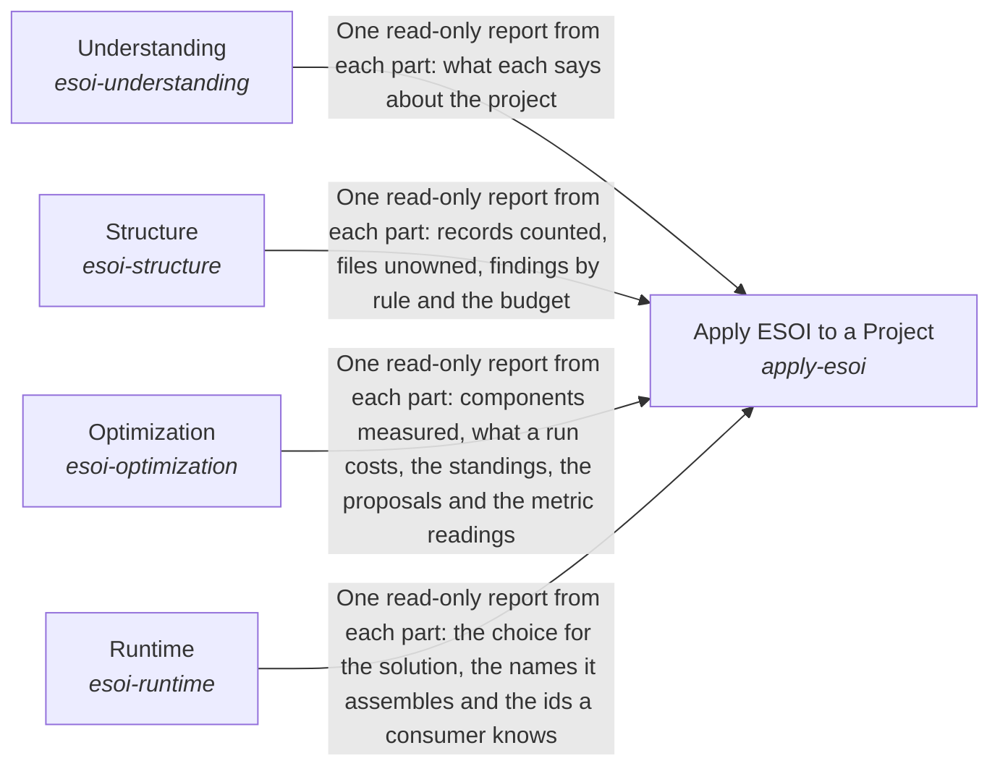

# Evolvable Structure that Optimizes Intent (ESOI)

**Vision statement:** Every intention is operationalized as an evolvable structure that optimizes the fulfilling of that intent.

Breadcrumb: Top

## How the solutions fit together

Apply ESOI to a Project is how a project takes up ESOI, in the order the work happens. Apply ESOI to a Project reaches people and agents through Understanding, which teaches the record types, the steps and the principles in the author's words and helps each reader find the part in front of them. It keeps the project's records and code one honest and lean whole through Structure, which ties every file to a purpose and lets the whole improve itself where it falls short. It learns which implementation is best through Optimization, which measures alternatives on the same cases, judges the evidence and moves each selection to the winner. It carries that choice into running programs through Runtime, so a better measurement changes what runs without anyone editing a call site.

## Diagram

An arrow runs from the solution that provides to the solution that builds on it; its label is what the provider outputs.

## Running experiments

1. `x-research-standard` (intent `understanding`) One research standard: How should every knowledge search and every experiment's research be done and recorded so that its findings are checked, applied and revisited? (reevaluate 2026-12-10)

## One level below

This intent is implemented by the sub-intents and solutions below it; each shows whether it goes deeper.

- [Implementations Chosen on Evidence](../implementations/python/esoi/optimization/README.md) (sub-intent): Solution implementations continuously improve through a pragmatic balance of measurement and efficient iteration.
- [ESOI Inside Other People's Running Code](../implementations/python/esoi/runtime/README.md) (sub-intent): Projects continuously use the best implementations without having to change what depends on them.
- [A Project's Records and Code as One Structure](../implementations/python/esoi/structure/README.md) (sub-intent): A project's structure enables the continuous evolution of interdependent parts to optimize its intent.
- [How People and Agents Come to Apply ESOI](../implementations/python/esoi/understanding/README.md) (sub-intent): Documentation ensures that an intent is optimally carried out.
- [Apply ESOI to a Project](../implementations/python/esoi/README.md) (solution with implementations and parts below it): Turn a project's intent into specifications that are checked, measured and selected by metric, so the structure keeps evolving with the intent.

## Solutions at a glance

| Solution | Handle | Entry call | Selected implementation | Metric |
|---|---|---|---|---|
| Apply ESOI to a Project | `apply-esoi` | `esoi.run("apply-esoi", '.')` | Through the four containers (`through-the-four-containers`) | Adoption effort, Intents whose solutions one paragraph and one diagram explain as the code builds them |
| Understanding | `esoi-understanding` | `esoi.run("esoi-understanding", '.')` | Calls each part in the order the work happens (`composition`) | Intents whose solutions one paragraph and one diagram explain as the code builds them |
| Structure | `esoi-structure` | `esoi.run("esoi-structure", '.')` | Calls each part in the order the work happens (`composition`) | Intents whose solutions one paragraph and one diagram explain as the code builds them |
| Optimization | `esoi-optimization` | `esoi.run("esoi-optimization", '.')` | Calls each part in the order the work happens (`composition`) | Intents whose solutions one paragraph and one diagram explain as the code builds them |
| Runtime | `esoi-runtime` | `esoi.run("esoi-runtime", 'structure-check')` | Calls each part in the order the work happens (`composition`) | Intents whose solutions one paragraph and one diagram explain as the code builds them |

## Problems and ideals

**Problems**

- Intent lost between person and code (`prob-intent-lost-between-person-and-code`): What someone meant when they asked for a capability lives in their head, a chat or a task, and the code that answers it carries little of that meaning.
- Best alternative unknown (`prob-best-alternative-unknown`): Most parts of a system can be done several ways (a model tier, a router, a retrieval method), and the one in use was chosen by whoever wrote it, not by evidence.
- Switching means editing code (`prob-switching-means-editing-code`): Switching a provider, runner or backend means finding and editing the call sites, often an `if` chain, and an embedding system cannot switch without forking.
- Metric measures a stand-in (`prob-metric-measures-a-stand-in`): A metric scores a scripted judge, a mocked model or a canned answer instead of the real thing, so its number measures the plumbing around the thing and not the thing.

**Ideals**

- Explicit intent (`ideal-explicit-intent`): Every built part traces to the problems it addresses and the ideals it pursues.
- Metric-chosen defaults (`ideal-metric-chosen-defaults`): The implementation that runs is the one the solution's authoritative metric ranks best.
- Trustworthy evidence (`ideal-trustworthy-evidence`): Every number can be reproduced from the code and the cases that produced it, and only like is compared with like.
- Effortless substitution (`ideal-effortless-substitution`): Switching the implementation of a solution changes no code that depends on it.
- Review by metric (`ideal-review-by-metric`): People can steer by reviewing problems, ideals, metrics and results alone, without needing to read implementations; anyone may still review or improve an implementation, and that still adds value.
- Faithful measurement (`ideal-faithful-measurement`): What is measured is what ships.
- Declared once (`ideal-declared-once`): Each fact is stated once, where it belongs, and every place that shows it agrees with it without anyone keeping a copy in step.

## Metrics and their leaders

- Adoption effort (`metric-adoption-effort`)
- Intents whose solutions one paragraph and one diagram explain as the code builds them (`metric-solution-coherence`)

## Where to go next

- Sub-intent: [Implementations Chosen on Evidence](../implementations/python/esoi/optimization/README.md)
- Sub-intent: [ESOI Inside Other People's Running Code](../implementations/python/esoi/runtime/README.md)
- Sub-intent: [A Project's Records and Code as One Structure](../implementations/python/esoi/structure/README.md)
- Sub-intent: [How People and Agents Come to Apply ESOI](../implementations/python/esoi/understanding/README.md)
- Repository: [top README](../README.md)
- Records beside the code: [implementations/python/esoi](../implementations/python/esoi/README.md)
- Records: [intent.csv](intent.csv), [problems.csv](problems.csv), [ideals.csv](ideals.csv), [solutions.csv](solutions.csv), [implementations.csv](implementations.csv), [metrics.csv](metrics.csv)
- Diagram page: [diagram.md](diagram.md)

---

## The full record

### Problems

- Intent lost between person and code (`prob-intent-lost-between-person-and-code`): What someone meant when they asked for a capability lives in their head, a chat or a task, and the code that answers it carries little of that meaning.
- Best alternative unknown (`prob-best-alternative-unknown`): Most parts of a system can be done several ways (a model tier, a router, a retrieval method), and the one in use was chosen by whoever wrote it, not by evidence.
- Switching means editing code (`prob-switching-means-editing-code`): Switching a provider, runner or backend means finding and editing the call sites, often an `if` chain, and an embedding system cannot switch without forking.
- Metric measures a stand-in (`prob-metric-measures-a-stand-in`): A metric scores a scripted judge, a mocked model or a canned answer instead of the real thing, so its number measures the plumbing around the thing and not the thing.

### Ideals

- Explicit intent (`ideal-explicit-intent`): Every built part traces to the problems it addresses and the ideals it pursues.
- Metric-chosen defaults (`ideal-metric-chosen-defaults`): The implementation that runs is the one the solution's authoritative metric ranks best.
- Trustworthy evidence (`ideal-trustworthy-evidence`): Every number can be reproduced from the code and the cases that produced it, and only like is compared with like.
- Effortless substitution (`ideal-effortless-substitution`): Switching the implementation of a solution changes no code that depends on it.
- Review by metric (`ideal-review-by-metric`): People can steer by reviewing problems, ideals, metrics and results alone, without needing to read implementations; anyone may still review or improve an implementation, and that still adds value.
- Faithful measurement (`ideal-faithful-measurement`): What is measured is what ships.
- Declared once (`ideal-declared-once`): Each fact is stated once, where it belongs, and every place that shows it agrees with it without anyone keeping a copy in step.

### Solutions

| Solution | Handle | Selected | Metric |
|---|---|---|---|
| Apply ESOI to a Project | `apply-esoi` | Through the four containers (`through-the-four-containers`) | Adoption effort, Intents whose solutions one paragraph and one diagram explain as the code builds them |
| Understanding | `esoi-understanding` | Calls each part in the order the work happens (`composition`) | Intents whose solutions one paragraph and one diagram explain as the code builds them |
| Structure | `esoi-structure` | Calls each part in the order the work happens (`composition`) | Intents whose solutions one paragraph and one diagram explain as the code builds them |
| Optimization | `esoi-optimization` | Calls each part in the order the work happens (`composition`) | Intents whose solutions one paragraph and one diagram explain as the code builds them |
| Runtime | `esoi-runtime` | Calls each part in the order the work happens (`composition`) | Intents whose solutions one paragraph and one diagram explain as the code builds them |

### Implementations

| Implementation | Handle | Where | Sub-intent |
|---|---|---|---|
| Documents only, applied by hand | `apply-esoi:documents-only` | [implementations/python/esoi/apply_esoi.py::DocumentsOnly](../implementations/python/esoi/apply_esoi.py) |  |
| Through the four containers | `apply-esoi:through-the-four-containers` | [implementations/python/esoi/apply_esoi.py::ThroughTheFourContainers](../implementations/python/esoi/apply_esoi.py) |  |
| Calls each part in the order the work happens | `esoi-understanding:composition` | [implementations/python/esoi/understanding/flow.py::UnderstandingFlow](../implementations/python/esoi/understanding/flow.py) | [understanding](../implementations/python/esoi/understanding/README.md) |
| Calls each part in the order the work happens | `esoi-structure:composition` | [implementations/python/esoi/structure/flow.py::StructureFlow](../implementations/python/esoi/structure/flow.py) | [structure](../implementations/python/esoi/structure/README.md) |
| Calls each part in the order the work happens | `esoi-optimization:composition` | [implementations/python/esoi/optimization/flow.py::OptimizationFlow](../implementations/python/esoi/optimization/flow.py) | [optimization](../implementations/python/esoi/optimization/README.md) |
| Calls each part in the order the work happens | `esoi-runtime:composition` | [implementations/python/esoi/runtime/flow.py::RuntimeFlow](../implementations/python/esoi/runtime/flow.py) | [runtime](../implementations/python/esoi/runtime/README.md) |

### Metrics

- Adoption effort (`metric-adoption-effort`): `none`
- Intents whose solutions one paragraph and one diagram explain as the code builds them (`metric-solution-coherence`): `python3 -m esoi.structure.structure_check.coherence --gate`

*Generated from the CSV files beside this page by `esoi readmes`. Edit the CSV files, not this page.*
