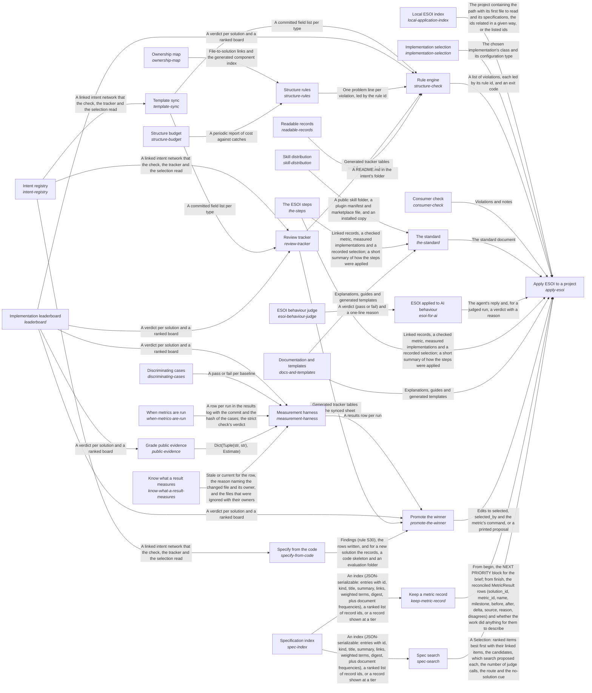

These are ESOI records rendered as a diagram (evolvable structure that optimizes intent). This page is generated from the solutions' outputs and the implementations' `uses_solution_ids` by `esoi diagram`; edit those records, not this page.

# Solution diagram: Evolvable structure that optimizes intent (ESOI)

ESOI turns an intention into a structure that keeps fulfilling it while both change, and Apply ESOI to a Project is how a project takes that up, in the order the work happens. Apply ESOI to a Project teaches people through The Standard, guides agents through ESOI Applied to AI Behaviour, keeps the records true through the Rule Engine, moves each selection to the measured winner through Promote the Winner, serves each call through Implementation Selection, finds the records a request concerns through Spec Search, records one piece of work's metric before and after through Keep a Metric Record, finds which projects apply ESOI through the Local ESOI Index, and checks a system built on the library through Consumer Check. The Standard shows how a solution is shaped and how a repository adopts it, drawing on Documentation and Templates, The ESOI Steps and the public skill that Skill Distribution publishes. ESOI Applied to AI Behaviour gives an agent the skill as standing instructions and measures its replies case by case, with the ESOI Behaviour Judge grading the replies a pattern cannot settle. To keep the records true, the Rule Engine applies every rule it holds through the Structure Rules, each rule kept only while the Structure Budget says it pays and with the Ownership Map tying every file to a component, keeps the record fields in step with the author's template through Template Sync, regenerates the pages of Readable Records and the Review Tracker sheet, and reads standings from the Implementation Leaderboard. Template Sync parses the template that the Intent Registry records follow. The Review Tracker puts the Intent Registry records, the Implementation Leaderboard standings and the fields kept in step by Template Sync in front of a reviewer. Behind each selection, the Measurement Harness runs each implementation on its solution's cases, proves through Discriminating Cases that those cases can fail, follows When Metrics Are Run for when a stage may run and what it may spend, asks Know What a Result Measures which recorded rows are stale, consults Grade Public Evidence before it pays to measure what others have measured, and hands its rows to the Implementation Leaderboard, which Grade Public Evidence reads as well. Promote the Winner switches a solution's selection when the Implementation Leaderboard shows a clear winner among the rows the Measurement Harness recorded, then updates the Review Tracker sheet and the declarations that Specify from the Code keeps in step with the Intent Registry. Implementation Selection then serves each call with the selected implementation by name, configuration or recorded default, and its declarations grow into the sub-intent ESOI Inside Other People's Running Code. When new work starts, Spec Search ranks the records a request concerns over the narrowed set the Specification Index gives it. Keep a Metric Record reads the slice the Specification Index gives for the work it records. The Local ESOI Index says where to look first in each project. Consumer Check scores a system built on the library with the library's own cases and shows how far its pinned version lags.

An arrow runs from the solution that provides to the solution that builds on it; its label is what the provider outputs.

