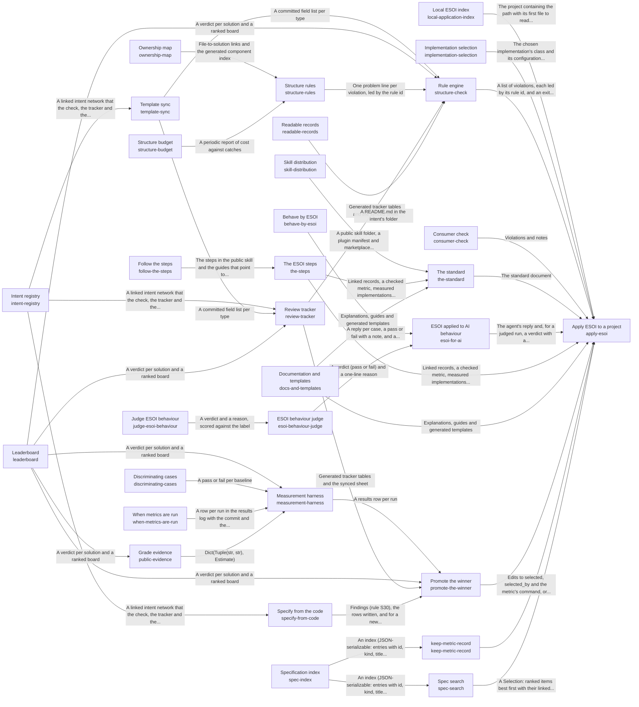

These are ESOI records rendered as a diagram (evolvable structure that optimizes intent). This page is generated from the solutions' outputs and the implementations' `uses_solution_ids` by `esoi diagram`; edit those records, not this page.

# Solution diagram: Evolvable structure that optimizes intent (ESOI)

esoi turns an intention into a structure that keeps fulfilling it while both change, and apply-esoi is how a project takes that up: apply-esoi teaches people through the-standard, guides AI agents through esoi-for-ai, holds the records and the code to their rules through structure-check, measures alternatives and moves the selection to the winner through promote-the-winner, chooses the implementation that serves each call through implementation-selection, finds the records a request concerns through spec-search, records one piece of work's metric before and after through keep-metric-record, finds which projects apply ESOI through local-application-index, and checks a project built on a library through consumer-check. the-standard explains ESOI and its fill-in templates in docs-and-templates, gives the order of the work in the-steps and ships the author's skill as a public folder through skill-distribution; the-steps is written down for readers in follow-the-steps. esoi-for-ai gives an agent the skill as standing instructions, behave-by-esoi measures case by case whether its replies act by the principles, and esoi-behaviour-judge grades the replies a pattern cannot settle, through judge-esoi-behaviour. structure-check applies every rule it holds through structure-rules, each rule kept only while structure-budget says it still pays and with ownership-map tying every file to a component, keeps the record fields in step with the template through template-sync, regenerates the pages of readable-records and the review-tracker sheet, and reads standings from leaderboard; template-sync parses the template that the intent-registry records follow. review-tracker puts the intent-registry records, the leaderboard standings and the fields kept in step by template-sync in front of a reviewer. promote-the-winner switches a solution's selected implementation when leaderboard shows a clear winner among the rows measurement-harness recorded, then updates the review-tracker sheet and the declarations that specify-from-code keeps in step with the intent-registry records; measurement-harness runs each implementation on its solution's cases, proves through discriminating-cases that those cases fail a naive implementation, follows when-metrics-are-run for when a stage may run and what it may spend, consults public-evidence before it pays to measure a candidate others have measured, and hands its rows to leaderboard, which public-evidence reads as well. implementation-selection chooses which implementation serves a solution by name, configuration or table default, and its declarations grow into the esoi-runtime sub-intent. spec-search ranks the records a request concerns over the narrowed set spec-index gives it. keep-metric-record reads the slice spec-index gives for the work it records. local-application-index says where to look first in each project. consumer-check scores a consumer's own implementations with the library's cases and shows its version lag.

An arrow runs from the solution that provides to the solution that builds on it; its label is what the provider outputs.

