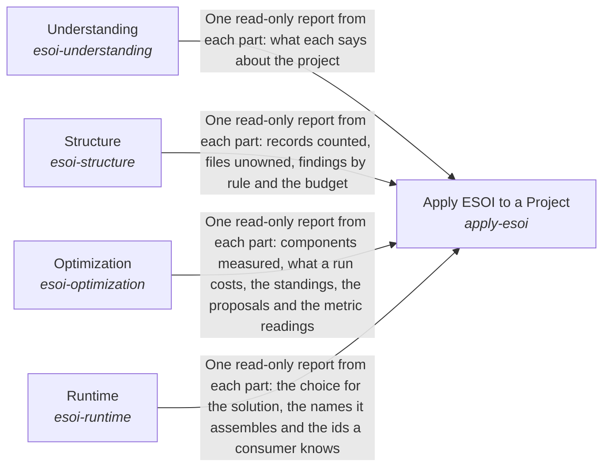

These are ESOI records rendered as a diagram (evolvable structure that optimizes intent). This page is generated from the solutions' outputs and the implementations' `uses_solution_ids` by `esoi diagram`; edit those records, not this page.

# Solution diagram: Evolvable Structure that Optimizes Intent (ESOI)

Apply ESOI to a Project is how a project takes up ESOI, in the order the work happens. Apply ESOI to a Project reaches people and agents through Understanding, which teaches the record types, the steps and the principles in the author's words and helps each reader find the part in front of them. It keeps the project's records and code one honest and lean whole through Structure, which ties every file to a purpose and lets the whole improve itself where it falls short. It learns which implementation is best through Optimization, which measures alternatives on the same cases, judges the evidence and moves each selection to the winner. It carries that choice into running programs through Runtime, so a better measurement changes what runs without anyone editing a call site.

An arrow runs from the solution that provides to the solution that builds on it; its label is what the provider outputs.

