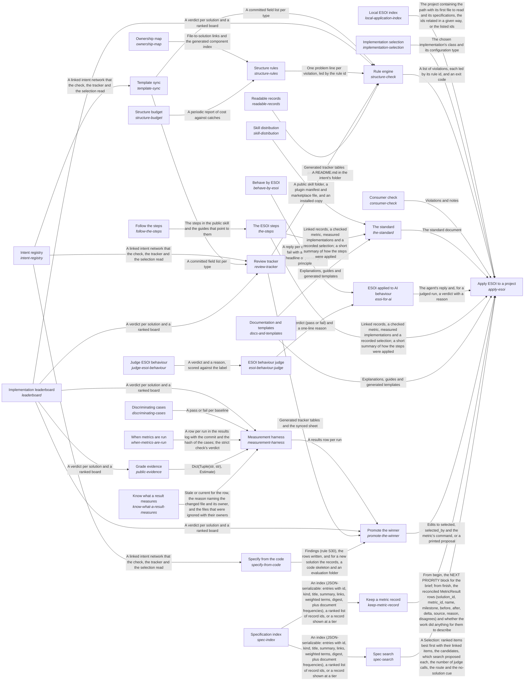

These are ESOI records rendered as a diagram (evolvable structure that optimizes intent). This page is generated from the solutions' outputs and the implementations' `uses_solution_ids` by `esoi diagram`; edit those records, not this page.

# Solution diagram: Evolvable structure that optimizes intent (ESOI)

ESOI turns an intention into a structure that keeps fulfilling it while both change, and Apply ESOI to a project is how a project takes that up: Apply ESOI to a project teaches people through The standard, guides AI agents through ESOI applied to AI behaviour, holds the records and the code to their rules through Rule engine, measures alternatives and moves the selection to the winner through Promote the winner, chooses the implementation that serves each call through Implementation selection, finds the records a request concerns through Spec search, records one piece of work's metric before and after through Keep a metric record, finds which projects apply ESOI through Local ESOI index, and checks a project built on a library through Consumer check. The standard explains ESOI and its fill-in templates in Documentation and templates, gives the order of the work in The ESOI steps and ships the author's skill as a public folder through Skill distribution; The ESOI steps is then written down for readers in Follow the steps. ESOI applied to AI behaviour gives an agent the skill as standing instructions, Behave by ESOI measures case by case whether its replies act by the principles, and ESOI behaviour judge grades the replies a pattern cannot settle, through Judge ESOI behaviour. Rule engine applies every rule it holds through Structure rules, each rule kept only while Structure budget says it still pays and with Ownership map tying every file to a component, keeps the record fields in step with the template through Template sync, regenerates the pages of Readable records and the Review tracker sheet, and reads standings from Implementation leaderboard; Template sync parses the template that the Intent registry records follow. Review tracker puts the Intent registry records, the Implementation leaderboard standings and the fields kept in step by Template sync in front of a reviewer. Promote the winner switches a solution's selected implementation when Implementation leaderboard shows a clear winner among the rows Measurement harness recorded, then updates the Review tracker sheet and the declarations that Specify from the code keeps in step with the Intent registry records. Measurement harness runs each implementation on its solution's cases, proves through Discriminating cases that those cases fail a naive implementation, follows When metrics are run for when a stage may run and what it may spend, consults Grade evidence before it pays to measure a candidate others have measured, asks Know what a result measures which changed files make a recorded row stale, and hands its rows to Implementation leaderboard, which Grade evidence reads as well. Implementation selection chooses which implementation serves a solution by name, configuration or table default, and its declarations grow into the sub-intent ESOI inside other people's running code. Spec search ranks the records a request concerns over the narrowed set Specification index gives it. Keep a metric record reads the slice Specification index gives for the work it records. Local ESOI index says where to look first in each project. Consumer check scores a consumer's own implementations with the library's cases and shows its version lag.

An arrow runs from the solution that provides to the solution that builds on it; its label is what the provider outputs.

