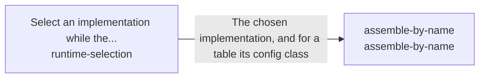

These are ESOI records rendered as a diagram (evolvable structure that optimizes intent). This page is generated from the solutions' outputs and the implementations' `uses_solution_ids` by `esoi diagram`; edit those records, not this page.

# Solution diagram: ESOI inside other people's running code

An arrow runs from the solution that provides to the solution that builds on it; its label is what the provider outputs.

