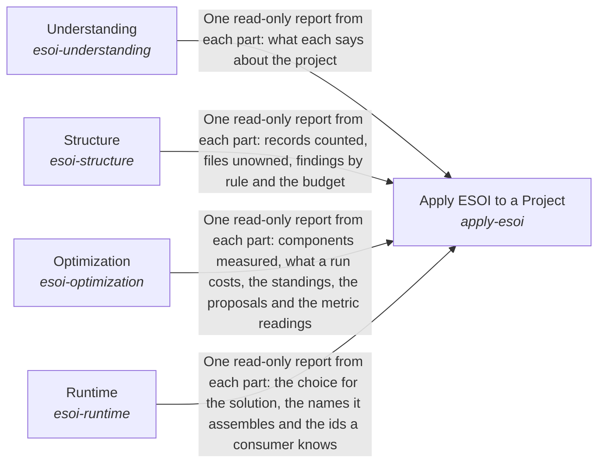

# esoi

Breadcrumb: [Top](../../../esoi/README.md) > esoi

Part of [Evolvable Structure that Optimizes Intent (ESOI)](../../../esoi/README.md)

## Apply ESOI to a Project (`apply-esoi`)

Turn a project's intent into specifications that are checked, measured and selected by metric, so the structure keeps evolving with the intent.

- Out of scope: Deciding what a project is for: that is the project's own top intent.
- Entry call: `esoi.run("apply-esoi", '.')`
- Selected implementation: Through the four containers (`through-the-four-containers`)
- Metric: Adoption effort, Intents whose solutions one paragraph and one diagram explain as the code builds them
- Implemented by: [`implementations/python/esoi/apply_esoi.py`](apply_esoi.py), [`implementations/python/esoi/esoi_selection.json`](esoi_selection.json), [`implementations/python/esoi/optimization/__init__.py`](optimization/__init__.py), [`implementations/python/esoi/optimization/keep_metric_record/__init__.py`](optimization/keep_metric_record/__init__.py), [`implementations/python/esoi/optimization/leaderboard/__init__.py`](optimization/leaderboard/__init__.py), [`implementations/python/esoi/optimization/measurement_harness/__init__.py`](optimization/measurement_harness/__init__.py), [`implementations/python/esoi/optimization/measurement_harness/discriminating_cases/__init__.py`](optimization/measurement_harness/discriminating_cases/__init__.py), [`implementations/python/esoi/optimization/promote_the_winner/__init__.py`](optimization/promote_the_winner/__init__.py) and 75 more

## Understanding (`esoi-understanding`)

Bring ESOI to the people and agents who apply it, in the author's own words, and let each of them find, read and steer the part of a structure in front of them.

- Out of scope: Keeping records true to the code; measuring alternatives and choosing between them; serving an implementation inside a running program.
- Delegates to: esoi-structure, esoi-optimization, esoi-runtime
- Entry call: `esoi.run("esoi-understanding", '.')`
- Selected implementation: Calls each part in the order the work happens (`composition`)
- Metric: Intents whose solutions one paragraph and one diagram explain as the code builds them
- Implemented by: [`implementations/python/esoi/understanding/flow.py`](understanding/flow.py), [`implementations/python/esoi/understanding/interface.py`](understanding/interface.py)

## Structure (`esoi-structure`)

Keep a project's records and code one true and lean structure that says why every part exists and improves itself where it falls short.

- Out of scope: Teaching ESOI and showing records to readers; measuring and selecting implementations; choosing at run time.
- Delegates to: esoi-understanding, esoi-optimization, esoi-runtime
- Entry call: `esoi.run("esoi-structure", '.')`
- Selected implementation: Calls each part in the order the work happens (`composition`)
- Metric: Intents whose solutions one paragraph and one diagram explain as the code builds them
- Implemented by: [`implementations/python/esoi/structure/flow.py`](structure/flow.py), [`implementations/python/esoi/structure/interface.py`](structure/interface.py)

## Optimization (`esoi-optimization`)

Make each solution run the implementation the evidence shows is best, with evidence that is trustworthy, current and worth what it cost.

- Out of scope: Keeping records true; serving the selected implementation inside a program; teaching.
- Delegates to: esoi-structure, esoi-runtime, esoi-understanding
- Entry call: `esoi.run("esoi-optimization", '.')`
- Selected implementation: Calls each part in the order the work happens (`composition`)
- Metric: Intents whose solutions one paragraph and one diagram explain as the code builds them
- Implemented by: [`implementations/python/esoi/optimization/flow.py`](optimization/flow.py), [`implementations/python/esoi/optimization/interface.py`](optimization/interface.py)

## Runtime (`esoi-runtime`)

Carry ESOI into other people's running programs, so a better measurement changes what runs without anyone editing a call site.

- Out of scope: Deciding which implementation is best; keeping the records; teaching.
- Delegates to: esoi-optimization, esoi-structure
- Entry call: `esoi.run("esoi-runtime", 'structure-check')`
- Selected implementation: Calls each part in the order the work happens (`composition`)
- Metric: Intents whose solutions one paragraph and one diagram explain as the code builds them
- Implemented by: [`implementations/python/esoi/runtime/flow.py`](runtime/flow.py), [`implementations/python/esoi/runtime/interface.py`](runtime/interface.py)

## One level below

- [Implementations Chosen on Evidence](optimization/README.md) (sub-intent): Solution implementations continuously improve through a pragmatic balance of measurement and efficient iteration.
- [ESOI Inside Other People's Running Code](runtime/README.md) (sub-intent): Projects continuously use the best implementations without having to change what depends on them.
- [A Project's Records and Code as One Structure](structure/README.md) (sub-intent): A project's structure enables the continuous evolution of interdependent parts to optimize its intent.
- [How People and Agents Come to Apply ESOI](understanding/README.md) (sub-intent): Documentation ensures that an intent is optimally carried out.
- [Keep a Metric Record](optimization/keep_metric_record/README.md) (solution with implementations): Keep the relevant metric's value before and after each piece of work, so the change can be judged later.
- [Implementation Leaderboard](optimization/leaderboard/README.md) (solution with implementations): Decide from recorded results which implementation is best, or whether they tie.
- [Measurement Harness](optimization/measurement_harness/README.md) (solution with implementations and parts below it): Run each implementation against its solution's cases through the shipped code, and record each result with its provenance.
- [Promote the Winner](optimization/promote_the_winner/README.md) (solution with implementations): Switch the selection to the rival that clearly wins on the solution's own metric, with the evidence recorded, or propose it when a person must approve.
- [When Metrics Are Run](optimization/when_metrics_are_run/README.md) (solution with implementations and parts below it): Decide when each metric is run, in what stages, with what limit, who approves the spend, and when its result stops counting.
- [Assemble Parts by Name](runtime/assemble_by_name/README.md) (solution with implementations): Build a program's parts from validated names in dependency order, so each part depends on a solution and never on one implementation, and check what each needs from its environment.
- [Consumer Check](runtime/consumer_check/README.md) (solution with implementations): Let a system built on the library show which library solution each part serves, score its parts on the library's cases by building on the library's metric, and see how far its pins trail.
- [Implementation Selection](runtime/implementation_selection/README.md) (solution with implementations): Choose which implementation serves a call, by a per-call name, an override, the environment, the lock or the recorded default, and refuse an unknown name by listing the valid choices.
- [Intent Registry](structure/intent_registry/README.md) (solution with implementations and parts below it): Record every problem, solution, implementation, ideal and metric of a project as linked records that people and checks both read.
- [Library Adoption](structure/library_adoption/README.md) (solution with implementations): Let a repository refer to a solution that another library's records define, and tell the adopted, the specialized and its own solutions apart, so no job is described twice.
- [Ownership Map](structure/ownership_map/README.md) (solution with implementations): Assign every file to exactly one component and every component to the solutions it serves, so code with no purpose cannot hide.
- [Structure Budget](structure/structure_budget/README.md) (solution with implementations): Keep the structure's own cost in view: admit a rule, record or sub-intent only with what it prevents, and prune what stops paying.
- [Structure Check](structure/structure_check/README.md) (solution with implementations): Run every structural rule on each change and report each finding by rule and path with its next action, quickly enough that nobody skips it.
- [Structure Quality](structure/structure_quality/README.md) (solution with implementations): Measure how well a project divides its work into solutions and parts, as one balanced number with the worst offenders named, before and after code exists.
- [ESOI Applied to AI Behaviour](understanding/esoi_for_ai/README.md) (solution with implementations and parts below it): Make an AI agent act by the evolvable-structure principles when designing, building, writing and advising.
- [Local ESOI Index](understanding/local_application_index/README.md) (solution with implementations): Find which projects ESOI is applied to, how they relate and where to look first in each.
- [Readable Records](understanding/readable_records/README.md) (solution with implementations): Give every intent folder a page, made from its records, that says at a glance what the intent is and how its parts fit.
- [Review Tracker](understanding/review_tracker/README.md) (solution with implementations): Put the whole intent network and its current results in front of a reviewer, and carry their edits back to the records.
- [Spec Search](understanding/spec_search/README.md) (solution with implementations): Find the records, standards and product items that a request concerns, cheapest first, each with the records it links to.
- [The Standard](understanding/the_standard/README.md) (solution with implementations and parts below it): Teach anyone, person or AI, how a solution is shaped and how a project adopts it, with explanation and fill-in templates that need no code.

## Diagram

An arrow runs from the solution that provides to the solution that builds on it; its label is what the provider outputs.

## Implementations

| Implementation | Handle | Purpose | Code | Selected |
|---|---|---|---|---|
| Documents only, applied by hand | `apply-esoi:documents-only` | Understanding alone: the same explanation, templates and steps, with records kept as documents, a sheet or a board by a person or an agent, and metrics read from whatever notes someone keeps. Nothing is installed. | [`implementations/python/esoi/apply_esoi.py`](apply_esoi.py) |  |
| Through the four containers | `apply-esoi:through-the-four-containers` | The root calls Understanding, Structure, Optimization and Runtime, each through its one-line entry, in the order the work happens: explanation and templates, steps and the author's skill, read by people and agents, with the esoi tools beside them. The records are checked on every change, alternatives are measured, and the implementation the metric ranks best is the one selected. The documents carry what a person must decide; the tools carry what can be checked. | [`implementations/python/esoi/apply_esoi.py`](apply_esoi.py) | selected |
| Calls each part in the order the work happens | `esoi-understanding:composition` | The flow calls the one-line entry of each part of Understanding in turn and gathers what each reports; the parts are typed needs, so each one can be replaced without changing the flow. | [`implementations/python/esoi/understanding/flow.py`](understanding/flow.py) | selected |
| Calls each part in the order the work happens | `esoi-structure:composition` | The flow calls the one-line entry of each part of Structure in turn and gathers what each reports; the parts are typed needs, so each one can be replaced without changing the flow. | [`implementations/python/esoi/structure/flow.py`](structure/flow.py) | selected |
| Calls each part in the order the work happens | `esoi-optimization:composition` | The flow calls the one-line entry of each part of Optimization in turn and gathers what each reports; the parts are typed needs, so each one can be replaced without changing the flow. | [`implementations/python/esoi/optimization/flow.py`](optimization/flow.py) | selected |
| Calls each part in the order the work happens | `esoi-runtime:composition` | The flow calls the one-line entry of each part of Runtime in turn and gathers what each reports; the parts are typed needs, so each one can be replaced without changing the flow. | [`implementations/python/esoi/runtime/flow.py`](runtime/flow.py) | selected |

## Metrics

- Adoption effort (`metric-adoption-effort`)
- Intents whose solutions one paragraph and one diagram explain as the code builds them (`metric-solution-coherence`)

## Problems

- Intent lost between person and code (`prob-intent-lost-between-person-and-code`): What someone meant when they asked for a capability lives in their head, a chat or a task, and the code that answers it carries little of that meaning.
- Best alternative unknown (`prob-best-alternative-unknown`): Most parts of a system can be done several ways (a model tier, a router, a retrieval method), and the one in use was chosen by whoever wrote it, not by evidence.
- Switching means editing code (`prob-switching-means-editing-code`): Switching a provider, runner or backend means finding and editing the call sites, often an `if` chain, and an embedding system cannot switch without forking.
- Metric measures a stand-in (`prob-metric-measures-a-stand-in`): A metric scores a scripted judge, a mocked model or a canned answer instead of the real thing, so its number measures the plumbing around the thing and not the thing.

## Ideals

- Explicit intent (`ideal-explicit-intent`): Every built part traces to the problems it addresses and the ideals it pursues.
- Metric-chosen defaults (`ideal-metric-chosen-defaults`): The implementation that runs is the one the solution's authoritative metric ranks best.
- Trustworthy evidence (`ideal-trustworthy-evidence`): Every number can be reproduced from the code and the cases that produced it, and only like is compared with like.
- Effortless substitution (`ideal-effortless-substitution`): Switching the implementation of a solution changes no code that depends on it.
- Review by metric (`ideal-review-by-metric`): People can steer by reviewing problems, ideals, metrics and results alone, without needing to read implementations; anyone may still review or improve an implementation, and that still adds value.
- Faithful measurement (`ideal-faithful-measurement`): What is measured is what ships.
- Declared once (`ideal-declared-once`): Each fact is stated once, where it belongs, and every place that shows it agrees with it without anyone keeping a copy in step.

## Where to go next

- Intent: [Evolvable Structure that Optimizes Intent (ESOI)](../../../esoi/README.md)
- Down: [implementations/python/esoi/optimization/keep_metric_record](optimization/keep_metric_record/README.md)
- Down: [implementations/python/esoi/optimization/leaderboard](optimization/leaderboard/README.md)
- Down: [implementations/python/esoi/optimization/measurement_harness](optimization/measurement_harness/README.md)
- Down: [implementations/python/esoi/optimization/promote_the_winner](optimization/promote_the_winner/README.md)
- Down: [implementations/python/esoi/optimization/when_metrics_are_run](optimization/when_metrics_are_run/README.md)
- Down: [implementations/python/esoi/runtime/assemble_by_name](runtime/assemble_by_name/README.md)
- Down: [implementations/python/esoi/runtime/consumer_check](runtime/consumer_check/README.md)
- Down: [implementations/python/esoi/runtime/implementation_selection](runtime/implementation_selection/README.md)
- Down: [implementations/python/esoi/structure/intent_registry](structure/intent_registry/README.md)
- Down: [implementations/python/esoi/structure/library_adoption](structure/library_adoption/README.md)
- Down: [implementations/python/esoi/structure/ownership_map](structure/ownership_map/README.md)
- Down: [implementations/python/esoi/structure/structure_budget](structure/structure_budget/README.md)
- Down: [implementations/python/esoi/structure/structure_check](structure/structure_check/README.md)
- Down: [implementations/python/esoi/structure/structure_quality](structure/structure_quality/README.md)
- Down: [implementations/python/esoi/understanding/esoi_for_ai](understanding/esoi_for_ai/README.md)
- Down: [implementations/python/esoi/understanding/local_application_index](understanding/local_application_index/README.md)
- Down: [implementations/python/esoi/understanding/readable_records](understanding/readable_records/README.md)
- Down: [implementations/python/esoi/understanding/review_tracker](understanding/review_tracker/README.md)
- Down: [implementations/python/esoi/understanding/spec_search](understanding/spec_search/README.md)
- Down: [implementations/python/esoi/understanding/the_standard](understanding/the_standard/README.md)
- Repository: [top README](../../../README.md)

*Generated from the CSV files in this folder by `esoi readmes`. Edit the CSV files, not this page.*
