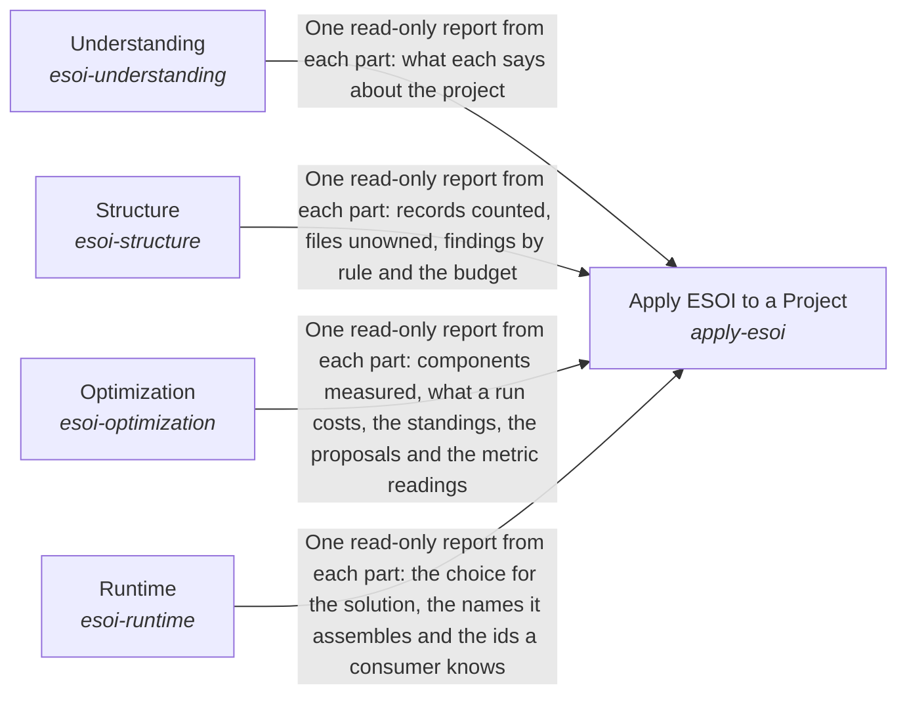

# esoi

*ESOI records kept beside the code in `implementations/python/esoi`, generated from the CSV files in this folder by `esoi readmes`. Edit the CSV files, not this page.*

Every intention is operationalized as an evolvable structure that optimizes the fulfilling of that intent.

These are the solutions of [Evolvable Structure that Optimizes Intent (ESOI)](../../../esoi/README.md).

## How the solutions fit together

Apply ESOI to a Project is how a project takes up ESOI, in the order the work happens. Apply ESOI to a Project reaches people and agents through Understanding, which teaches the record types, the steps and the principles in the author's words and helps each reader find the part in front of them. It keeps the project's records and code one honest and lean whole through Structure, which ties every file to a purpose and lets the whole improve itself where it falls short. It learns which implementation is best through Optimization, which measures alternatives on the same cases, judges the evidence and moves each selection to the winner. It carries that choice into running programs through Runtime, so a better measurement changes what runs without anyone editing a call site.

## Overview diagram

An arrow runs from the solution that provides to the solution that builds on it; its label is what the provider outputs.

## Apply ESOI to a Project (`apply-esoi`)

Turn a project's intent into specifications that are checked, measured and selected by metric, so the structure keeps evolving with the intent.

- Entry call: `esoi.run("apply-esoi", '.')`
- Selected implementation: Through the four containers (`through-the-four-containers`)
- Metric: Adoption effort, Intents whose solutions one paragraph and one diagram explain as the code builds them
- Implemented by: [`implementations/python/esoi/apply_esoi.py`](apply_esoi.py), [`implementations/python/esoi/esoi_selection.json`](esoi_selection.json), [`implementations/python/esoi/optimization/__init__.py`](optimization/__init__.py), [`implementations/python/esoi/optimization/keep_metric_record/__init__.py`](optimization/keep_metric_record/__init__.py), [`implementations/python/esoi/optimization/leaderboard/__init__.py`](optimization/leaderboard/__init__.py), [`implementations/python/esoi/optimization/measurement_harness/__init__.py`](optimization/measurement_harness/__init__.py), [`implementations/python/esoi/optimization/measurement_harness/discriminating_cases/__init__.py`](optimization/measurement_harness/discriminating_cases/__init__.py), [`implementations/python/esoi/optimization/promote_the_winner/__init__.py`](optimization/promote_the_winner/__init__.py) and 73 more

## Understanding (`esoi-understanding`)

Bring ESOI to the people and agents who apply it, in the author's own words, and let each of them find, read and steer the part of a structure in front of them.

- Entry call: `esoi.run("esoi-understanding", '.')`
- Selected implementation: Calls each part in the order the work happens (`composition`)
- Metric: Intents whose solutions one paragraph and one diagram explain as the code builds them
- Implemented by: [`implementations/python/esoi/understanding/flow.py`](understanding/flow.py), [`implementations/python/esoi/understanding/interface.py`](understanding/interface.py)

## Structure (`esoi-structure`)

Keep a project's records and code one true and lean structure that says why every part exists and improves itself where it falls short.

- Entry call: `esoi.run("esoi-structure", '.')`
- Selected implementation: Calls each part in the order the work happens (`composition`)
- Metric: Intents whose solutions one paragraph and one diagram explain as the code builds them
- Implemented by: [`implementations/python/esoi/structure/flow.py`](structure/flow.py), [`implementations/python/esoi/structure/interface.py`](structure/interface.py)

## Optimization (`esoi-optimization`)

Make each solution run the implementation the evidence shows is best, with evidence that is trustworthy, current and worth what it cost.

- Entry call: `esoi.run("esoi-optimization", '.')`
- Selected implementation: Calls each part in the order the work happens (`composition`)
- Metric: Intents whose solutions one paragraph and one diagram explain as the code builds them
- Implemented by: [`implementations/python/esoi/optimization/flow.py`](optimization/flow.py), [`implementations/python/esoi/optimization/interface.py`](optimization/interface.py)

## Runtime (`esoi-runtime`)

Carry ESOI into other people's running programs, so a better measurement changes what runs without anyone editing a call site.

- Entry call: `esoi.run("esoi-runtime", 'structure-check')`
- Selected implementation: Calls each part in the order the work happens (`composition`)
- Metric: Intents whose solutions one paragraph and one diagram explain as the code builds them
- Implemented by: [`implementations/python/esoi/runtime/flow.py`](runtime/flow.py), [`implementations/python/esoi/runtime/interface.py`](runtime/interface.py)

## Diagram

An arrow runs from the solution that provides to the solution that builds on it; its label is what the provider outputs.

## Implementations

| Implementation | Handle | Code | Selected |
|---|---|---|---|
| Documents only, applied by hand | `apply-esoi:documents-only` | [`implementations/python/esoi/apply_esoi.py`](apply_esoi.py) |  |
| Through the four containers | `apply-esoi:through-the-four-containers` | [`implementations/python/esoi/apply_esoi.py`](apply_esoi.py) | selected |
| Calls each part in the order the work happens | `esoi-understanding:composition` | [`implementations/python/esoi/understanding/flow.py`](understanding/flow.py) | selected |
| Calls each part in the order the work happens | `esoi-structure:composition` | [`implementations/python/esoi/structure/flow.py`](structure/flow.py) | selected |
| Calls each part in the order the work happens | `esoi-optimization:composition` | [`implementations/python/esoi/optimization/flow.py`](optimization/flow.py) | selected |
| Calls each part in the order the work happens | `esoi-runtime:composition` | [`implementations/python/esoi/runtime/flow.py`](runtime/flow.py) | selected |

## Metrics

- Adoption effort (`metric-adoption-effort`)
- Intents whose solutions one paragraph and one diagram explain as the code builds them (`metric-solution-coherence`)

## Problems

- Intent lost between person and code (`prob-intent-lost-between-person-and-code`): What someone meant when they asked for a capability lives in their head, a chat or a task, and the code that answers it carries little of that meaning.
- Best alternative unknown (`prob-best-alternative-unknown`): Most parts of a system can be done several ways (a model tier, a router, a retrieval method), and the one in use was chosen by whoever wrote it, not by evidence.
- Switching means editing code (`prob-switching-means-editing-code`): Switching a provider, runner or backend means finding and editing the call sites, often an `if` chain, and an embedding system cannot switch without forking.
- Metric measures a stand-in (`prob-metric-measures-a-stand-in`): A metric scores a scripted judge, a mocked model or a canned answer instead of the real thing, so its number measures the plumbing around the thing and not the thing.

## Ideals

- Explicit intent (`ideal-explicit-intent`): Every built part traces to the problems it addresses and the ideals it pursues.
- Metric-chosen defaults (`ideal-metric-chosen-defaults`): The implementation that runs is the one the solution's authoritative metric ranks best.
- Trustworthy evidence (`ideal-trustworthy-evidence`): Every number can be reproduced from the code and the cases that produced it, and only like is compared with like.
- Effortless substitution (`ideal-effortless-substitution`): Switching the implementation of a solution changes no code that depends on it.
- Review by metric (`ideal-review-by-metric`): People can steer by reviewing problems, ideals, metrics and results alone, without needing to read implementations; anyone may still review or improve an implementation, and that still adds value.
- Faithful measurement (`ideal-faithful-measurement`): What is measured is what ships.
- Declared once (`ideal-declared-once`): Each fact is stated once, where it belongs, and every place that shows it agrees with it without anyone keeping a copy in step.

## Where to go next

- Intent: [Evolvable Structure that Optimizes Intent (ESOI)](../../../esoi/README.md)
- Down: [implementations/python/esoi/optimization/keep_metric_record](optimization/keep_metric_record/README.md)
- Down: [implementations/python/esoi/optimization/leaderboard](optimization/leaderboard/README.md)
- Down: [implementations/python/esoi/optimization/measurement_harness](optimization/measurement_harness/README.md)
- Down: [implementations/python/esoi/optimization/promote_the_winner](optimization/promote_the_winner/README.md)
- Down: [implementations/python/esoi/optimization/when_metrics_are_run](optimization/when_metrics_are_run/README.md)
- Down: [implementations/python/esoi/runtime/assemble_by_name](runtime/assemble_by_name/README.md)
- Down: [implementations/python/esoi/runtime/consumer_check](runtime/consumer_check/README.md)
- Down: [implementations/python/esoi/runtime/implementation_selection](runtime/implementation_selection/README.md)
- Down: [implementations/python/esoi/structure/intent_registry](structure/intent_registry/README.md)
- Down: [implementations/python/esoi/structure/ownership_map](structure/ownership_map/README.md)
- Down: [implementations/python/esoi/structure/structure_budget](structure/structure_budget/README.md)
- Down: [implementations/python/esoi/structure/structure_check](structure/structure_check/README.md)
- Down: [implementations/python/esoi/understanding/esoi_for_ai](understanding/esoi_for_ai/README.md)
- Down: [implementations/python/esoi/understanding/local_application_index](understanding/local_application_index/README.md)
- Down: [implementations/python/esoi/understanding/readable_records](understanding/readable_records/README.md)
- Down: [implementations/python/esoi/understanding/review_tracker](understanding/review_tracker/README.md)
- Down: [implementations/python/esoi/understanding/spec_search](understanding/spec_search/README.md)
- Down: [implementations/python/esoi/understanding/the_standard](understanding/the_standard/README.md)
- Repository: [top README](../../../README.md)
