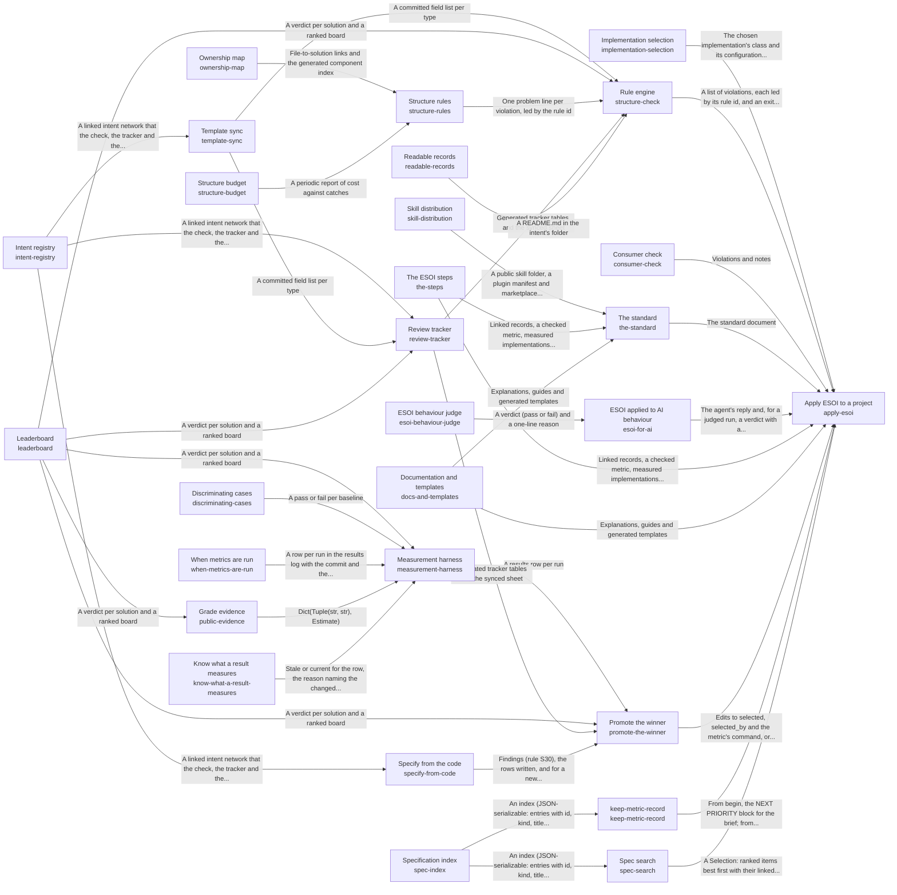

# esoi

*ESOI records kept beside the code in `implementations/python/esoi`, generated from the CSV files in this folder by `esoi readmes`. Edit the CSV files, not this page.*

## Apply ESOI to a project (`apply-esoi`)

Turn a project's intent into specifications that are checked, measured and selected by metric, so the structure keeps evolving with the intent.

- Entry call: `esoi.run("apply-esoi", '.')`
- Selected implementation: `documents-templates-and-tools`
- Metric: Adoption effort, Intents whose solutions one paragraph and one diagram explain as the code builds them
- Implemented by: [`implementations/python/esoi/entry.py`](entry.py), [`implementations/python/esoi/esoi_selection.json`](esoi_selection.json), [`implementations/python/esoi/interfaces.py`](interfaces.py)

## Intent registry (`intent-registry`)

Record every problem, solution, implementation, ideal and metric of a repository as linked records that people and checks both read.

- Entry call: `esoi.run("intent-registry", '.')`
- Selected implementation: `beside_code`
- Metric: Navigable records, Record completeness
- Implemented by: [`esoi/COMPONENTS.md`](../../../esoi/COMPONENTS.md), [`esoi/components.csv`](../../../esoi/components.csv), [`esoi/esoi_template.csv`](../../../esoi/esoi_template.csv), [`esoi/metric-run-policy.md`](../../../esoi/metric-run-policy.md), [`esoi/network.md`](../../../esoi/network.md), [`esoi/standards/naming.md`](../../../esoi/standards/naming.md), [`esoi/standards/no-em-dash.md`](../../../esoi/standards/no-em-dash.md), [`esoi/standards/tags.csv`](../../../esoi/standards/tags.csv) and 30 more

## Template sync (`template-sync`)

Derive the registry's fields from the intent template in the skill so the author's wording stays the single definition.

- Entry call: `esoi.run("template-sync", '.')`
- Selected implementation: `template-parser`
- Metric: Template agreement
- Implemented by: [`implementations/python/esoi/__main__.py`](__main__.py), [`implementations/python/esoi/cli.py`](cli.py), [`implementations/python/esoi/data/esoi_template.csv`](data/esoi_template.csv), [`implementations/python/esoi/data/skill_version.json`](data/skill_version.json), [`implementations/python/esoi/interfaces.py`](interfaces.py), [`implementations/python/esoi/rules/generated.py`](rules/generated.py), [`implementations/python/esoi/rules/version_rules.py`](rules/version_rules.py), [`implementations/python/esoi/template.py`](template.py) and 10 more

## Ownership map (`ownership-map`)

Assign every file to exactly one component and every component to the solutions it serves, so code with no purpose cannot hide.

- Entry call: `esoi.run("ownership-map", '.')`
- Selected implementation: `component-rows`
- Metric: Trace completeness
- Implemented by: [`implementations/python/esoi/interfaces.py`](interfaces.py), [`implementations/python/esoi/rules/layout.py`](rules/layout.py), [`implementations/python/evaluation/components/own_every_file/__init__.py`](../evaluation/components/own_every_file/__init__.py), [`implementations/python/evaluation/components/own_every_file/broken/__init__.py`](../evaluation/components/own_every_file/broken/__init__.py), [`implementations/python/evaluation/components/own_every_file/broken/coverage_only.py`](../evaluation/components/own_every_file/broken/coverage_only.py), [`implementations/python/evaluation/components/own_every_file/cases.json`](../evaluation/components/own_every_file/cases.json), [`implementations/python/evaluation/components/own_every_file/impls/__init__.py`](../evaluation/components/own_every_file/impls/__init__.py), [`implementations/python/evaluation/components/own_every_file/impls/live_checker.py`](../evaluation/components/own_every_file/impls/live_checker.py) and 2 more

## Implementation selection (`implementation-selection`)

Choose which implementation serves a swappable solution by name, configuration or table default.

- Entry call: `esoi.run("implementation-selection", 'structure-check')`
- Selected implementation: `declarations`
- Metric: Resolution correctness
- Implemented by: [`implementations/python/esoi/entry.py`](entry.py), [`implementations/python/esoi/esoi_selection.json`](esoi_selection.json), [`implementations/python/esoi/interfaces.py`](interfaces.py)

## Measurement harness (`measurement-harness`)

Run each implementation of a solution against that solution's cases through the live code and record the result with its provenance.

- Entry call: `esoi.run("measurement-harness", '.')`
- Selected implementation: `component-harness`
- Metric: Provenance completeness
- Implemented by: [`implementations/python/esoi/__main__.py`](__main__.py), [`implementations/python/esoi/balance.py`](balance.py), [`implementations/python/esoi/cli.py`](cli.py), [`implementations/python/esoi/expect.py`](expect.py), [`implementations/python/esoi/harness.py`](harness.py), [`implementations/python/esoi/hermetic.py`](hermetic.py), [`implementations/python/esoi/interfaces.py`](interfaces.py), [`implementations/python/esoi/run_guards.py`](run_guards.py) and 21 more

## Leaderboard (`leaderboard`)

Decide from recorded results which implementation of a solution is best, or whether they tie.

- Entry call: `esoi.run("leaderboard", '.')`
- Selected implementation: `margin-leaderboard`
- Metric: Ranking correctness
- Implemented by: [`implementations/python/esoi/__main__.py`](__main__.py), [`implementations/python/esoi/balance.py`](balance.py), [`implementations/python/esoi/cascade.py`](cascade.py), [`implementations/python/esoi/circumstances.py`](circumstances.py), [`implementations/python/esoi/cli.py`](cli.py), [`implementations/python/esoi/evidence_table.py`](evidence_table.py), [`implementations/python/esoi/interfaces.py`](interfaces.py), [`implementations/python/esoi/leaderboard.py`](leaderboard.py) and 13 more

## Discriminating cases (`discriminating-cases`)

Prove that a solution's cases can tell a sound implementation from a naive one, even when only one implementation exists.

- Entry call: `esoi.run("discriminating-cases", '.')`
- Selected implementation: `broken-baselines`
- Metric: Case discrimination
- Implemented by: [`implementations/python/esoi/interfaces.py`](interfaces.py)

## Rule engine (`structure-check`)

Apply a set of rules to a repository on each change and report every violation by rule and path.

- Entry call: `esoi.run("structure-check", '.')`
- Selected implementation: `rule-script`
- Metric: Check dependability
- Implemented by: [`implementations/python/conftest.py`](../conftest.py), [`implementations/python/docs/configuration.md`](../docs/configuration.md), [`implementations/python/docs/evaluation-components.md`](../docs/evaluation-components.md), [`implementations/python/docs/rules.md`](../docs/rules.md), [`implementations/python/esoi/__main__.py`](__main__.py), [`implementations/python/esoi/check.py`](check.py), [`implementations/python/esoi/cli.py`](cli.py), [`implementations/python/esoi/coherence.py`](coherence.py) and 91 more

## Structure rules (`structure-rules`)

Decide which structural rules a repository is held to, each with the mistake that justifies it and the evidence that it still catches something.

- Entry call: `esoi.run("structure-rules", '.')`
- Selected implementation: `rule-modules`
- Metric: Violation detection
- Implemented by: [`implementations/python/esoi/interfaces.py`](interfaces.py), [`implementations/python/esoi/rules/cascade_rules.py`](rules/cascade_rules.py), [`implementations/python/esoi/rules/generated.py`](rules/generated.py), [`implementations/python/esoi/rules/hierarchy_rules.py`](rules/hierarchy_rules.py), [`implementations/python/esoi/rules/intents.py`](rules/intents.py), [`implementations/python/esoi/rules/layout.py`](rules/layout.py), [`implementations/python/esoi/rules/measurement.py`](rules/measurement.py), [`implementations/python/esoi/rules/registry_rules.py`](rules/registry_rules.py) and 69 more

## Review tracker (`review-tracker`)

Put the whole intent network and its current results in front of a human reviewer, and carry their edits back.

- Entry call: `esoi.run("review-tracker", '.')`
- Selected implementation: `tracker-and-sheet`
- Metric: Review coverage
- Implemented by: [`implementations/python/esoi/__main__.py`](__main__.py), [`implementations/python/esoi/cli.py`](cli.py), [`implementations/python/esoi/interfaces.py`](interfaces.py), [`implementations/python/esoi/rules/generated.py`](rules/generated.py), [`implementations/python/esoi/sheets.py`](sheets.py), [`implementations/python/esoi/tracker.py`](tracker.py), [`implementations/python/evaluation/components/review_tracker/__init__.py`](../evaluation/components/review_tracker/__init__.py), [`implementations/python/evaluation/components/review_tracker/broken/__init__.py`](../evaluation/components/review_tracker/broken/__init__.py) and 6 more

## Consumer check (`consumer-check`)

Let a system built on a library record which library solution each of its parts serves, score its own implementations with the library's cases, and see its version lag.

- Entry call: `esoi.run("consumer-check", 'esoi')`
- Selected implementation: `consumer-command`
- Metric: Consumer soundness
- Implemented by: [`implementations/python/esoi/__main__.py`](__main__.py), [`implementations/python/esoi/cli.py`](cli.py), [`implementations/python/esoi/consumer.py`](consumer.py), [`implementations/python/esoi/interfaces.py`](interfaces.py), [`implementations/python/evaluation/components/assemble_fixture.py`](../evaluation/components/assemble_fixture.py), [`implementations/python/evaluation/components/check_a_consumer/__init__.py`](../evaluation/components/check_a_consumer/__init__.py), [`implementations/python/evaluation/components/check_a_consumer/broken/__init__.py`](../evaluation/components/check_a_consumer/broken/__init__.py), [`implementations/python/evaluation/components/check_a_consumer/broken/columns_only.py`](../evaluation/components/check_a_consumer/broken/columns_only.py) and 16 more

## The standard (`the-standard`)

Teach anyone, person or AI, how a solution is shaped in this structure and how another repository adopts it.

- Entry call: `esoi.run("the-standard", '.')`
- Selected implementation: `standard-document`
- Metric: Adoption effort
- Implemented by: [`implementations/python/esoi/interfaces.py`](interfaces.py)

## Structure budget (`structure-budget`)

Keep the structure's own cost in view and prune what stops paying.

- Entry call: `esoi.run("structure-budget", '.')`
- Selected implementation: `written-weighing-rule`
- Metric: Structure cost against catches
- Implemented by: [`implementations/python/esoi/interfaces.py`](interfaces.py)

## When metrics are run (`when-metrics-are-run`)

Decide when each metric is run, in what stages, with what limit, who approves the spend, and when its result stops counting.

- Entry call: `esoi.run("when-metrics-are-run", '.')`
- Selected implementation: `on-every-change`
- Metric: Decisions backed by current results
- Implemented by: [`.github/workflows/check.yml`](../../../.github/workflows/check.yml), [`implementations/python/esoi/interfaces.py`](interfaces.py), [`implementations/python/evaluation/components/assemble_fixture.py`](../evaluation/components/assemble_fixture.py), [`implementations/python/evaluation/components/consumer_fixture.py`](../evaluation/components/consumer_fixture.py), [`implementations/python/evaluation/components/glance_fixture.py`](../evaluation/components/glance_fixture.py), [`implementations/python/evaluation/components/harness_fixture.py`](../evaluation/components/harness_fixture.py), [`implementations/python/evaluation/components/index_world.py`](../evaluation/components/index_world.py), [`implementations/python/evaluation/components/know_stale_results/__init__.py`](../evaluation/components/know_stale_results/__init__.py) and 14 more

## Skill distribution (`skill-distribution`)

Publish an author's skill from the private folder where it is maintained as a complete public folder that people install without anything else.

- Entry call: `esoi.run("skill-distribution", '.')`
- Selected implementation: `generated-public-copy`
- Metric: Skill copy agreement and leaks
- Implemented by: [`.claude-plugin/marketplace.json`](../../../.claude-plugin/marketplace.json), [`implementations/python/esoi/data/skill/evolvable-structure/INDEX.md`](data/skill/evolvable-structure/INDEX.md), [`implementations/python/esoi/data/skill/evolvable-structure/SKILL.md`](data/skill/evolvable-structure/SKILL.md), [`implementations/python/esoi/data/skill/evolvable-structure/coding.md`](data/skill/evolvable-structure/coding.md), [`implementations/python/esoi/data/skill/evolvable-structure/coding/components.md`](data/skill/evolvable-structure/coding/components.md), [`implementations/python/esoi/data/skill/evolvable-structure/coding/concept_ai_quest_qar.md`](data/skill/evolvable-structure/coding/concept_ai_quest_qar.md), [`implementations/python/esoi/data/skill/evolvable-structure/coding/pipelines_and_experiments.md`](data/skill/evolvable-structure/coding/pipelines_and_experiments.md), [`implementations/python/esoi/data/skill/evolvable-structure/coding/registry_and_templates.md`](data/skill/evolvable-structure/coding/registry_and_templates.md) and 58 more

## ESOI applied to AI behaviour (`esoi-for-ai`)

Make an AI agent act by the evolvable-structure principles when designing, building, writing and advising.

- Entry call: `esoi.run("esoi-for-ai", '.')`
- Selected implementation: `skill-as-standing-instructions`
- Metric: Behaviour adherence
- Implemented by: [`implementations/python/esoi/interfaces.py`](interfaces.py), [`implementations/python/esoi/standards_nav.py`](standards_nav.py)

## The ESOI steps (`the-steps`)

Give the order in which to define and apply ESOI to anything new or changed, and say where to loop back when something changes.

- Entry call: `esoi.run("the-steps", '.')`
- Selected implementation: `esoi-steps`
- Metric: Steps followed
- Implemented by: [`implementations/python/esoi/interfaces.py`](interfaces.py)

## Documentation and templates (`docs-and-templates`)

Explain ESOI and give fill-in templates that need no code so anyone can apply it by hand first.

- Entry call: `esoi.run("docs-and-templates", '.')`
- Selected implementation: `documentation-folder`
- Metric: Newcomer effort
- Implemented by: [`.gitignore`](../../../.gitignore), [`CHANGELOG.md`](../../../CHANGELOG.md), [`CLAUDE.md`](../../../CLAUDE.md), [`CONTRIBUTING.md`](../../../CONTRIBUTING.md), [`LICENSE`](../../../LICENSE), [`NOTICE`](../../../NOTICE), [`SECURITY.md`](../../../SECURITY.md), [`docs/explanation/beyond-code.md`](../../../docs/explanation/beyond-code.md) and 72 more

## ESOI behaviour judge (`esoi-behaviour-judge`)

Grade whether one reply acts by the principles when a pattern match cannot tell, and show how far the grading agrees with people.

- Entry call: `esoi.run("esoi-behaviour-judge", '.')`
- Selected implementation: `model-judge-on-the-rubric`
- Metric: Judge agreement
- Implemented by: [`implementations/python/esoi/interfaces.py`](interfaces.py)

## Specify from the code (`specify-from-code`)

Keep the records of a solution and its alternatives in step with the code that declares them, and create a new solution in one command.

- Entry call: `esoi.run("specify-from-code", '.')`
- Selected implementation: `declarations-and-sync`
- Metric: Declaration sync
- Implemented by: [`implementations/python/esoi/__main__.py`](__main__.py), [`implementations/python/esoi/cli.py`](cli.py), [`implementations/python/esoi/declarations.py`](declarations.py), [`implementations/python/esoi/interfaces.py`](interfaces.py), [`implementations/python/esoi/newsolution.py`](newsolution.py), [`implementations/python/esoi/rules/declarations.py`](rules/declarations.py), [`implementations/python/evaluation/components/assemble_fixture.py`](../evaluation/components/assemble_fixture.py), [`implementations/python/evaluation/components/consumer_fixture.py`](../evaluation/components/consumer_fixture.py) and 18 more

## Readable records (`readable-records`)

Give every intent folder a generated page that says what the intent is and lists its parts.

- Entry call: `esoi.run("readable-records", '.')`
- Selected implementation: `at_a_glance`
- Metric: README glanceability, README fidelity
- Implemented by: [`implementations/python/esoi/check.py`](check.py), [`implementations/python/esoi/coherence.py`](coherence.py), [`implementations/python/esoi/diagram.py`](diagram.py), [`implementations/python/esoi/interfaces.py`](interfaces.py), [`implementations/python/esoi/ratchet.py`](ratchet.py), [`implementations/python/esoi/readme.py`](readme.py), [`implementations/python/esoi/rules/entry_rules.py`](rules/entry_rules.py), [`implementations/python/esoi/rules/generated.py`](rules/generated.py) and 30 more

## Promote the winner (`promote-the-winner`)

Switch the selected implementation of an evaluated solution to the rival that clearly wins on the solution's own metric, with the evidence recorded.

- Entry call: `esoi.run("promote-the-winner", '.')`
- Selected implementation: `margin-promotion`
- Metric: Promotion correctness
- Implemented by: [`implementations/python/esoi/__main__.py`](__main__.py), [`implementations/python/esoi/cascade.py`](cascade.py), [`implementations/python/esoi/cli.py`](cli.py), [`implementations/python/esoi/interfaces.py`](interfaces.py), [`implementations/python/esoi/promote.py`](promote.py), [`implementations/python/evaluation/components/assemble_fixture.py`](../evaluation/components/assemble_fixture.py), [`implementations/python/evaluation/components/consumer_fixture.py`](../evaluation/components/consumer_fixture.py), [`implementations/python/evaluation/components/glance_fixture.py`](../evaluation/components/glance_fixture.py) and 17 more

## Specification index (`spec-index`)

Narrow a repository's intent records to the few that a new use case or input may concern.

- Entry call: `esoi.run("spec-index", ...)`
- Selected implementation: `weighted-tfidf`
- Metric: Specification recall at k
- Implemented by: [`implementations/python/esoi/spec_index.py`](spec_index.py), [`implementations/python/evaluation/components/spec_index/__init__.py`](../evaluation/components/spec_index/__init__.py), [`implementations/python/evaluation/components/spec_index/cases.json`](../evaluation/components/spec_index/cases.json), [`implementations/python/evaluation/components/spec_index/impls/__init__.py`](../evaluation/components/spec_index/impls/__init__.py), [`implementations/python/evaluation/components/spec_index/impls/live.py`](../evaluation/components/spec_index/impls/live.py), [`implementations/python/evaluation/components/spec_index/impls/term_overlap.py`](../evaluation/components/spec_index/impls/term_overlap.py), [`implementations/python/evaluation/components/spec_index/impls/weighted_tfidf.py`](../evaluation/components/spec_index/impls/weighted_tfidf.py), [`implementations/python/evaluation/components/spec_index/interface.py`](../evaluation/components/spec_index/interface.py) and 1 more

## keep-metric-record (`keep-metric-record`)

Keep the relevant metric's value before and after each piece of work, so the change can be judged later.

- Entry call: `esoi.run("keep-metric-record", '.')`
- Selected implementation: `library-modules`
- Metric: Metric record kept
- Implemented by: [`implementations/python/esoi/interfaces.py`](interfaces.py), [`implementations/python/esoi/iteration.py`](iteration.py), [`implementations/python/esoi/metric_meter.py`](metric_meter.py), [`implementations/python/esoi/metric_results.py`](metric_results.py), [`implementations/python/esoi/spec_slice.py`](spec_slice.py), [`implementations/python/evaluation/components/keep_metric_record/__init__.py`](../evaluation/components/keep_metric_record/__init__.py), [`implementations/python/evaluation/components/keep_metric_record/broken/__init__.py`](../evaluation/components/keep_metric_record/broken/__init__.py), [`implementations/python/evaluation/components/keep_metric_record/broken/naive_claims.py`](../evaluation/components/keep_metric_record/broken/naive_claims.py) and 5 more

## Spec search (`spec-search`)

Find the records and items a request concerns by lexical scoring, an optional semantic search, rank fusion, a confidence gate and at most one judging call, and bring each result's links.

- Entry call: `esoi.run("spec-search", ...)`
- Selected implementation: `lexical-vector-gated`
- Metric: Spec search correctness
- Implemented by: [`implementations/python/esoi/spec_search.py`](spec_search.py), [`implementations/python/evaluation/components/spec_search/__init__.py`](../evaluation/components/spec_search/__init__.py), [`implementations/python/evaluation/components/spec_search/broken/__init__.py`](../evaluation/components/spec_search/broken/__init__.py), [`implementations/python/evaluation/components/spec_search/broken/naive_order.py`](../evaluation/components/spec_search/broken/naive_order.py), [`implementations/python/evaluation/components/spec_search/cases.json`](../evaluation/components/spec_search/cases.json), [`implementations/python/evaluation/components/spec_search/impls/__init__.py`](../evaluation/components/spec_search/impls/__init__.py), [`implementations/python/evaluation/components/spec_search/impls/gated.py`](../evaluation/components/spec_search/impls/gated.py), [`implementations/python/evaluation/components/spec_search/impls/lexical_only.py`](../evaluation/components/spec_search/impls/lexical_only.py) and 3 more

## Grade evidence (`public-evidence`)

Grade what others measured: one ``Estimate`` per candidate and dimension, with its flags and whether an own run is needed.

- Entry call: `esoi.run("public-evidence", {'evidence': []})`
- Selected implementation: `graded`
- Metric: Public evidence graded
- Implemented by: [`implementations/python/esoi/evidence.py`](evidence.py), [`implementations/python/evaluation/components/public_evidence/__init__.py`](../evaluation/components/public_evidence/__init__.py), [`implementations/python/evaluation/components/public_evidence/broken/__init__.py`](../evaluation/components/public_evidence/broken/__init__.py), [`implementations/python/evaluation/components/public_evidence/broken/trust_the_number.py`](../evaluation/components/public_evidence/broken/trust_the_number.py), [`implementations/python/evaluation/components/public_evidence/cases.json`](../evaluation/components/public_evidence/cases.json), [`implementations/python/evaluation/components/public_evidence/impls/__init__.py`](../evaluation/components/public_evidence/impls/__init__.py), [`implementations/python/evaluation/components/public_evidence/impls/graded.py`](../evaluation/components/public_evidence/impls/graded.py), [`implementations/python/evaluation/components/public_evidence/impls/live.py`](../evaluation/components/public_evidence/impls/live.py) and 2 more

## Know what a result measures (`know-what-a-result-measures`)

Tell, for one recorded result, whether the code, cases or circumstances it measures changed since its commit, and say which changed file and which component's ownership explains the answer.

- Entry call: `esoi stale --explain COMPONENT`
- Selected implementation: `import_closure`
- Metric: Staleness precision
- Implemented by: [`implementations/python/esoi/staleness.py`](staleness.py), [`implementations/python/evaluation/components/staleness_precision/__init__.py`](../evaluation/components/staleness_precision/__init__.py), [`implementations/python/evaluation/components/staleness_precision/broken/__init__.py`](../evaluation/components/staleness_precision/broken/__init__.py), [`implementations/python/evaluation/components/staleness_precision/broken/never_stale.py`](../evaluation/components/staleness_precision/broken/never_stale.py), [`implementations/python/evaluation/components/staleness_precision/cases.json`](../evaluation/components/staleness_precision/cases.json), [`implementations/python/evaluation/components/staleness_precision/datasets/fixture.json`](../evaluation/components/staleness_precision/datasets/fixture.json), [`implementations/python/evaluation/components/staleness_precision/impls/__init__.py`](../evaluation/components/staleness_precision/impls/__init__.py), [`implementations/python/evaluation/components/staleness_precision/impls/component_paths.py`](../evaluation/components/staleness_precision/impls/component_paths.py) and 4 more

## Diagram

An arrow runs from the solution that provides to the solution that builds on it; its label is what the provider outputs.

## Implementations

| Implementation | Name | Code | Selected |
|---|---|---|---|
| `apply-esoi:documents-templates-and-tools` | Documents, templates and tools together | [`implementations/python/esoi/interfaces.py`](interfaces.py) | selected |
| `intent-registry:esoi_folder` | Records in the esoi folder | [`implementations/python/esoi/interfaces.py`](interfaces.py) |  |
| `intent-registry:beside_code` | Records beside the code | [`implementations/python/esoi/interfaces.py`](interfaces.py) | selected |
| `template-sync:template-parser` | Template parser | [`implementations/python/esoi/interfaces.py`](interfaces.py) | selected |
| `ownership-map:component-rows` | Component rows | [`implementations/python/esoi/interfaces.py`](interfaces.py) | selected |
| `implementation-selection:declarations` | Declarations in code | [`implementations/python/esoi/interfaces.py`](interfaces.py) | selected |
| `measurement-harness:component-harness` | Component harness | [`implementations/python/esoi/interfaces.py`](interfaces.py) | selected |
| `leaderboard:margin-leaderboard` | Margin leaderboard | [`implementations/python/esoi/interfaces.py`](interfaces.py) | selected |
| `discriminating-cases:broken-baselines` | Broken baselines | [`implementations/python/esoi/interfaces.py`](interfaces.py) | selected |
| `structure-check:rule-script` | Rule script | [`implementations/python/esoi/interfaces.py`](interfaces.py) | selected |
| `structure-rules:rule-modules` | Numbered rule modules | [`implementations/python/esoi/interfaces.py`](interfaces.py) | selected |
| `review-tracker:tracker-and-sheet` | Tracker and sheet | [`implementations/python/esoi/interfaces.py`](interfaces.py) | selected |
| `consumer-check:consumer-command` | Consumer command | [`implementations/python/esoi/interfaces.py`](interfaces.py) | selected |
| `the-standard:standard-document` | Standard document | [`implementations/python/esoi/interfaces.py`](interfaces.py) | selected |
| `when-metrics-are-run:on-every-change` | On every change | [`implementations/python/esoi/interfaces.py`](interfaces.py) | selected |
| `skill-distribution:generated-public-copy` | Generated public copy | [`implementations/python/esoi/interfaces.py`](interfaces.py) | selected |
| `structure-budget:written-weighing-rule` | Written weighing rule | [`implementations/python/esoi/interfaces.py`](interfaces.py) | selected |
| `esoi-for-ai:skill-as-standing-instructions` | Skill as standing instructions | [`implementations/python/esoi/interfaces.py`](interfaces.py) | selected |
| `the-steps:esoi-steps` | The ESOI steps | [`implementations/python/esoi/interfaces.py`](interfaces.py) | selected |
| `docs-and-templates:documentation-folder` | Documentation folder | [`implementations/python/esoi/interfaces.py`](interfaces.py) | selected |
| `follow-the-steps:steps` | The ESOI steps | [`implementations/python/esoi/interfaces.py`](interfaces.py) | selected |
| `local-application-index:live_index` | Index folder in the user's home | [`implementations/python/esoi/interfaces.py`](interfaces.py) | selected |
| `esoi-behaviour-judge:model-judge-on-the-rubric` | Model judge on the rubric | [`implementations/python/esoi/interfaces.py`](interfaces.py) | selected |
| `behave-by-esoi:standing-instructions` | Skill as standing instructions | [`implementations/python/esoi/interfaces.py`](interfaces.py) | selected |
| `judge-esoi-behaviour:model-judge` | Model judge | [`implementations/python/esoi/interfaces.py`](interfaces.py) | selected |
| `specify-from-code:declarations-and-sync` | Declarations read from the code, rows synced | [`implementations/python/esoi/interfaces.py`](interfaces.py) | selected |
| `readable-records:full_page` | Record tables only | [`implementations/python/esoi/interfaces.py`](interfaces.py) |  |
| `readable-records:at_a_glance` | At a glance, full record below | [`implementations/python/esoi/interfaces.py`](interfaces.py) | selected |
| `readable-records:links_page` | Compact page of links | [`implementations/python/esoi/interfaces.py`](interfaces.py) |  |
| `promote-the-winner:margin-promotion` | Promotion on the leaderboard's verdict | [`implementations/python/esoi/interfaces.py`](interfaces.py) | selected |
| `spec-index:weighted-tfidf` | Field-weighted TF-IDF over the index | [`implementations/python/esoi/spec_index.py`](spec_index.py) | selected |
| `spec-index:term-overlap` | Plain term overlap | [`implementations/python/esoi/spec_index.py`](spec_index.py) |  |
| `keep-metric-record:library-modules` | Library modules | [`implementations/python/esoi/interfaces.py`](interfaces.py) | selected |
| `spec-search:lexical-only` | Lexical only | [`implementations/python/esoi/spec_search.py`](spec_search.py) |  |
| `spec-search:lexical-vector-gated` | Lexical vector gated | [`implementations/python/esoi/spec_search.py`](spec_search.py) | selected |
| `public-evidence:graded` | Graded | [`implementations/python/esoi/evidence.py`](evidence.py) | selected |
| `know-what-a-result-measures:repo_wide` | Repo wide | [`implementations/python/esoi/staleness.py`](staleness.py) |  |
| `know-what-a-result-measures:component_paths` | Component paths | [`implementations/python/esoi/staleness.py`](staleness.py) |  |
| `know-what-a-result-measures:import_closure` | Import closure | [`implementations/python/esoi/staleness.py`](staleness.py) | selected |

## Metrics

- `metric-trace-completeness`, Trace completeness: leader `live_checker`, 12 of 16 cases
- `metric-template-agreement`, Template agreement: leader `live_parser`, 11 of 11 cases
- `metric-resolution-correctness`, Resolution correctness
- `metric-provenance-completeness`, Provenance completeness: leader `live_harness`, 27 of 28 cases
- `metric-ranking-correctness`, Ranking correctness: leader `live_leaderboard`, 54 of 54 cases
- `metric-case-discrimination`, Case discrimination
- `metric-violation-detection`, Violation detection: leader `live_checker`, 61 of 76 cases
- `metric-check-dependability`, Check dependability: leader `live_checker`, 61 of 76 cases
- `metric-review-coverage`, Review coverage: leader `live_tracker`, 10 of 10 cases
- `metric-consumer-soundness`, Consumer soundness: leader `live_consumer_check`, 22 of 22 cases
- `metric-adoption-effort`, Adoption effort
- `metric-structure-cost-against-catches`, Structure cost against catches
- `metric-decisions-backed-by-current-results`, Decisions backed by current results: leader `live_checker`, 10 of 16 cases
- `metric-skill-copy-agreement`, Skill copy agreement and leaks: leader `live_skill`, 26 of 26 cases
- `metric-esoi-behaviour-adherence`, Behaviour adherence
- `metric-steps-followed`, Steps followed
- `metric-docs-and-templates`, Newcomer effort
- `metric-esoi-judge-agreement`, Judge agreement
- `metric-record-completeness`, Record completeness: leader `live_checker`, 11 of 14 cases
- `metric-declaration-sync`, Declaration sync: leader `live_declarations`, 14 of 14 cases
- `metric-readme-fidelity`, README fidelity: leader `live_readme`, 10 of 10 cases
- `metric-readme-glanceability`, README glanceability: leader `at_a_glance`, 1 of 4 cases
- `metric-promotion-correctness`, Promotion correctness: leader `live_promote`, 17 of 17 cases
- `metric-spec-index-recall`, Specification recall at k: leader `weighted_tfidf`, 31 of 35 cases
- `metric-keep-metric-record`, Metric record kept: leader `live_record`, 67 of 67 cases
- `metric-spec-search`, Spec search correctness: leader `gated`, 6 of 6 cases
- `metric-public-evidence`, Public evidence graded: leader `graded`, 11 of 11 cases
- `metric-solution-coherence`, Intents whose solutions one paragraph and one diagram explain as the code builds them
- `metric-navigable-records`, Navigable records: leader `beside_code`, 29 of 53 cases
- `metric-staleness-precision`, Staleness precision: leader `import_closure`, 46 of 55 cases

## Problems

- `prob-intent-lost-between-person-and-code`: What someone meant when they asked for a capability lives in their head, a chat or a task, and the code that answers it carries none of that meaning.
- `prob-best-alternative-unknown`: Most parts of a system can be done several ways (a model tier, a router, a retrieval method), and the one in use was chosen by whoever wrote it, not by evidence.
- `prob-measurements-untrusted`: A number recorded on uncommitted code, on a different case set, typed by hand, or copied into prose that is never updated looks like evidence but proves nothing.
- `prob-switching-means-editing-code`: Switching a provider, runner or backend means finding and editing the call sites, often an `if` chain, and an embedding system cannot switch without forking.
- `prob-purposeless-oversized-code`: Files no one can attribute to a purpose stay because deleting feels risky, and modules grow until no one reads them whole (one adapter file reached thousands of lines).
- `prob-structure-rules-decay`: Rules written in prose (where files go, which way imports point, what must be documented) are followed by whoever read them and broken by the next agent, and generated documents drift from what they...
- `prob-review-needs-implementations`: A person who wants to steer quality has to read implementations, because ideals, metrics and current results are not gathered anywhere they can read and correct.
- `prob-evaluation-detached-from-shipped-code`: Evaluations built beside production code test copies, stubs or scripts of their own, so their results describe something that does not run.
- `prob-embedding-soundness-unknown`: A system builds on a library's solutions with its own stores and prompts, but cannot see which library solution each of its parts serves, whether its parts meet the library's own cases, or how far...
- `prob-template-copies-drift`: The intent template is being refined in the skill, and every registry and checker that copied its fields falls out of date.
- `prob-others-cannot-adopt`: There is no worked, checked example of evolvable structure in code, so each team that wants it designs its own from prose.
- `prob-structure-costs-more-than-it-returns`: Every rule, record and check adds work to each change, and past a point contributors spend more time satisfying the structure than improving the code.
- `prob-metrics-run-at-the-wrong-time`: Results are stale when a choice depends on them, or paid runs happen with no decision behind them, so people either decide on numbers that no longer describe the code or stop running the metrics at...
- `prob-skill-cannot-be-reached-safely`: A person who wants to use the author's skill cannot get it in a form that is both complete and safe to publish.
- `prob-records-copy-the-code`: The records repeat what the code already says: which alternatives of a solution exist, the file each lives in, and an interface's signature.
- `prob-winner-not-adopted`: A rival that clearly beats the selected implementation on the solution's own metric stays unadopted until someone notices and edits the selection, the metric's command and the record of why, by hand.
- `prob-records-unreadable-at-a-glance`: An intent's folder of CSV files states it completely, but what the intent is for cannot be seen without opening several files and following ids between them.
- `prob-simulated-arm-false-loss`: An arm that meters a deterministic stand-in for a model counts the calls a real model would make but spends nothing.
- `prob-rules-unjustified`: A rule is kept in code with no record of the mistake that justified it or of what it has caught since, so nobody can tell whether it still earns its place or why its limit has its value.
- `prob-intent-specs-not-found-for-new-input`: A new use case or input arrives, and nobody (human or AI) can tell which of a project's problems, ideals, solutions, implementations and metrics apply without reading all of them.
- `prob-metric-measures-a-stand-in`: A metric scores a scripted judge, a mocked model or a canned answer instead of the real thing, so its number measures the plumbing around the thing and not the thing.
- `prob-spec-search`: A system that finds a repository's records for a request, or finds them together with its own notes or documents, rebuilds the same stages inside its own code: lexical scoring, a semantic search...
- `prob-intent-folder-not-glanceable`: A person clicking into an intent folder cannot tell at a glance what it is, how its parts fit or where to go next: the page lists the records but shows no picture of how the solutions connect, no...
- `prob-spec-far-from-code`: A person reading the code of a solution cannot find its specification without leaving the code tree: the records sit in a separate folder, a code folder carries no page that says what it is for, and...
- `prob-results-stale-when-nothing-measured-changed`: A recorded result is called stale when any file of the repository's measured code changed, so every component's metrics are re-run after every commit although what most of them measure did not change.

## Ideals

- `ideal-explicit-intent`: Every built part traces to the problems it addresses and the ideals it pursues.
- `ideal-metric-chosen-defaults`: The implementation that runs is the one the solution's authoritative metric ranks best.
- `ideal-trustworthy-evidence`: Every number can be reproduced from a commit and a case set, and only like is compared with like.
- `ideal-effortless-substitution`: Switching the implementation of a solution is a change of data, not of code.
- `ideal-purposeful-code`: Nothing exists that serves no solution, and every part is small enough to understand in one reading.
- `ideal-self-enforcing-structure`: A structural rule is enforced by the structure, at the moment it is broken.
- `ideal-review-by-metric`: People can steer by reviewing problems, ideals, metrics and results alone, without needing to read implementations; anyone may still review or improve an implementation, and that still adds value.
- `ideal-faithful-measurement`: What is measured is what ships.
- `ideal-sound-integration`: A system built on a library meets the same standard as the library, through the library's own checks and cases.
- `ideal-living-template`: The template's author changes it in one place and every record follows.
- `ideal-adoptable-structure`: Another team can apply the same structure to its own code by following one standard and reusing this library's tools.
- `ideal-proportionate-structure`: The structure costs less than it returns, and a small change carries a small cost.
- `ideal-timely-affordable-evidence`: Every choice between alternatives is backed by a current result, and what it cost to get was proportionate to the choice and approved.
- `ideal-installable-skill`: A stranger gets the author's current skill, complete and public-safe, in one step, while the author keeps one source of truth.
- `ideal-declared-once`: Each fact is stated once, where it belongs, and everything else is derived from it or measured; a second copy held in step by a check is upkeep, not structure.
- `ideal-readable-intent`: Anyone opening an intent's folder learns what it is for, and what it contains, from a page the records themselves produce.
- `ideal-rules-earn-their-place`: Every rule can say which mistake it prevents, and is removed when it stops catching any.
- `ideal-right-spec-at-the-right-time`: For any new use case or input, the relevant specifications are found by looking at a small, cheap description first and reading in full only what was chosen.
- `ideal-spec-search`: The stages of finding the specifications a request concerns are written once, in the library, and a product supplies only its vector search and its judge.
- `ideal-glanceable-intent`: Anyone clicking into an intent folder sees on the first screen what the intent is, how its solutions fit together and where to go next.
- `ideal-navigable-records`: A person opening a code folder finds the specification of what it holds beside it, and a person opening a specification finds its code one folder away.
- `ideal-stale-only-when-measured-changed`: A recorded result goes stale if and only if the code, cases or circumstances it measures changed.

## Where to go next

- Intent: [Evolvable structure that optimizes intent (ESOI)](../../../esoi/README.md)
- Repository: [top README](../../../README.md)
