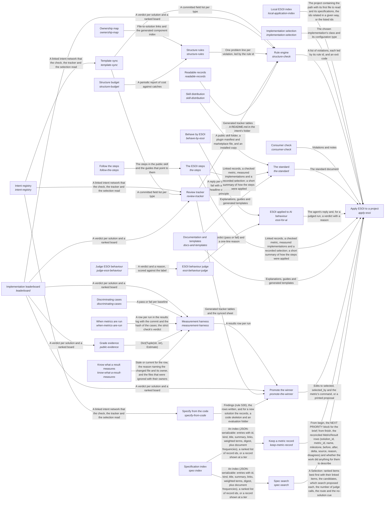
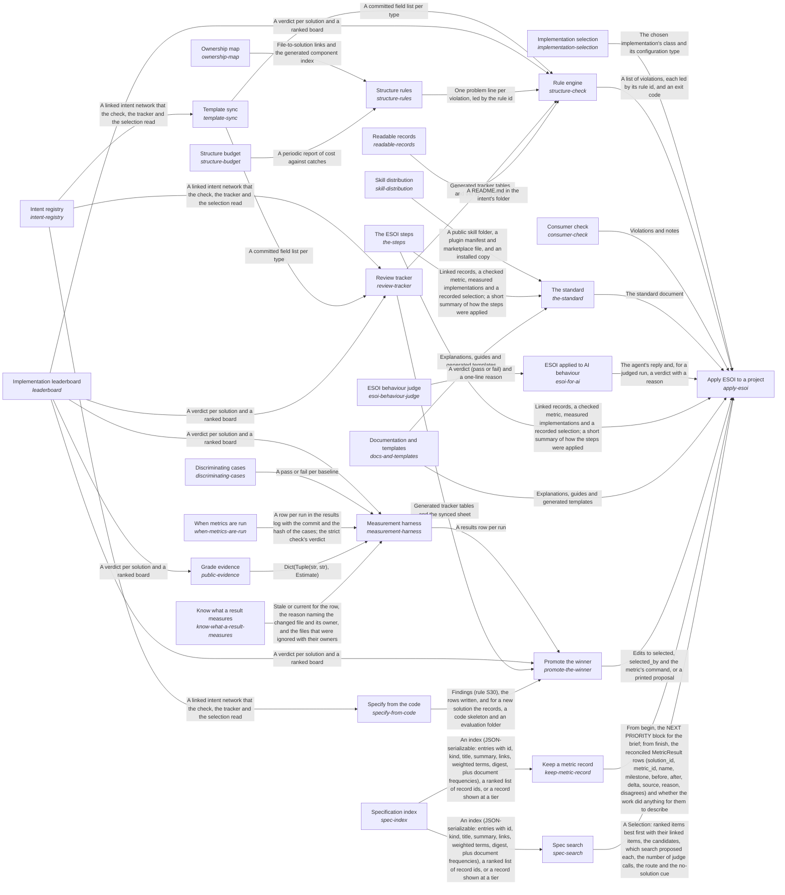

# esoi

*ESOI records kept beside the code in `implementations/python/esoi`, generated from the CSV files in this folder by `esoi readmes`. Edit the CSV files, not this page.*

Every intention is turned into a structure that optimizes the fulfilling of that intent while supporting changes to it, and the intent and the structure evolve together in a continual feedback loop.

These are the solutions of [Evolvable structure that optimizes intent (ESOI)](../../../esoi/README.md).

## How the solutions fit together

ESOI turns an intention into a structure that keeps fulfilling it while both change, and Apply ESOI to a project is how a project takes that up: Apply ESOI to a project teaches people through The standard, guides AI agents through ESOI applied to AI behaviour, holds the records and the code to their rules through Rule engine, measures alternatives and moves the selection to the winner through Promote the winner, chooses the implementation that serves each call through Implementation selection, finds the records a request concerns through Spec search, records one piece of work's metric before and after through Keep a metric record, finds which projects apply ESOI through Local ESOI index, and checks a project built on a library through Consumer check. The standard explains ESOI and its fill-in templates in Documentation and templates, gives the order of the work in The ESOI steps and ships the author's skill as a public folder through Skill distribution; The ESOI steps is then written down for readers in Follow the steps. ESOI applied to AI behaviour gives an agent the skill as standing instructions, Behave by ESOI measures case by case whether its replies act by the principles, and ESOI behaviour judge grades the replies a pattern cannot settle, through Judge ESOI behaviour. Rule engine applies every rule it holds through Structure rules, each rule kept only while Structure budget says it still pays and with Ownership map tying every file to a component, keeps the record fields in step with the template through Template sync, regenerates the pages of Readable records and the Review tracker sheet, and reads standings from Implementation leaderboard; Template sync parses the template that the Intent registry records follow. Review tracker puts the Intent registry records, the Implementation leaderboard standings and the fields kept in step by Template sync in front of a reviewer. Promote the winner switches a solution's selected implementation when Implementation leaderboard shows a clear winner among the rows Measurement harness recorded, then updates the Review tracker sheet and the declarations that Specify from the code keeps in step with the Intent registry records. Measurement harness runs each implementation on its solution's cases, proves through Discriminating cases that those cases fail a naive implementation, follows When metrics are run for when a stage may run and what it may spend, consults Grade evidence before it pays to measure a candidate others have measured, asks Know what a result measures which changed files make a recorded row stale, and hands its rows to Implementation leaderboard, which Grade evidence reads as well. Implementation selection chooses which implementation serves a solution by name, configuration or table default, and its declarations grow into the sub-intent ESOI inside other people's running code. Spec search ranks the records a request concerns over the narrowed set Specification index gives it. Keep a metric record reads the slice Specification index gives for the work it records. Local ESOI index says where to look first in each project. Consumer check scores a consumer's own implementations with the library's cases and shows its version lag.

## Overview diagram

An arrow runs from the solution that provides to the solution that builds on it; its label is what the provider outputs.

## Apply ESOI to a project (`apply-esoi`)

Turn a project's intent into specifications that are checked, measured and selected by metric, so the structure keeps evolving with the intent.

- Entry call: `esoi.run("apply-esoi", '.')`
- Selected implementation: Documents, templates and tools together (`documents-templates-and-tools`)
- Metric: Adoption effort, Intents whose solutions one paragraph and one diagram explain as the code builds them
- Implemented by: [`implementations/python/esoi/entry.py`](entry.py), [`implementations/python/esoi/esoi_selection.json`](esoi_selection.json), [`implementations/python/esoi/interfaces.py`](interfaces.py)

## Intent registry (`intent-registry`)

Record every problem, solution, implementation, ideal and metric of a repository as linked records that people and checks both read.

- Entry call: `esoi.run("intent-registry", '.')`
- Selected implementation: Records beside the code (`beside_code`)
- Metric: Navigable records, Record completeness
- Implemented by: [`esoi/COMPONENTS.md`](../../../esoi/COMPONENTS.md), [`esoi/components.csv`](../../../esoi/components.csv), [`esoi/esoi_template.csv`](../../../esoi/esoi_template.csv), [`esoi/metric-run-policy.md`](../../../esoi/metric-run-policy.md), [`esoi/network.md`](../../../esoi/network.md), [`esoi/standards/naming.md`](../../../esoi/standards/naming.md), [`esoi/standards/no-em-dash.md`](../../../esoi/standards/no-em-dash.md), [`esoi/standards/tags.csv`](../../../esoi/standards/tags.csv) and 30 more

## Template sync (`template-sync`)

Derive the registry's fields from the intent template in the skill so the author's wording stays the single definition.

- Entry call: `esoi.run("template-sync", '.')`
- Selected implementation: Template parser (`template-parser`)
- Metric: Template agreement
- Implemented by: [`implementations/python/esoi/__main__.py`](__main__.py), [`implementations/python/esoi/cli.py`](cli.py), [`implementations/python/esoi/data/esoi_template.csv`](data/esoi_template.csv), [`implementations/python/esoi/data/skill_version.json`](data/skill_version.json), [`implementations/python/esoi/interfaces.py`](interfaces.py), [`implementations/python/esoi/rules/generated.py`](rules/generated.py), [`implementations/python/esoi/rules/version_rules.py`](rules/version_rules.py), [`implementations/python/esoi/template.py`](template.py) and 10 more

## Ownership map (`ownership-map`)

Assign every file to exactly one component and every component to the solutions it serves, so code with no purpose cannot hide.

- Entry call: `esoi.run("ownership-map", '.')`
- Selected implementation: Component rows (`component-rows`)
- Metric: Trace completeness
- Implemented by: [`implementations/python/esoi/interfaces.py`](interfaces.py), [`implementations/python/esoi/rules/layout.py`](rules/layout.py), [`implementations/python/evaluation/components/own_every_file/__init__.py`](../evaluation/components/own_every_file/__init__.py), [`implementations/python/evaluation/components/own_every_file/broken/__init__.py`](../evaluation/components/own_every_file/broken/__init__.py), [`implementations/python/evaluation/components/own_every_file/broken/coverage_only.py`](../evaluation/components/own_every_file/broken/coverage_only.py), [`implementations/python/evaluation/components/own_every_file/cases.json`](../evaluation/components/own_every_file/cases.json), [`implementations/python/evaluation/components/own_every_file/impls/__init__.py`](../evaluation/components/own_every_file/impls/__init__.py), [`implementations/python/evaluation/components/own_every_file/impls/live_checker.py`](../evaluation/components/own_every_file/impls/live_checker.py) and 2 more

## Implementation selection (`implementation-selection`)

Choose which implementation serves a swappable solution by name, configuration or table default.

- Entry call: `esoi.run("implementation-selection", 'structure-check')`
- Selected implementation: Declarations in code (`declarations`)
- Metric: Resolution correctness
- Implemented by: [`implementations/python/esoi/entry.py`](entry.py), [`implementations/python/esoi/esoi_selection.json`](esoi_selection.json), [`implementations/python/esoi/interfaces.py`](interfaces.py)

## Measurement harness (`measurement-harness`)

Run each implementation of a solution against that solution's cases through the live code and record the result with its provenance.

- Entry call: `esoi.run("measurement-harness", '.')`
- Selected implementation: Component harness (`component-harness`)
- Metric: Provenance completeness
- Implemented by: [`implementations/python/esoi/__main__.py`](__main__.py), [`implementations/python/esoi/access.py`](access.py), [`implementations/python/esoi/balance.py`](balance.py), [`implementations/python/esoi/cassette.py`](cassette.py), [`implementations/python/esoi/cli.py`](cli.py), [`implementations/python/esoi/expect.py`](expect.py), [`implementations/python/esoi/follow.py`](follow.py), [`implementations/python/esoi/foundation.py`](foundation.py) and 26 more

## Implementation leaderboard (`leaderboard`)

Decide from recorded results which implementation of a solution is best, or whether they tie.

- Entry call: `esoi.run("leaderboard", '.')`
- Selected implementation: Margin leaderboard (`margin-leaderboard`)
- Metric: Ranking correctness
- Implemented by: [`implementations/python/esoi/__main__.py`](__main__.py), [`implementations/python/esoi/access.py`](access.py), [`implementations/python/esoi/admit.py`](admit.py), [`implementations/python/esoi/balance.py`](balance.py), [`implementations/python/esoi/cascade.py`](cascade.py), [`implementations/python/esoi/circumstances.py`](circumstances.py), [`implementations/python/esoi/cli.py`](cli.py), [`implementations/python/esoi/evidence_table.py`](evidence_table.py) and 17 more

## Discriminating cases (`discriminating-cases`)

Prove that a solution's cases can tell a sound implementation from a naive one, even when only one implementation exists.

- Entry call: `esoi.run("discriminating-cases", '.')`
- Selected implementation: Broken baselines (`broken-baselines`)
- Metric: Case discrimination
- Implemented by: [`implementations/python/esoi/interfaces.py`](interfaces.py)

## Rule engine (`structure-check`)

Apply a set of rules to a repository on each change and report every violation by rule and path.

- Entry call: `esoi.run("structure-check", '.')`
- Selected implementation: Rule script (`rule-script`)
- Metric: Check dependability
- Implemented by: [`implementations/python/conftest.py`](../conftest.py), [`implementations/python/docs/configuration.md`](../docs/configuration.md), [`implementations/python/docs/evaluation-components.md`](../docs/evaluation-components.md), [`implementations/python/docs/rules.md`](../docs/rules.md), [`implementations/python/esoi/__main__.py`](__main__.py), [`implementations/python/esoi/check.py`](check.py), [`implementations/python/esoi/cli.py`](cli.py), [`implementations/python/esoi/coherence.py`](coherence.py) and 100 more

## Structure rules (`structure-rules`)

Decide which structural rules a repository is held to, each with the mistake that justifies it and the evidence that it still catches something.

- Entry call: `esoi.run("structure-rules", '.')`
- Selected implementation: Numbered rule modules (`rule-modules`)
- Metric: Violation detection
- Implemented by: [`implementations/python/esoi/interfaces.py`](interfaces.py), [`implementations/python/esoi/rules/cascade_rules.py`](rules/cascade_rules.py), [`implementations/python/esoi/rules/foundation_rules.py`](rules/foundation_rules.py), [`implementations/python/esoi/rules/generated.py`](rules/generated.py), [`implementations/python/esoi/rules/hierarchy_rules.py`](rules/hierarchy_rules.py), [`implementations/python/esoi/rules/intents.py`](rules/intents.py), [`implementations/python/esoi/rules/layout.py`](rules/layout.py), [`implementations/python/esoi/rules/measurement.py`](rules/measurement.py) and 81 more

## Review tracker (`review-tracker`)

Put the whole intent network and its current results in front of a human reviewer, and carry their edits back.

- Entry call: `esoi.run("review-tracker", '.')`
- Selected implementation: Tracker and sheet (`tracker-and-sheet`)
- Metric: Review coverage
- Implemented by: [`implementations/python/esoi/__main__.py`](__main__.py), [`implementations/python/esoi/cli.py`](cli.py), [`implementations/python/esoi/interfaces.py`](interfaces.py), [`implementations/python/esoi/rules/generated.py`](rules/generated.py), [`implementations/python/esoi/sheets.py`](sheets.py), [`implementations/python/esoi/tracker.py`](tracker.py), [`implementations/python/evaluation/components/review_tracker/__init__.py`](../evaluation/components/review_tracker/__init__.py), [`implementations/python/evaluation/components/review_tracker/broken/__init__.py`](../evaluation/components/review_tracker/broken/__init__.py) and 6 more

## Consumer check (`consumer-check`)

Let a system built on a library record which library solution each of its parts serves, score its own implementations with the library's cases, and see its version lag.

- Entry call: `esoi.run("consumer-check", 'esoi')`
- Selected implementation: Consumer command (`consumer-command`)
- Metric: Consumer soundness
- Implemented by: [`implementations/python/esoi/__main__.py`](__main__.py), [`implementations/python/esoi/cli.py`](cli.py), [`implementations/python/esoi/consumer.py`](consumer.py), [`implementations/python/esoi/interfaces.py`](interfaces.py), [`implementations/python/evaluation/components/assemble_fixture.py`](../evaluation/components/assemble_fixture.py), [`implementations/python/evaluation/components/check_a_consumer/__init__.py`](../evaluation/components/check_a_consumer/__init__.py), [`implementations/python/evaluation/components/check_a_consumer/broken/__init__.py`](../evaluation/components/check_a_consumer/broken/__init__.py), [`implementations/python/evaluation/components/check_a_consumer/broken/columns_only.py`](../evaluation/components/check_a_consumer/broken/columns_only.py) and 16 more

## The standard (`the-standard`)

Teach anyone, person or AI, how a solution is shaped in this structure and how another repository adopts it.

- Entry call: `esoi.run("the-standard", '.')`
- Selected implementation: Standard document (`standard-document`)
- Metric: Adoption effort
- Implemented by: [`implementations/python/esoi/interfaces.py`](interfaces.py)

## Structure budget (`structure-budget`)

Keep the structure's own cost in view and prune what stops paying.

- Entry call: `esoi.run("structure-budget", '.')`
- Selected implementation: Written weighing rule (`written-weighing-rule`)
- Metric: Structure cost against catches
- Implemented by: [`implementations/python/esoi/interfaces.py`](interfaces.py)

## When metrics are run (`when-metrics-are-run`)

Decide when each metric is run, in what stages, with what limit, who approves the spend, and when its result stops counting.

- Entry call: `esoi.run("when-metrics-are-run", '.')`
- Selected implementation: On every change (`on-every-change`)
- Metric: Decisions backed by current results
- Implemented by: [`.github/workflows/check.yml`](../../../.github/workflows/check.yml), [`implementations/python/esoi/interfaces.py`](interfaces.py), [`implementations/python/evaluation/components/assemble_fixture.py`](../evaluation/components/assemble_fixture.py), [`implementations/python/evaluation/components/consumer_fixture.py`](../evaluation/components/consumer_fixture.py), [`implementations/python/evaluation/components/glance_fixture.py`](../evaluation/components/glance_fixture.py), [`implementations/python/evaluation/components/harness_fixture.py`](../evaluation/components/harness_fixture.py), [`implementations/python/evaluation/components/index_world.py`](../evaluation/components/index_world.py), [`implementations/python/evaluation/components/know_stale_results/__init__.py`](../evaluation/components/know_stale_results/__init__.py) and 14 more

## Skill distribution (`skill-distribution`)

Publish an author's skill from the private folder where it is maintained as a complete public folder that people install without anything else.

- Entry call: `esoi.run("skill-distribution", '.')`
- Selected implementation: Generated public copy (`generated-public-copy`)
- Metric: Skill copy agreement and leaks
- Implemented by: [`.claude-plugin/marketplace.json`](../../../.claude-plugin/marketplace.json), [`implementations/python/esoi/data/skill/evolvable-structure/INDEX.md`](data/skill/evolvable-structure/INDEX.md), [`implementations/python/esoi/data/skill/evolvable-structure/SKILL.md`](data/skill/evolvable-structure/SKILL.md), [`implementations/python/esoi/data/skill/evolvable-structure/coding.md`](data/skill/evolvable-structure/coding.md), [`implementations/python/esoi/data/skill/evolvable-structure/coding/components.md`](data/skill/evolvable-structure/coding/components.md), [`implementations/python/esoi/data/skill/evolvable-structure/coding/concept_ai_quest_qar.md`](data/skill/evolvable-structure/coding/concept_ai_quest_qar.md), [`implementations/python/esoi/data/skill/evolvable-structure/coding/pipelines_and_experiments.md`](data/skill/evolvable-structure/coding/pipelines_and_experiments.md), [`implementations/python/esoi/data/skill/evolvable-structure/coding/registry_and_templates.md`](data/skill/evolvable-structure/coding/registry_and_templates.md) and 58 more

## ESOI applied to AI behaviour (`esoi-for-ai`)

Make an AI agent act by the evolvable-structure principles when designing, building, writing and advising.

- Entry call: `esoi.run("esoi-for-ai", '.')`
- Selected implementation: Skill as standing instructions (`skill-as-standing-instructions`)
- Metric: Behaviour adherence
- Implemented by: [`implementations/python/esoi/interfaces.py`](interfaces.py), [`implementations/python/esoi/standards_measure.py`](standards_measure.py), [`implementations/python/esoi/standards_nav.py`](standards_nav.py)

## The ESOI steps (`the-steps`)

Give the order in which to define and apply ESOI to anything new or changed, and say where to loop back when something changes.

- Entry call: `esoi.run("the-steps", '.')`
- Selected implementation: The ESOI steps (`esoi-steps`)
- Metric: Steps followed
- Implemented by: [`implementations/python/esoi/interfaces.py`](interfaces.py)

## Documentation and templates (`docs-and-templates`)

Explain ESOI and give fill-in templates that need no code so anyone can apply it by hand first.

- Entry call: `esoi.run("docs-and-templates", '.')`
- Selected implementation: Documentation folder (`documentation-folder`)
- Metric: Newcomer effort
- Implemented by: [`.gitignore`](../../../.gitignore), [`CHANGELOG.md`](../../../CHANGELOG.md), [`CLAUDE.md`](../../../CLAUDE.md), [`CONTRIBUTING.md`](../../../CONTRIBUTING.md), [`LICENSE`](../../../LICENSE), [`NOTICE`](../../../NOTICE), [`SECURITY.md`](../../../SECURITY.md), [`docs/explanation/a-cascade-runs-one-criterion.md`](../../../docs/explanation/a-cascade-runs-one-criterion.md) and 90 more

## ESOI behaviour judge (`esoi-behaviour-judge`)

Grade whether one reply acts by the principles when a pattern match cannot tell, and show how far the grading agrees with people.

- Entry call: `esoi.run("esoi-behaviour-judge", '.')`
- Selected implementation: Model judge on the rubric (`model-judge-on-the-rubric`)
- Metric: Judge agreement
- Implemented by: [`implementations/python/esoi/interfaces.py`](interfaces.py)

## Specify from the code (`specify-from-code`)

Keep the records of a solution and its alternatives in step with the code that declares them, and create a new solution in one command.

- Entry call: `esoi.run("specify-from-code", '.')`
- Selected implementation: Declarations read from the code, rows synced (`declarations-and-sync`)
- Metric: Declaration sync
- Implemented by: [`implementations/python/esoi/__main__.py`](__main__.py), [`implementations/python/esoi/admit.py`](admit.py), [`implementations/python/esoi/cli.py`](cli.py), [`implementations/python/esoi/declarations.py`](declarations.py), [`implementations/python/esoi/interfaces.py`](interfaces.py), [`implementations/python/esoi/newsolution.py`](newsolution.py), [`implementations/python/esoi/rules/declarations.py`](rules/declarations.py), [`implementations/python/evaluation/components/assemble_fixture.py`](../evaluation/components/assemble_fixture.py) and 19 more

## Readable records (`readable-records`)

Give every intent folder a generated page that says what the intent is and lists its parts.

- Entry call: `esoi.run("readable-records", '.')`
- Selected implementation: At a glance, full record below (`at_a_glance`)
- Metric: README glanceability, README fidelity
- Implemented by: [`implementations/python/esoi/check.py`](check.py), [`implementations/python/esoi/coherence.py`](coherence.py), [`implementations/python/esoi/diagram.py`](diagram.py), [`implementations/python/esoi/interfaces.py`](interfaces.py), [`implementations/python/esoi/ratchet.py`](ratchet.py), [`implementations/python/esoi/readme.py`](readme.py), [`implementations/python/esoi/rules/entry_rules.py`](rules/entry_rules.py), [`implementations/python/esoi/rules/generated.py`](rules/generated.py) and 30 more

## Promote the winner (`promote-the-winner`)

Switch the selected implementation of an evaluated solution to the rival that clearly wins on the solution's own metric, with the evidence recorded.

- Entry call: `esoi.run("promote-the-winner", '.')`
- Selected implementation: Promotion on the leaderboard's verdict (`margin-promotion`)
- Metric: Promotion correctness
- Implemented by: [`implementations/python/esoi/__main__.py`](__main__.py), [`implementations/python/esoi/cascade.py`](cascade.py), [`implementations/python/esoi/cli.py`](cli.py), [`implementations/python/esoi/interfaces.py`](interfaces.py), [`implementations/python/esoi/promote.py`](promote.py), [`implementations/python/evaluation/components/assemble_fixture.py`](../evaluation/components/assemble_fixture.py), [`implementations/python/evaluation/components/consumer_fixture.py`](../evaluation/components/consumer_fixture.py), [`implementations/python/evaluation/components/glance_fixture.py`](../evaluation/components/glance_fixture.py) and 17 more

## Specification index (`spec-index`)

Narrow a repository's intent records to the few that a new use case or input may concern.

- Entry call: `esoi.run("spec-index", ...)`
- Selected implementation: Field-weighted TF-IDF over the index (`weighted-tfidf`)
- Metric: Specification recall at k
- Implemented by: [`implementations/python/esoi/spec_index.py`](spec_index.py), [`implementations/python/evaluation/components/spec_index/__init__.py`](../evaluation/components/spec_index/__init__.py), [`implementations/python/evaluation/components/spec_index/cases.json`](../evaluation/components/spec_index/cases.json), [`implementations/python/evaluation/components/spec_index/impls/__init__.py`](../evaluation/components/spec_index/impls/__init__.py), [`implementations/python/evaluation/components/spec_index/impls/live.py`](../evaluation/components/spec_index/impls/live.py), [`implementations/python/evaluation/components/spec_index/impls/term_overlap.py`](../evaluation/components/spec_index/impls/term_overlap.py), [`implementations/python/evaluation/components/spec_index/impls/weighted_tfidf.py`](../evaluation/components/spec_index/impls/weighted_tfidf.py), [`implementations/python/evaluation/components/spec_index/interface.py`](../evaluation/components/spec_index/interface.py) and 1 more

## Keep a metric record (`keep-metric-record`)

Keep the relevant metric's value before and after each piece of work, so the change can be judged later.

- Entry call: `esoi.run("keep-metric-record", '.')`
- Selected implementation: Library modules (`library-modules`)
- Metric: Metric record kept
- Implemented by: [`implementations/python/esoi/interfaces.py`](interfaces.py), [`implementations/python/esoi/iteration.py`](iteration.py), [`implementations/python/esoi/metric_meter.py`](metric_meter.py), [`implementations/python/esoi/metric_results.py`](metric_results.py), [`implementations/python/esoi/spec_slice.py`](spec_slice.py), [`implementations/python/evaluation/components/keep_metric_record/__init__.py`](../evaluation/components/keep_metric_record/__init__.py), [`implementations/python/evaluation/components/keep_metric_record/broken/__init__.py`](../evaluation/components/keep_metric_record/broken/__init__.py), [`implementations/python/evaluation/components/keep_metric_record/broken/naive_claims.py`](../evaluation/components/keep_metric_record/broken/naive_claims.py) and 5 more

## Spec search (`spec-search`)

Find the records and items a request concerns by lexical scoring, an optional semantic search, rank fusion, a confidence gate and at most one judging call, and bring each result's links.

- Entry call: `esoi.run("spec-search", ...)`
- Selected implementation: Lexical vector gated (`lexical-vector-gated`)
- Metric: Spec search correctness
- Implemented by: [`implementations/python/esoi/spec_search.py`](spec_search.py), [`implementations/python/evaluation/components/spec_search/__init__.py`](../evaluation/components/spec_search/__init__.py), [`implementations/python/evaluation/components/spec_search/broken/__init__.py`](../evaluation/components/spec_search/broken/__init__.py), [`implementations/python/evaluation/components/spec_search/broken/naive_order.py`](../evaluation/components/spec_search/broken/naive_order.py), [`implementations/python/evaluation/components/spec_search/cases.json`](../evaluation/components/spec_search/cases.json), [`implementations/python/evaluation/components/spec_search/impls/__init__.py`](../evaluation/components/spec_search/impls/__init__.py), [`implementations/python/evaluation/components/spec_search/impls/gated.py`](../evaluation/components/spec_search/impls/gated.py), [`implementations/python/evaluation/components/spec_search/impls/lexical_only.py`](../evaluation/components/spec_search/impls/lexical_only.py) and 3 more

## Grade evidence (`public-evidence`)

Grade what others measured: one ``Estimate`` per candidate and dimension, with its flags and whether an own run is needed.

- Entry call: `esoi.run("public-evidence", {'evidence': []})`
- Selected implementation: Letter grades by weighted evidence (`graded`)
- Metric: Public evidence graded
- Implemented by: [`implementations/python/esoi/evidence.py`](evidence.py), [`implementations/python/evaluation/components/public_evidence/__init__.py`](../evaluation/components/public_evidence/__init__.py), [`implementations/python/evaluation/components/public_evidence/broken/__init__.py`](../evaluation/components/public_evidence/broken/__init__.py), [`implementations/python/evaluation/components/public_evidence/broken/trust_the_number.py`](../evaluation/components/public_evidence/broken/trust_the_number.py), [`implementations/python/evaluation/components/public_evidence/cases.json`](../evaluation/components/public_evidence/cases.json), [`implementations/python/evaluation/components/public_evidence/impls/__init__.py`](../evaluation/components/public_evidence/impls/__init__.py), [`implementations/python/evaluation/components/public_evidence/impls/graded.py`](../evaluation/components/public_evidence/impls/graded.py), [`implementations/python/evaluation/components/public_evidence/impls/live.py`](../evaluation/components/public_evidence/impls/live.py) and 2 more

## Know what a result measures (`know-what-a-result-measures`)

Tell, for one recorded result, whether the code, cases or circumstances it measures changed since its commit, and say which changed file and which component's ownership explains the answer.

- Entry call: `esoi stale --explain COMPONENT`
- Selected implementation: Import closure (`import_closure`)
- Metric: Staleness precision
- Implemented by: [`implementations/python/esoi/attest.py`](attest.py), [`implementations/python/esoi/staleness.py`](staleness.py), [`implementations/python/evaluation/components/staleness_precision/__init__.py`](../evaluation/components/staleness_precision/__init__.py), [`implementations/python/evaluation/components/staleness_precision/broken/__init__.py`](../evaluation/components/staleness_precision/broken/__init__.py), [`implementations/python/evaluation/components/staleness_precision/broken/never_stale.py`](../evaluation/components/staleness_precision/broken/never_stale.py), [`implementations/python/evaluation/components/staleness_precision/cases.json`](../evaluation/components/staleness_precision/cases.json), [`implementations/python/evaluation/components/staleness_precision/datasets/fixture.json`](../evaluation/components/staleness_precision/datasets/fixture.json), [`implementations/python/evaluation/components/staleness_precision/impls/__init__.py`](../evaluation/components/staleness_precision/impls/__init__.py) and 5 more

## Diagram

An arrow runs from the solution that provides to the solution that builds on it; its label is what the provider outputs.

## Implementations

| Implementation | Handle | Code | Selected |
|---|---|---|---|
| Documents, templates and tools together | `apply-esoi:documents-templates-and-tools` | [`implementations/python/esoi/interfaces.py`](interfaces.py) | selected |
| Records in the esoi folder | `intent-registry:esoi_folder` | [`implementations/python/esoi/interfaces.py`](interfaces.py) |  |
| Records beside the code | `intent-registry:beside_code` | [`implementations/python/esoi/interfaces.py`](interfaces.py) | selected |
| Template parser | `template-sync:template-parser` | [`implementations/python/esoi/interfaces.py`](interfaces.py) | selected |
| Component rows | `ownership-map:component-rows` | [`implementations/python/esoi/interfaces.py`](interfaces.py) | selected |
| Declarations in code | `implementation-selection:declarations` | [`implementations/python/esoi/interfaces.py`](interfaces.py) | selected |
| Component harness | `measurement-harness:component-harness` | [`implementations/python/esoi/interfaces.py`](interfaces.py) | selected |
| Margin leaderboard | `leaderboard:margin-leaderboard` | [`implementations/python/esoi/interfaces.py`](interfaces.py) | selected |
| Broken baselines | `discriminating-cases:broken-baselines` | [`implementations/python/esoi/interfaces.py`](interfaces.py) | selected |
| Rule script | `structure-check:rule-script` | [`implementations/python/esoi/interfaces.py`](interfaces.py) | selected |
| Numbered rule modules | `structure-rules:rule-modules` | [`implementations/python/esoi/interfaces.py`](interfaces.py) | selected |
| Tracker and sheet | `review-tracker:tracker-and-sheet` | [`implementations/python/esoi/interfaces.py`](interfaces.py) | selected |
| Consumer command | `consumer-check:consumer-command` | [`implementations/python/esoi/interfaces.py`](interfaces.py) | selected |
| Standard document | `the-standard:standard-document` | [`implementations/python/esoi/interfaces.py`](interfaces.py) | selected |
| On every change | `when-metrics-are-run:on-every-change` | [`implementations/python/esoi/interfaces.py`](interfaces.py) | selected |
| Generated public copy | `skill-distribution:generated-public-copy` | [`implementations/python/esoi/interfaces.py`](interfaces.py) | selected |
| Written weighing rule | `structure-budget:written-weighing-rule` | [`implementations/python/esoi/interfaces.py`](interfaces.py) | selected |
| Skill as standing instructions | `esoi-for-ai:skill-as-standing-instructions` | [`implementations/python/esoi/interfaces.py`](interfaces.py) | selected |
| The ESOI steps | `the-steps:esoi-steps` | [`implementations/python/esoi/interfaces.py`](interfaces.py) | selected |
| Documentation folder | `docs-and-templates:documentation-folder` | [`implementations/python/esoi/interfaces.py`](interfaces.py) | selected |
| The ESOI steps | `follow-the-steps:steps` | [`implementations/python/esoi/interfaces.py`](interfaces.py) | selected |
| Index folder in the user's home | `local-application-index:live_index` | [`implementations/python/esoi/interfaces.py`](interfaces.py) | selected |
| Model judge on the rubric | `esoi-behaviour-judge:model-judge-on-the-rubric` | [`implementations/python/esoi/interfaces.py`](interfaces.py) | selected |
| Skill as standing instructions | `behave-by-esoi:standing-instructions` | [`implementations/python/esoi/interfaces.py`](interfaces.py) | selected |
| Model judge | `judge-esoi-behaviour:model-judge` | [`implementations/python/esoi/interfaces.py`](interfaces.py) | selected |
| Declarations read from the code, rows synced | `specify-from-code:declarations-and-sync` | [`implementations/python/esoi/interfaces.py`](interfaces.py) | selected |
| Record tables only | `readable-records:full_page` | [`implementations/python/esoi/interfaces.py`](interfaces.py) |  |
| At a glance, full record below | `readable-records:at_a_glance` | [`implementations/python/esoi/interfaces.py`](interfaces.py) | selected |
| Compact page of links | `readable-records:links_page` | [`implementations/python/esoi/interfaces.py`](interfaces.py) |  |
| Promotion on the leaderboard's verdict | `promote-the-winner:margin-promotion` | [`implementations/python/esoi/interfaces.py`](interfaces.py) | selected |
| Field-weighted TF-IDF over the index | `spec-index:weighted-tfidf` | [`implementations/python/esoi/spec_index.py`](spec_index.py) | selected |
| Plain term overlap | `spec-index:term-overlap` | [`implementations/python/esoi/spec_index.py`](spec_index.py) |  |
| Library modules | `keep-metric-record:library-modules` | [`implementations/python/esoi/interfaces.py`](interfaces.py) | selected |
| Lexical only | `spec-search:lexical-only` | [`implementations/python/esoi/spec_search.py`](spec_search.py) |  |
| Lexical vector gated | `spec-search:lexical-vector-gated` | [`implementations/python/esoi/spec_search.py`](spec_search.py) | selected |
| Letter grades by weighted evidence | `public-evidence:graded` | [`implementations/python/esoi/evidence.py`](evidence.py) | selected |
| Repo wide | `know-what-a-result-measures:repo_wide` | [`implementations/python/esoi/staleness.py`](staleness.py) |  |
| Component paths | `know-what-a-result-measures:component_paths` | [`implementations/python/esoi/staleness.py`](staleness.py) |  |
| Import closure | `know-what-a-result-measures:import_closure` | [`implementations/python/esoi/staleness.py`](staleness.py) | selected |

## Metrics

- Trace completeness (`metric-trace-completeness`): leader `live_checker`, 12 of 16 cases
- Template agreement (`metric-template-agreement`): leader `live_parser`, 11 of 11 cases
- Resolution correctness (`metric-resolution-correctness`)
- Provenance completeness (`metric-provenance-completeness`): leader `live_harness`, 27 of 28 cases
- Ranking correctness (`metric-ranking-correctness`): leader `live_leaderboard`, 54 of 54 cases
- Case discrimination (`metric-case-discrimination`)
- Violation detection (`metric-violation-detection`): leader `live_checker`, 61 of 76 cases
- Check dependability (`metric-check-dependability`): leader `live_checker`, 61 of 76 cases
- Review coverage (`metric-review-coverage`): leader `live_tracker`, 10 of 10 cases
- Consumer soundness (`metric-consumer-soundness`): leader `live_consumer_check`, 22 of 22 cases
- Adoption effort (`metric-adoption-effort`)
- Structure cost against catches (`metric-structure-cost-against-catches`)
- Decisions backed by current results (`metric-decisions-backed-by-current-results`): leader `live_checker`, 10 of 16 cases
- Skill copy agreement and leaks (`metric-skill-copy-agreement`): leader `live_skill`, 26 of 26 cases
- Behaviour adherence (`metric-esoi-behaviour-adherence`)
- Steps followed (`metric-steps-followed`)
- Newcomer effort (`metric-docs-and-templates`)
- Judge agreement (`metric-esoi-judge-agreement`)
- Record completeness (`metric-record-completeness`): leader `live_checker`, 11 of 14 cases
- Declaration sync (`metric-declaration-sync`): leader `live_declarations`, 14 of 14 cases
- README fidelity (`metric-readme-fidelity`): leader `live_readme`, 10 of 10 cases
- README glanceability (`metric-readme-glanceability`): leader `at_a_glance`, 1 of 4 cases
- Promotion correctness (`metric-promotion-correctness`): leader `live_promote`, 17 of 17 cases
- Specification recall at k (`metric-spec-index-recall`): leader `weighted_tfidf`, 31 of 35 cases
- Metric record kept (`metric-keep-metric-record`): leader `live_record`, 67 of 67 cases
- Spec search correctness (`metric-spec-search`): leader `gated`, 6 of 6 cases
- Public evidence graded (`metric-public-evidence`): leader `graded`, 11 of 11 cases
- Intents whose solutions one paragraph and one diagram explain as the code builds them (`metric-solution-coherence`)
- Navigable records (`metric-navigable-records`): leader `beside_code`, 29 of 53 cases
- Staleness precision (`metric-staleness-precision`): leader `import_closure`, 46 of 55 cases

## Problems

- Intent lost between person and code (`prob-intent-lost-between-person-and-code`): What someone meant when they asked for a capability lives in their head, a chat or a task, and the code that answers it carries none of that meaning.
- Best alternative unknown (`prob-best-alternative-unknown`): Most parts of a system can be done several ways (a model tier, a router, a retrieval method), and the one in use was chosen by whoever wrote it, not by evidence.
- Measurements untrusted (`prob-measurements-untrusted`): A number recorded on uncommitted code, on a different case set, typed by hand, or copied into prose that is never updated looks like evidence but proves nothing.
- Switching means editing code (`prob-switching-means-editing-code`): Switching a provider, runner or backend means finding and editing the call sites, often an `if` chain, and an embedding system cannot switch without forking.
- Purposeless, oversized code (`prob-purposeless-oversized-code`): Files no one can attribute to a purpose stay because deleting feels risky, and modules grow until no one reads them whole (one adapter file reached thousands of lines).
- Structure rules decay (`prob-structure-rules-decay`): Rules written in prose (where files go, which way imports point, what must be documented) are followed by whoever read them and broken by the next agent, and generated documents drift from what they describe.
- Review needs implementations (`prob-review-needs-implementations`): A person who wants to steer quality has to read implementations, because ideals, metrics and current results are not gathered anywhere they can read and correct.
- Evaluation detached from shipped code (`prob-evaluation-detached-from-shipped-code`): Evaluations built beside production code test copies, stubs or scripts of their own, so their results describe something that does not run.
- Embedding soundness unknown (`prob-embedding-soundness-unknown`): A system builds on a library's solutions with its own stores and prompts, but cannot see which library solution each of its parts serves, whether its parts meet the library's own cases, or how far its pinned version lags.
- Template copies drift (`prob-template-copies-drift`): The intent template is being refined in the skill, and every registry and checker that copied its fields falls out of date.
- Others cannot adopt (`prob-others-cannot-adopt`): There is no worked, checked example of evolvable structure in code, so each team that wants it designs its own from prose.
- Structure costs more than it returns (`prob-structure-costs-more-than-it-returns`): Every rule, record and check adds work to each change, and past a point contributors spend more time satisfying the structure than improving the code.
- Metrics run at the wrong time (`prob-metrics-run-at-the-wrong-time`): Results are stale when a choice depends on them, or paid runs happen with no decision behind them, so people either decide on numbers that no longer describe the code or stop running the metrics at all.
- Skill cannot be reached safely (`prob-skill-cannot-be-reached-safely`): A person who wants to use the author's skill cannot get it in a form that is both complete and safe to publish.
- Records copy the code (`prob-records-copy-the-code`): The records repeat what the code already says: which alternatives of a solution exist, the file each lives in, and an interface's signature.
- Winner not adopted (`prob-winner-not-adopted`): A rival that clearly beats the selected implementation on the solution's own metric stays unadopted until someone notices and edits the selection, the metric's command and the record of why, by hand.
- Records unreadable at a glance (`prob-records-unreadable-at-a-glance`): An intent's folder of CSV files states it completely, but what the intent is for cannot be seen without opening several files and following ids between them.
- Simulated arm shows a false loss (`prob-simulated-arm-false-loss`): An arm that meters a deterministic stand-in for a model counts the calls a real model would make but spends nothing.
- Rules unjustified (`prob-rules-unjustified`): A rule is kept in code with no record of the mistake that justified it or of what it has caught since, so nobody can tell whether it still earns its place or why its limit has its value.
- Specifications not found for new input (`prob-intent-specs-not-found-for-new-input`): A new use case or input arrives, and nobody (human or AI) can tell which of a project's problems, ideals, solutions, implementations and metrics apply without reading all of them.
- Metric measures a stand-in (`prob-metric-measures-a-stand-in`): A metric scores a scripted judge, a mocked model or a canned answer instead of the real thing, so its number measures the plumbing around the thing and not the thing.
- Specifications hard to search (`prob-spec-search`): A system that finds a repository's records for a request, or finds them together with its own notes or documents, rebuilds the same stages inside its own code: lexical scoring, a semantic search, rank fusion, a confidence gate, one judging call and the way a ranked record brings its links.
- Intent folder not glanceable (`prob-intent-folder-not-glanceable`): A person clicking into an intent folder cannot tell at a glance what it is, how its parts fit or where to go next: the page lists the records but shows no picture of how the solutions connect, no call that tries a solution, and no link down to the sub-intents, up to the parent intent or out to the repository.
- Specification far from the code (`prob-spec-far-from-code`): A person reading the code of a solution cannot find its specification without leaving the code tree: the records sit in a separate folder, a code folder carries no page that says what it is for, and a change to the code and to its spec happen in two places.
- Results stale when nothing measured changed (`prob-results-stale-when-nothing-measured-changed`): A recorded result is called stale when any file of the repository's measured code changed, so every component's metrics are re-run after every commit although what most of them measure did not change.

## Ideals

- Explicit intent (`ideal-explicit-intent`): Every built part traces to the problems it addresses and the ideals it pursues.
- Metric-chosen defaults (`ideal-metric-chosen-defaults`): The implementation that runs is the one the solution's authoritative metric ranks best.
- Trustworthy evidence (`ideal-trustworthy-evidence`): Every number can be reproduced from a commit and a case set, and only like is compared with like.
- Effortless substitution (`ideal-effortless-substitution`): Switching the implementation of a solution is a change of data, not of code.
- Purposeful code (`ideal-purposeful-code`): Nothing exists that serves no solution, and every part is small enough to understand in one reading.
- Self-enforcing structure (`ideal-self-enforcing-structure`): A structural rule is enforced by the structure, at the moment it is broken.
- Review by metric (`ideal-review-by-metric`): People can steer by reviewing problems, ideals, metrics and results alone, without needing to read implementations; anyone may still review or improve an implementation, and that still adds value.
- Faithful measurement (`ideal-faithful-measurement`): What is measured is what ships.
- Sound integration (`ideal-sound-integration`): A system built on a library meets the same standard as the library, through the library's own checks and cases.
- Living template (`ideal-living-template`): The template's author changes it in one place and every record follows.
- Adoptable structure (`ideal-adoptable-structure`): Another team can apply the same structure to its own code by following one standard and reusing this library's tools.
- Proportionate structure (`ideal-proportionate-structure`): The structure costs less than it returns, and a small change carries a small cost.
- Timely affordable evidence (`ideal-timely-affordable-evidence`): Every choice between alternatives is backed by a current result, and what it cost to get was proportionate to the choice and approved.
- Installable skill (`ideal-installable-skill`): A stranger gets the author's current skill, complete and public-safe, in one step, while the author keeps one source of truth.
- Declared once (`ideal-declared-once`): Each fact is stated once, where it belongs, and everything else is derived from it or measured; a second copy held in step by a check is upkeep, not structure.
- Readable intent (`ideal-readable-intent`): Anyone opening an intent's folder learns what it is for, and what it contains, from a page the records themselves produce.
- Rules earn their place (`ideal-rules-earn-their-place`): Every rule can say which mistake it prevents, and is removed when it stops catching any.
- Right specification at the right time (`ideal-right-spec-at-the-right-time`): For any new use case or input, the relevant specifications are found by looking at a small, cheap description first and reading in full only what was chosen.
- One search, written once (`ideal-spec-search`): The stages of finding the specifications a request concerns are written once, in the library, and a product supplies only its vector search and its judge.
- Glanceable intent (`ideal-glanceable-intent`): Anyone clicking into an intent folder sees on the first screen what the intent is, how its solutions fit together and where to go next.
- Navigable records (`ideal-navigable-records`): A person opening a code folder finds the specification of what it holds beside it, and a person opening a specification finds its code one folder away.
- Stale only when what it measures changed (`ideal-stale-only-when-measured-changed`): A recorded result goes stale if and only if the code, cases or circumstances it measures changed.

## Where to go next

- Intent: [Evolvable structure that optimizes intent (ESOI)](../../../esoi/README.md)
- Repository: [top README](../../../README.md)
