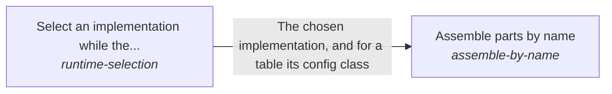

# ESOI inside other people's running code

The esoi package is a dependency of other people's production code, which declares its alternatives gracefully and selects the best implementation while it runs.

*ESOI records of this intent (evolvable structure that optimizes intent), generated from the CSV files beside this page by `esoi readmes`. Edit the CSV files, not this page.*

This sub-intent arises as the implementation `implementation-selection:declarations` of its parent intent [`esoi`](../../../../esoi/README.md). Opportunities: The Python package can become a runtime dependency inside other people's production code, not only a tool run on a repository: selection at run time, graceful declarations of alternatives (decorators, for example) and embedding without forking. That is a creative space beyond selecting an implementation by a table in one repository.

## How the solutions fit together

Inside a running program, Implementation selection hands each call to Select an implementation while the program runs, which picks the declared implementation of a solution by name, override, environment or default and refuses an unknown name with the valid choices, and to Assemble parts by name, which builds whole assemblies of named implementations and their needs. Assemble parts by name makes each of its choices through Select an implementation while the program runs, with a parent's defaults beneath a child's own.

## Diagram

An arrow runs from the solution that provides to the solution that builds on it; its label is what the provider outputs.

## Solutions at a glance

| Solution | Handle | Entry call | Selected implementation | Metric |
|---|---|---|---|---|
| Select an implementation while the program runs | `runtime-selection` | `esoi.run("runtime-selection", 'structure-check')` | `declarations-and-cascade` | Python selector cases |
| Assemble parts by name | `assemble-by-name` | `esoi.run("assemble-by-name", 'structure-check')` | `assembler` | Assembly by name cases |

## Problems and ideals

**Problems**

- `prob-selection-default-kept-twice`: The default implementation of a solution is written in the selection table and again in the records, and only a check holds the two equal.
- `prob-swappable-needs-ceremony`: Making a part swappable takes a port class, a table entry with an import path for every alternative, a wrapper file to measure each one, and edits wherever the choice is made, so most parts are never...

## Metrics and their leaders

- Python selector cases (`metric-runtime-selection`): leader `live_selector`, 32 of 32 cases
- Assembly by name cases (`metric-assemble-by-name`): leader `live_assembler`, 41 of 41 cases

## Where to go next

- Parent intent: [Evolvable structure that optimizes intent (ESOI)](../../../../esoi/README.md)
- Repository: [top README](../../../../README.md)
- Records: [intent.csv](intent.csv), [problems.csv](problems.csv), [solutions.csv](solutions.csv), [implementations.csv](implementations.csv), [metrics.csv](metrics.csv)
- Diagram page: [diagram.md](diagram.md)

---

## The full record

### Problems

- `prob-selection-default-kept-twice`: The default implementation of a solution is written in the selection table and again in the records, and only a check holds the two equal. Choosing a winner means editing both, and a mismatch fails the build.
- `prob-swappable-needs-ceremony`: Making a part swappable takes a port class, a table entry with an import path for every alternative, a wrapper file to measure each one, and edits wherever the choice is made, so most parts are never made swappable.

### Solutions

| Solution | Handle | Selected | Metric |
|---|---|---|---|
| Select an implementation while the program runs | `runtime-selection` | declarations-and-cascade | Python selector cases |
| Assemble parts by name | `assemble-by-name` | assembler | Assembly by name cases |

### Implementations

| Implementation | Handle | Where | Sub-intent |
|---|---|---|---|
| Selector class and table | `runtime-selection:select` | [implementations/python/esoi/select.py](../select.py) |  |
| Declarations in code with one cascade | `runtime-selection:declarations-and-cascade` | [implementations/python/esoi/interfaces.py](../interfaces.py) |  |
| Dependency-ordered assembler | `assemble-by-name:assembler` | [implementations/python/esoi/interfaces.py](../interfaces.py) |  |

### Metrics

- Python selector cases (`metric-runtime-selection`): `esoi run select_an_implementation --impl live_selector`
- Assembly by name cases (`metric-assemble-by-name`): `esoi run assemble_by_name --impl live_assembler`
