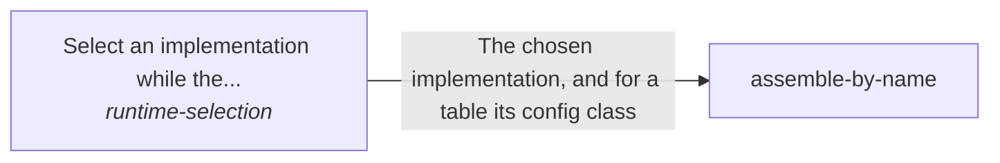

These are ESOI records rendered as a diagram (evolvable structure that optimizes intent). This page is generated from the solutions' outputs and the implementations' `uses_solution_ids` by `esoi diagram`; edit those records, not this page.

# Solution diagram: ESOI inside other people's running code

Inside a running program, implementation-selection hands each call to runtime-selection, which picks the declared implementation of a solution by name, override, environment or default and refuses an unknown name with the valid choices, and to assemble-by-name, which builds whole assemblies of named implementations and their needs. assemble-by-name makes each of its choices through runtime-selection, with a parent's defaults beneath a child's own.

An arrow runs from the solution that provides to the solution that builds on it; its label is what the provider outputs.

