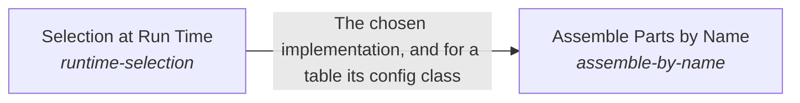

These are ESOI records rendered as a diagram (evolvable structure that optimizes intent). This page is generated from the solutions' outputs and the implementations' `uses_solution_ids` by `esoi diagram`; edit those records, not this page.

# Solution diagram: ESOI Inside Other People's Running Code

Inside a running program, Implementation Selection hands each call to Selection at Run Time, which picks the declared implementation of a solution by name, override, environment or default and refuses an unknown name with the valid choices, and to Assemble Parts by Name, which builds whole assemblies of named implementations and their needs. Assemble Parts by Name makes each of its choices through Selection at Run Time, with a parent's defaults beneath a child's own.

An arrow runs from the solution that provides to the solution that builds on it; its label is what the provider outputs.

