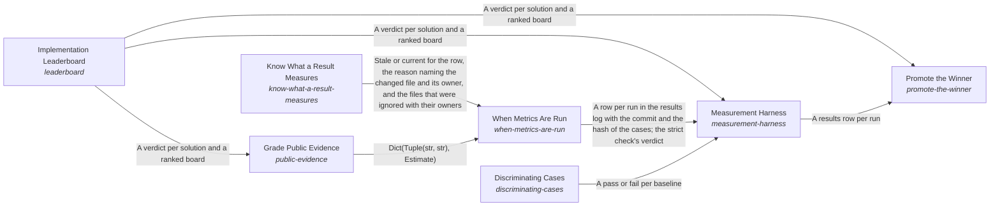

# Implementations Chosen on Evidence

**Vision statement:** Solution implementations continuously improve through a pragmatic balance of measurement and efficient iteration.

Breadcrumb: [Top](../../../../esoi/README.md) > Implementations Chosen on Evidence

This sub-intent arises as the implementation `esoi-optimization:composition` of its parent intent [`esoi`](../../../../esoi/README.md). Opportunities: An evidence engine for any project's evaluations: public evidence before paying, selection per circumstance, replayed model calls, ranking by probability. This creative space goes beyond picking one arm in one repository.

## How the solutions fit together

Optimization is how a project comes to run its best implementation on evidence. The Measurement Harness runs each implementation through the shipped code on its solution's cases and records every result with its commit, cases and cost, and it shows through Discriminating Cases that those cases can fail a naive implementation. The Measurement Harness leaves the decision to run to When Metrics Are Run, which says whether a run is worth what it costs. When Metrics Are Run relies on the answer of Know What a Result Measures to tell whether the code a result measured has changed, and it consults Grade Public Evidence before paying to measure what others already have. Grade Public Evidence reads the standings of the Implementation Leaderboard to weigh what others measured. The Measurement Harness hands its rows to the Implementation Leaderboard, which turns them into an honest verdict, calling a winner only beyond the noise. Promote the Winner switches a selection when the Implementation Leaderboard shows a clear winner among the rows the Measurement Harness recorded, or proposes the switch when a person must approve it. Keep a Metric Record reads the relevant metric before and after each piece of work and keeps both readings, so progress is judged from a ledger rather than a closing message.

## Diagram

An arrow runs from the solution that provides to the solution that builds on it; its label is what the provider outputs.

## One level below

This intent is implemented by the sub-intents and solutions below it; each shows whether it goes deeper.

- [Keep a Metric Record](keep_metric_record/README.md) (solution with implementations): Keep the relevant metric's value before and after each piece of work, so the change can be judged later.
- [Implementation Leaderboard](leaderboard/README.md) (solution with implementations): Decide from recorded results which implementation is best, or whether they tie.
- [Measurement Harness](measurement_harness/README.md) (solution with implementations and parts below it): Run each implementation against its solution's cases through the shipped code, and record each result with its provenance.
- [Promote the Winner](promote_the_winner/README.md) (solution with implementations): Switch the selection to the rival that clearly wins on the solution's own metric, with the evidence recorded, or propose it when a person must approve.
- [When Metrics Are Run](when_metrics_are_run/README.md) (solution with implementations and parts below it): Decide when each metric is run, in what stages, with what limit, who approves the spend, and when its result stops counting.

## Solutions at a glance

| Solution | Handle | Entry call | Selected implementation | Metric |
|---|---|---|---|---|
| Keep a Metric Record | `keep-metric-record` | `esoi.run("keep-metric-record", '.')` | Library modules (`library-modules`) | Metric record kept |
| Implementation Leaderboard | `leaderboard` | `esoi.run("leaderboard", '.')` | Margin leaderboard (`margin-leaderboard`) | Ranking correctness |
| Measurement Harness | `measurement-harness` | `esoi.run("measurement-harness", '.')` | Component harness (`component-harness`) | Provenance completeness |
| Promote the Winner | `promote-the-winner` | `esoi.run("promote-the-winner", '.')` | Promotion on the leaderboard's verdict (`margin-promotion`) | Promotion correctness |
| When Metrics Are Run | `when-metrics-are-run` | `esoi.run("when-metrics-are-run", '.')` | On a decision (`on-a-decision`) | Decisions backed by current results |
| Discriminating Cases | `discriminating-cases` | `esoi.run("discriminating-cases", '.')` | Broken baselines (`broken-baselines`) | Case discrimination |
| Know What a Result Measures | `know-what-a-result-measures` | `esoi.run("know-what-a-result-measures", '.')` | Import closure (`import_closure`) | Staleness precision |
| Grade Public Evidence | `public-evidence` | `esoi.run("public-evidence", {'evidence': []})` | Letter grades by weighted evidence (`graded`) | Public evidence graded |

## Problems and ideals

**Problems**

- Measurements untrusted (`prob-measurements-untrusted`): A number recorded on uncommitted code, on a different case set, typed by hand, or copied into prose that goes stale looks like evidence but cannot be reproduced.
- Simulated arm shows a false loss (`prob-simulated-arm-false-loss`): An arm that meters a deterministic stand-in for a model counts the calls a real model would make at no cost.
- One run decides a ranking (`prob-one-run-decides-a-ranking`): An arm that is run again and again has several results on the same cases and the same code, and the ranking reads only the newest, so a lucky or unlucky last run decides which arm leads and a record of the repeats changes nothing.
- Evaluation detached from shipped code (`prob-evaluation-detached-from-shipped-code`): Evaluations built beside production code test copies, stubs or scripts of their own, so their results describe something that does not run.
- Winner not adopted (`prob-winner-not-adopted`): A rival that clearly beats the selected implementation on the solution's own metric stays unadopted until someone notices and edits the selection, the metric's command and the record of why, by hand.
- Metrics run at the wrong time (`prob-metrics-run-at-the-wrong-time`): Results are stale when a choice depends on them, or paid runs happen with no decision behind them, so people either decide on numbers that no longer describe the code or stop running the metrics at all.
- Results called stale when what they measure did not change (`prob-results-stale-when-nothing-measured-changed`): A recorded result is called stale when any file of the repository's measured code changed, so every component's metrics are re-run after every commit although what most of them measure did not change.

**Ideals**

- Best available implementation (`ideal-best-available-implementation`): A solution is served by the best implementation anyone can offer for its job, not by the one that was built first or is most familiar.
- Timely affordable evidence (`ideal-timely-affordable-evidence`): Every choice between alternatives is backed by a current result, and what it cost to get was proportionate to the choice and approved.
- Stale only when what it measures changed (`ideal-stale-only-when-measured-changed`): A recorded result goes stale if and only if the code, cases or circumstances it measures changed.

## Metrics and their leaders

- Metric record kept (`metric-keep-metric-record`): leader `live_record`, 67 of 67 cases
- Ranking correctness (`metric-ranking-correctness`): leader `live_leaderboard`, 54 of 54 cases
- Provenance completeness (`metric-provenance-completeness`): leader `live_harness`, 29 of 29 cases
- Promotion correctness (`metric-promotion-correctness`): leader `live_promote`, 17 of 17 cases
- Decisions backed by current results (`metric-decisions-backed-by-current-results`): leader `live_checker`, 16 of 16 cases
- Case discrimination (`metric-case-discrimination`)
- Staleness precision (`metric-staleness-precision`): leader `import_closure`, 46 of 55 cases
- Public evidence graded (`metric-public-evidence`): leader `graded`, 11 of 11 cases

## Where to go next

- Parent intent: [Evolvable Structure that Optimizes Intent (ESOI)](../../../../esoi/README.md)
- Repository: [top README](../../../../README.md)
- Records beside the code: [implementations/python/esoi/optimization/keep_metric_record](keep_metric_record/README.md), [implementations/python/esoi/optimization/leaderboard](leaderboard/README.md), [implementations/python/esoi/optimization/measurement_harness](measurement_harness/README.md), [implementations/python/esoi/optimization/promote_the_winner](promote_the_winner/README.md), [implementations/python/esoi/optimization/when_metrics_are_run](when_metrics_are_run/README.md), [implementations/python/esoi/optimization/measurement_harness/discriminating_cases](measurement_harness/discriminating_cases/README.md), [implementations/python/esoi/optimization/when_metrics_are_run/know_what_a_result_measures](when_metrics_are_run/know_what_a_result_measures/README.md), [implementations/python/esoi/optimization/when_metrics_are_run/public_evidence](when_metrics_are_run/public_evidence/README.md)
- Records: [intent.csv](intent.csv), [problems.csv](problems.csv), [ideals.csv](ideals.csv)
- Diagram page: [diagram.md](diagram.md)

---

## The full record

### Problems

- Measurements untrusted (`prob-measurements-untrusted`): A number recorded on uncommitted code, on a different case set, typed by hand, or copied into prose that goes stale looks like evidence but cannot be reproduced.
- Simulated arm shows a false loss (`prob-simulated-arm-false-loss`): An arm that meters a deterministic stand-in for a model counts the calls a real model would make at no cost.
- One run decides a ranking (`prob-one-run-decides-a-ranking`): An arm that is run again and again has several results on the same cases and the same code, and the ranking reads only the newest, so a lucky or unlucky last run decides which arm leads and a record of the repeats changes nothing.
- Evaluation detached from shipped code (`prob-evaluation-detached-from-shipped-code`): Evaluations built beside production code test copies, stubs or scripts of their own, so their results describe something that does not run.
- Winner not adopted (`prob-winner-not-adopted`): A rival that clearly beats the selected implementation on the solution's own metric stays unadopted until someone notices and edits the selection, the metric's command and the record of why, by hand.
- Metrics run at the wrong time (`prob-metrics-run-at-the-wrong-time`): Results are stale when a choice depends on them, or paid runs happen with no decision behind them, so people either decide on numbers that no longer describe the code or stop running the metrics at all.
- Results called stale when what they measure did not change (`prob-results-stale-when-nothing-measured-changed`): A recorded result is called stale when any file of the repository's measured code changed, so every component's metrics are re-run after every commit although what most of them measure did not change.

### Ideals

- Best available implementation (`ideal-best-available-implementation`): A solution is served by the best implementation anyone can offer for its job, not by the one that was built first or is most familiar.
- Timely affordable evidence (`ideal-timely-affordable-evidence`): Every choice between alternatives is backed by a current result, and what it cost to get was proportionate to the choice and approved.
- Stale only when what it measures changed (`ideal-stale-only-when-measured-changed`): A recorded result goes stale if and only if the code, cases or circumstances it measures changed.

### Solutions

| Solution | Handle | Selected | Metric |
|---|---|---|---|
| Keep a Metric Record | `keep-metric-record` | Library modules (`library-modules`) | Metric record kept |
| Implementation Leaderboard | `leaderboard` | Margin leaderboard (`margin-leaderboard`) | Ranking correctness |
| Measurement Harness | `measurement-harness` | Component harness (`component-harness`) | Provenance completeness |
| Promote the Winner | `promote-the-winner` | Promotion on the leaderboard's verdict (`margin-promotion`) | Promotion correctness |
| When Metrics Are Run | `when-metrics-are-run` | On a decision (`on-a-decision`) | Decisions backed by current results |
| Discriminating Cases | `discriminating-cases` | Broken baselines (`broken-baselines`) | Case discrimination |
| Know What a Result Measures | `know-what-a-result-measures` | Import closure (`import_closure`) | Staleness precision |
| Grade Public Evidence | `public-evidence` | Letter grades by weighted evidence (`graded`) | Public evidence graded |

### Implementations

| Implementation | Handle | Where | Sub-intent |
|---|---|---|---|
| Library modules | `keep-metric-record:library-modules` | [implementations/python/esoi/optimization/keep_metric_record/interface.py::LibraryModules](keep_metric_record/interface.py) |  |
| Values the worker reports | `keep-metric-record:worker-reported` |  |  |
| Margin leaderboard | `leaderboard:margin-leaderboard` | [implementations/python/esoi/optimization/leaderboard/interface.py::MarginLeaderboard](leaderboard/interface.py) |  |
| Probability each arm is best | `leaderboard:posterior-ranking` |  |  |
| Component harness | `measurement-harness:component-harness` | [implementations/python/esoi/optimization/measurement_harness/interface.py::ComponentHarness](measurement_harness/interface.py) |  |
| External eval platform | `measurement-harness:external-eval-platform` |  |  |
| Promotion on the leaderboard's verdict | `promote-the-winner:margin-promotion` | [implementations/python/esoi/optimization/promote_the_winner/interface.py::MarginPromotion](promote_the_winner/interface.py) |  |
| A person edits the records | `promote-the-winner:person-edits-the-records` |  |  |
| On a decision | `when-metrics-are-run:on-a-decision` | [implementations/python/esoi/optimization/when_metrics_are_run/interface.py::OnADecision](when_metrics_are_run/interface.py) |  |
| On every change | `when-metrics-are-run:on-every-change` |  |  |
| On a schedule | `when-metrics-are-run:on-a-schedule` |  |  |
| On drift | `when-metrics-are-run:on-drift` |  |  |
| Broken baselines | `discriminating-cases:broken-baselines` | [implementations/python/esoi/optimization/measurement_harness/discriminating_cases/interface.py::BrokenBaselines](measurement_harness/discriminating_cases/interface.py) |  |
| Mutants of the selected implementation | `discriminating-cases:mutation-testing` |  |  |
| Repo wide | `know-what-a-result-measures:repo_wide` | [implementations/python/esoi/optimization/when_metrics_are_run/know_what_a_result_measures/staleness.py](when_metrics_are_run/know_what_a_result_measures/staleness.py) |  |
| Component paths | `know-what-a-result-measures:component_paths` | [implementations/python/esoi/optimization/when_metrics_are_run/know_what_a_result_measures/staleness.py](when_metrics_are_run/know_what_a_result_measures/staleness.py) |  |
| Import closure | `know-what-a-result-measures:import_closure` | [implementations/python/esoi/optimization/when_metrics_are_run/know_what_a_result_measures/staleness.py](when_metrics_are_run/know_what_a_result_measures/staleness.py) |  |
| Letter grades by weighted evidence | `public-evidence:graded` | [implementations/python/esoi/optimization/when_metrics_are_run/public_evidence/evidence_grading.py](when_metrics_are_run/public_evidence/evidence_grading.py) |  |
| A model summarizes the sources | `public-evidence:model-summary` |  |  |

### Metrics

- Metric record kept (`metric-keep-metric-record`): `esoi run keep_metric_record --impl live_record`
- Ranking correctness (`metric-ranking-correctness`): `esoi run rank_implementations --impl live_leaderboard`
- Provenance completeness (`metric-provenance-completeness`): `esoi run measure_implementations --impl live_harness`
- Promotion correctness (`metric-promotion-correctness`): `esoi run promote_the_winner --impl live_promote`
- Decisions backed by current results (`metric-decisions-backed-by-current-results`): `esoi run know_stale_results --impl live_checker`
- Case discrimination (`metric-case-discrimination`): `none`
- Staleness precision (`metric-staleness-precision`): `esoi run staleness_precision --impl repo_wide; esoi run staleness_precision --impl component_paths; esoi run staleness_precision --impl import_closure`
- Public evidence graded (`metric-public-evidence`): `esoi run public_evidence --impl graded`

*Generated from the CSV files beside this page by `esoi readmes`. Edit the CSV files, not this page.*
