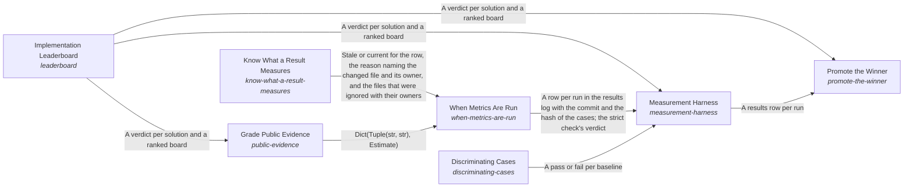

These are ESOI records rendered as a diagram (evolvable structure that optimizes intent). This page is generated from the solutions' outputs and the implementations' `uses_solution_ids` by `esoi diagram`; edit those records, not this page.

# Solution diagram: Implementations Chosen on Evidence

Optimization is how a project comes to run its best implementation on evidence. The Measurement Harness runs each implementation through the shipped code on its solution's cases and records every result with its commit, cases and cost, and it shows through Discriminating Cases that those cases can fail a naive implementation. The Measurement Harness leaves the decision to run to When Metrics Are Run, which says whether a run is worth what it costs. When Metrics Are Run relies on the answer of Know What a Result Measures to tell whether the code a result measured has changed, and it consults Grade Public Evidence before paying to measure what others already have. Grade Public Evidence reads the standings of the Implementation Leaderboard to weigh what others measured. The Measurement Harness hands its rows to the Implementation Leaderboard, which turns them into an honest verdict, calling a winner only beyond the noise. Promote the Winner switches a selection when the Implementation Leaderboard shows a clear winner among the rows the Measurement Harness recorded, or proposes the switch when a person must approve it. Keep a Metric Record reads the relevant metric before and after each piece of work and keeps both readings, so progress is judged from a ledger rather than a closing message.

An arrow runs from the solution that provides to the solution that builds on it; its label is what the provider outputs.

