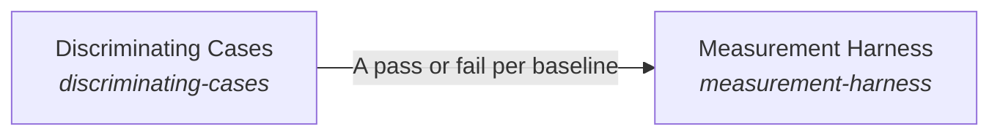

# Measurement Harness

**Purpose:** Run each implementation against its solution's cases through the shipped code, and record each result with its provenance.

Breadcrumb: [Top](../../../../../esoi/README.md) > [Implementations Chosen on Evidence](../README.md) > Measurement Harness

Part of [Implementations Chosen on Evidence](../README.md)

## Measurement Harness (`measurement-harness`)

- Out of scope: Ranking; deciding whether a run is worth it.
- Delegates to: leaderboard, when-metrics-are-run
- Entry call: `esoi.run("measurement-harness", '.')`
- Selected implementation: Component harness (`component-harness`)
- Metric: Provenance completeness
- Implemented by: [`implementations/python/esoi/__main__.py`](../../__main__.py), [`implementations/python/esoi/command_table.py`](../../command_table.py), [`implementations/python/esoi/optimization/leaderboard/inherited_gate.py`](../leaderboard/inherited_gate.py), [`implementations/python/esoi/optimization/measurement_harness/access.py`](access.py), [`implementations/python/esoi/optimization/measurement_harness/arm_loading.py`](arm_loading.py), [`implementations/python/esoi/optimization/measurement_harness/balance.py`](balance.py), [`implementations/python/esoi/optimization/measurement_harness/call_meter.py`](call_meter.py), [`implementations/python/esoi/optimization/measurement_harness/case_count.py`](case_count.py) and 55 more

## One level below

- [Discriminating Cases](discriminating_cases/README.md) (solution with implementations): Prove that a solution's cases can tell a sound implementation from a naive one, even when only one implementation exists.

## Diagram

An arrow runs from the solution that provides to the solution that builds on it; its label is what the provider outputs.

## Implementations

| Implementation | Handle | Purpose | Code | Selected |
|---|---|---|---|---|
| Component harness | `measurement-harness:component-harness` | One folder per solution with cases, a scorer and implementation files that drive live code; `esoi run --record` appends provenance-stamped rows to `results.csv`. | [`implementations/python/esoi/optimization/measurement_harness/interface.py`](interface.py) | selected |
| External eval platform | `measurement-harness:external-eval-platform` | promptfoo, LangSmith or a similar tool runs the cases and stores results. | no code yet |  |

## Metrics

- Provenance completeness (`metric-provenance-completeness`): leader `live_harness`, 29 of 29 cases

## Problems

- Evaluation detached from shipped code (`prob-evaluation-detached-from-shipped-code`): Evaluations built beside production code test copies, stubs or scripts of their own, so their results describe something that does not run.

## Where to go next

- Up: [implementations/python/esoi](../../README.md)
- Intent: [Implementations Chosen on Evidence](../README.md)
- Down: [implementations/python/esoi/optimization/measurement_harness/discriminating_cases](discriminating_cases/README.md)
- Repository: [top README](../../../../../README.md)

*Generated from the CSV files in this folder by `esoi readmes`. Edit the CSV files, not this page.*
