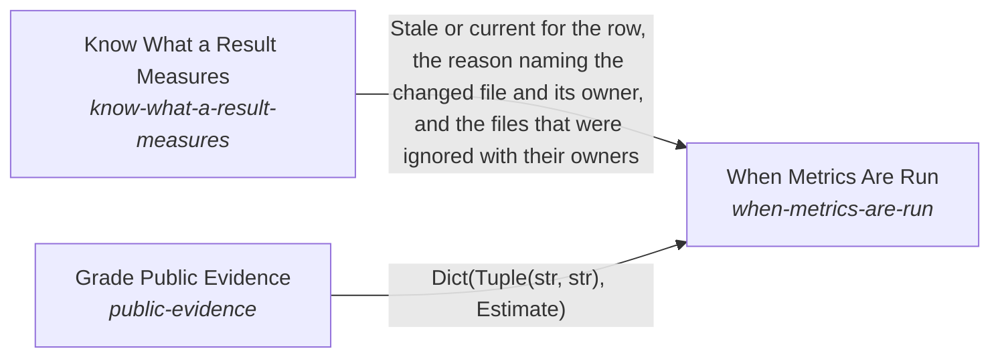

# When Metrics Are Run

**Purpose:** Decide when each metric is run, in what stages, with what limit, who approves the spend, and when its result stops counting.

Breadcrumb: [Top](../../../../../esoi/README.md) > [Implementations Chosen on Evidence](../README.md) > When Metrics Are Run

Part of [Implementations Chosen on Evidence](../README.md)

## When Metrics Are Run (`when-metrics-are-run`)

- Out of scope: How a metric is implemented; which alternative wins.
- Delegates to: measurement-harness, leaderboard
- Entry call: `esoi.run("when-metrics-are-run", '.')`
- Selected implementation: On a decision (`on-a-decision`)
- Metric: Decisions backed by current results
- Implemented by: [`.github/workflows/check.yml`](../../../../../.github/workflows/check.yml), [`implementations/python/esoi/optimization/when_metrics_are_run/interface.py`](interface.py), [`implementations/python/evaluation/components/know_stale_results/__init__.py`](../../../evaluation/components/know_stale_results/__init__.py), [`implementations/python/evaluation/components/know_stale_results/broken/__init__.py`](../../../evaluation/components/know_stale_results/broken/__init__.py), [`implementations/python/evaluation/components/know_stale_results/broken/never_stale.py`](../../../evaluation/components/know_stale_results/broken/never_stale.py), [`implementations/python/evaluation/components/know_stale_results/cases.json`](../../../evaluation/components/know_stale_results/cases.json), [`implementations/python/evaluation/components/know_stale_results/impls/__init__.py`](../../../evaluation/components/know_stale_results/impls/__init__.py), [`implementations/python/evaluation/components/know_stale_results/impls/live_checker.py`](../../../evaluation/components/know_stale_results/impls/live_checker.py) and 19 more

## One level below

- [Know What a Result Measures](know_what_a_result_measures/README.md) (solution with implementations): Tell, for one recorded result, whether the code, cases or circumstances it measures changed since its commit, and say which changed file and which component's ownership explains the answer.
- [Grade Public Evidence](public_evidence/README.md) (solution with implementations): Grade what others have measured about a candidate, so a measurement that costs money is made only when outside evidence cannot settle the question.

## Diagram

An arrow runs from the solution that provides to the solution that builds on it; its label is what the provider outputs.

## Implementations

| Implementation | Handle | Purpose | Code | Selected |
|---|---|---|---|---|
| On a decision | `when-metrics-are-run:on-a-decision` | Run a metric when a choice depends on its result: a new alternative, a selection change or a suspected regression. | [`implementations/python/esoi/optimization/when_metrics_are_run/interface.py`](interface.py) | selected |
| On every change | `when-metrics-are-run:on-every-change` | Run a metric whenever the measured code or its cases change. | no code yet |  |
| On a schedule | `when-metrics-are-run:on-a-schedule` | Run a metric at a fixed interval whatever changed. | no code yet |  |
| On drift | `when-metrics-are-run:on-drift` | Run a metric when a cheap probe or an announcement says the world moved. | no code yet |  |

## Metrics

- Decisions backed by current results (`metric-decisions-backed-by-current-results`): leader `live_checker`, 10 of 16 cases

## Problems

- Metrics run at the wrong time (`prob-metrics-run-at-the-wrong-time`): Results are stale when a choice depends on them, or paid runs happen with no decision behind them, so people either decide on numbers that no longer describe the code or stop running the metrics at all.

## Ideals

- Timely affordable evidence (`ideal-timely-affordable-evidence`): Every choice between alternatives is backed by a current result, and what it cost to get was proportionate to the choice and approved.

## Where to go next

- Up: [implementations/python/esoi](../../README.md)
- Intent: [Implementations Chosen on Evidence](../README.md)
- Down: [implementations/python/esoi/optimization/when_metrics_are_run/know_what_a_result_measures](know_what_a_result_measures/README.md)
- Down: [implementations/python/esoi/optimization/when_metrics_are_run/public_evidence](public_evidence/README.md)
- Repository: [top README](../../../../../README.md)

*Generated from the CSV files in this folder by `esoi readmes`. Edit the CSV files, not this page.*
