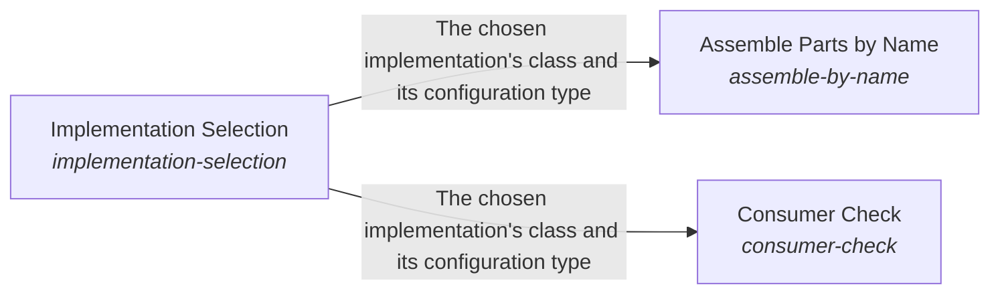

# ESOI Inside Other People's Running Code

Projects continuously use the best implementations without having to change what depends on them.

*ESOI records of this intent (evolvable structure that optimizes intent), generated from the CSV files beside this page by `esoi readmes`. Edit the CSV files, not this page.*

This sub-intent arises as the implementation `esoi-runtime:composition` of its parent intent [`esoi`](../../../../esoi/README.md). Opportunities: The Python package can become a runtime dependency inside other people's production code, not only a tool run on a repository: selection at run time, graceful declarations of alternatives (decorators, for example) and embedding without forking. That is a creative space beyond selecting an implementation from a table in one repository.

## How the solutions fit together

Runtime carries ESOI into other people's running programs. Implementation Selection serves each call with the declared implementation chosen by a per-call name, an override, the environment, the lock or the recorded default, and refuses an unknown name by listing the valid choices. Assemble Parts by Name builds whole programs from named parts in dependency order, choosing each part through Implementation Selection and checking what each part needs from its environment before it runs. Consumer Check lets a system built on the library show which library solution each of its parts serves and scores those parts with the library's cases, and it reads the pins that Implementation Selection keeps to show how far they trail the library.

## Diagram

An arrow runs from the solution that provides to the solution that builds on it; its label is what the provider outputs.

## Solutions at a glance

| Solution | Handle | Entry call | Selected implementation | Metric |
|---|---|---|---|---|
| Assemble Parts by Name | `assemble-by-name` | `esoi.run("assemble-by-name", 'structure-check')` | Dependency-ordered assembler (`assembler`) | Assembly by name cases |
| Consumer Check | `consumer-check` | `esoi.run("consumer-check", 'esoi')` | Consumer command (`consumer-command`) | Consumer soundness |
| Implementation Selection | `implementation-selection` | `esoi.run("implementation-selection", 'structure-check')` | Declarations in code (`declarations`) | Resolution correctness |

## Problems and ideals

**Problems**

- Swappable needs ceremony (`prob-swappable-needs-ceremony`): Making a part swappable takes a port class, a table entry with an import path for every alternative, a wrapper file to measure each one, and edits wherever the choice is made, so many parts are left fixed.
- Embedding soundness unknown (`prob-embedding-soundness-unknown`): A system builds on a library's solutions with its own stores and prompts, but cannot see which library solution each of its parts serves, whether its parts meet the library's own cases, or how far its pinned version lags.
- Selection default kept twice (`prob-selection-default-kept-twice`): The default implementation of a solution is written in the selection table and again in the records, and only a check holds the two equal.

**Ideals**

- Sound integration (`ideal-sound-integration`): A system built on a library meets the same standard as the library, through the library's own checks and cases.

## Metrics and their leaders

- Assembly by name cases (`metric-assemble-by-name`): leader `live_assembler`, 41 of 41 cases
- Consumer soundness (`metric-consumer-soundness`): leader `live_consumer_check`, 22 of 22 cases
- Resolution correctness (`metric-resolution-correctness`): leader `live_selector`, 32 of 32 cases

## Where to go next

- Parent intent: [Evolvable Structure that Optimizes Intent (ESOI)](../../../../esoi/README.md)
- Repository: [top README](../../../../README.md)
- Records beside the code: [implementations/python/esoi/runtime/assemble_by_name](assemble_by_name/README.md), [implementations/python/esoi/runtime/consumer_check](consumer_check/README.md), [implementations/python/esoi/runtime/implementation_selection](implementation_selection/README.md)
- Records: [intent.csv](intent.csv), [problems.csv](problems.csv)
- Diagram page: [diagram.md](diagram.md)

---

## The full record

### Problems

- Swappable needs ceremony (`prob-swappable-needs-ceremony`): Making a part swappable takes a port class, a table entry with an import path for every alternative, a wrapper file to measure each one, and edits wherever the choice is made, so many parts are left fixed.
- Embedding soundness unknown (`prob-embedding-soundness-unknown`): A system builds on a library's solutions with its own stores and prompts, but cannot see which library solution each of its parts serves, whether its parts meet the library's own cases, or how far its pinned version lags.
- Selection default kept twice (`prob-selection-default-kept-twice`): The default implementation of a solution is written in the selection table and again in the records, and only a check holds the two equal.

### Ideals

- Sound integration (`ideal-sound-integration`): A system built on a library meets the same standard as the library, through the library's own checks and cases.

### Solutions

| Solution | Handle | Selected | Metric |
|---|---|---|---|
| Assemble Parts by Name | `assemble-by-name` | Dependency-ordered assembler (`assembler`) | Assembly by name cases |
| Consumer Check | `consumer-check` | Consumer command (`consumer-command`) | Consumer soundness |
| Implementation Selection | `implementation-selection` | Declarations in code (`declarations`) | Resolution correctness |

### Implementations

| Implementation | Handle | Where | Sub-intent |
|---|---|---|---|
| Dependency-ordered assembler | `assemble-by-name:assembler` | [implementations/python/esoi/runtime/assemble_by_name/interface.py::AssemblerByName](assemble_by_name/interface.py) |  |
| Dependency injection container | `assemble-by-name:injection-container` |  |  |
| Consumer command | `consumer-check:consumer-command` | [implementations/python/esoi/runtime/consumer_check/interface.py::ConsumerCommand](consumer_check/interface.py) |  |
| Contract tests the consumer installs | `consumer-check:contract-test-plugin` |  |  |
| Declarations in code | `implementation-selection:declarations` | [implementations/python/esoi/runtime/implementation_selection/interface.py::Declarations](implementation_selection/interface.py) |  |
| Entry-point plugins | `implementation-selection:entry-point-plugins` |  |  |
| Selector class and table | `implementation-selection:select` | [implementations/python/esoi/runtime/implementation_selection/select.py](implementation_selection/select.py) |  |

### Metrics

- Assembly by name cases (`metric-assemble-by-name`): `esoi run assemble_by_name --impl live_assembler`
- Consumer soundness (`metric-consumer-soundness`): `esoi run check_a_consumer --impl live_consumer_check`
- Resolution correctness (`metric-resolution-correctness`): `esoi run select_an_implementation --impl live_selector`
