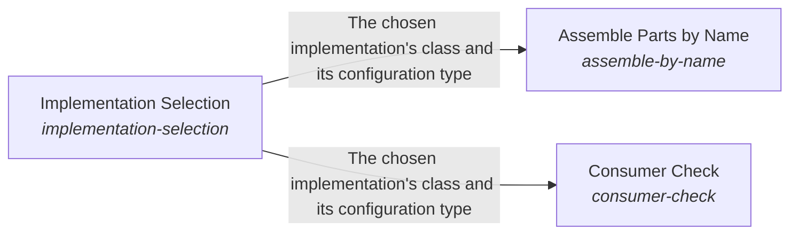

# Assemble Parts by Name

*ESOI records kept beside the code in `implementations/python/esoi/runtime/assemble_by_name`, generated from the CSV files in this folder by `esoi readmes`. Edit the CSV files, not this page.*

Projects continuously use the best implementations without having to change what depends on them.

These are the solutions of [ESOI Inside Other People's Running Code](../README.md).

## How the solutions fit together

Runtime carries ESOI into other people's running programs. Implementation Selection serves each call with the declared implementation chosen by a per-call name, an override, the environment, the lock or the recorded default, and refuses an unknown name by listing the valid choices. Assemble Parts by Name builds whole programs from named parts in dependency order, choosing each part through Implementation Selection and checking what each part needs from its environment before it runs. Consumer Check lets a system built on the library show which library solution each of its parts serves and scores those parts with the library's cases, and it reads the pins that Implementation Selection keeps to show how far they trail the library.

## Overview diagram

An arrow runs from the solution that provides to the solution that builds on it; its label is what the provider outputs.

## Assemble Parts by Name (`assemble-by-name`)

Build a program's parts from validated names in dependency order, so each part depends on a solution and never on one implementation, and check what each needs from its environment.

- Entry call: `esoi.run("assemble-by-name", 'structure-check')`
- Selected implementation: Dependency-ordered assembler (`assembler`)
- Metric: Assembly by name cases
- Implemented by: [`implementations/python/esoi/runtime/assemble_by_name/assemble.py`](assemble.py), [`implementations/python/esoi/runtime/assemble_by_name/hierarchy.py`](hierarchy.py), [`implementations/python/esoi/runtime/assemble_by_name/interface.py`](interface.py), [`implementations/python/esoi/runtime/consumer_check/follow.py`](../consumer_check/follow.py), [`implementations/python/esoi/runtime/implementation_selection/lock.py`](../implementation_selection/lock.py), [`implementations/python/esoi/structure/structure_check/rules/hierarchy_rules.py`](../../structure/structure_check/rules/hierarchy_rules.py), [`implementations/python/evaluation/components/assemble_by_name/__init__.py`](../../../evaluation/components/assemble_by_name/__init__.py), [`implementations/python/evaluation/components/assemble_by_name/broken/__init__.py`](../../../evaluation/components/assemble_by_name/broken/__init__.py) and 6 more

## Implementations

| Implementation | Handle | Code | Selected |
|---|---|---|---|
| Dependency-ordered assembler | `assemble-by-name:assembler` | [`implementations/python/esoi/runtime/assemble_by_name/interface.py`](interface.py) | selected |
| Dependency injection container | `assemble-by-name:injection-container` | no code yet |  |

## Metrics

- Assembly by name cases (`metric-assemble-by-name`): leader `live_assembler`, 41 of 41 cases

## Where to go next

- Up: [implementations/python/esoi](../../README.md)
- Intent: [ESOI Inside Other People's Running Code](../README.md)
- Repository: [top README](../../../../../README.md)
