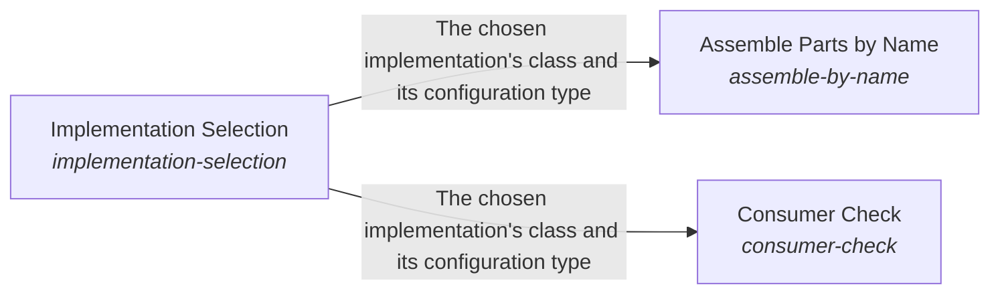

These are ESOI records rendered as a diagram (evolvable structure that optimizes intent). This page is generated from the solutions' outputs and the implementations' `uses_solution_ids` by `esoi diagram`; edit those records, not this page.

# Solution diagram: ESOI Inside Other People's Running Code

Runtime carries ESOI into other people's running programs. Implementation Selection serves each call with the declared implementation chosen by a per-call name, an override, the environment, the lock or the recorded default, and refuses an unknown name by listing the valid choices. Assemble Parts by Name builds whole programs from named parts in dependency order, choosing each part through Implementation Selection and checking what each part needs from its environment before it runs. Consumer Check lets a system built on the library show which library solution each of its parts serves and scores those parts with the library's cases, and it reads the pins that Implementation Selection keeps to show how far they trail the library.

An arrow runs from the solution that provides to the solution that builds on it; its label is what the provider outputs.

