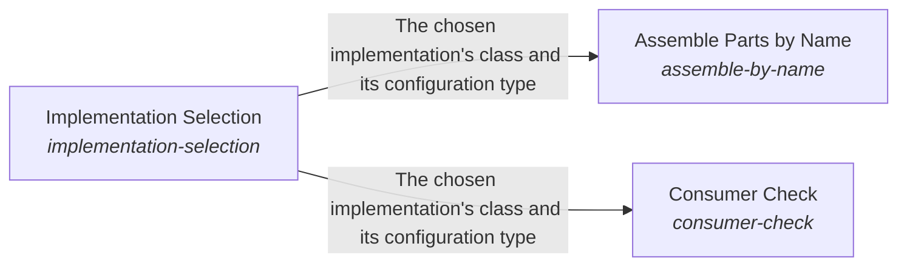

# Implementation Selection

*ESOI records kept beside the code in `implementations/python/esoi/runtime/implementation_selection`, generated from the CSV files in this folder by `esoi readmes`. Edit the CSV files, not this page.*

Projects continuously use the best implementations without having to change what depends on them.

These are the solutions of [ESOI Inside Other People's Running Code](../README.md).

## How the solutions fit together

Runtime carries ESOI into other people's running programs. Implementation Selection serves each call with the declared implementation chosen by a per-call name, an override, the environment, the lock or the recorded default, and refuses an unknown name by listing the valid choices. Assemble Parts by Name builds whole programs from named parts in dependency order, choosing each part through Implementation Selection and checking what each part needs from its environment before it runs. Consumer Check lets a system built on the library show which library solution each of its parts serves and scores those parts with the library's cases, and it reads the pins that Implementation Selection keeps to show how far they trail the library.

## Overview diagram

An arrow runs from the solution that provides to the solution that builds on it; its label is what the provider outputs.

## Implementation Selection (`implementation-selection`)

Choose which implementation serves a call, by a per-call name, an override, the environment, the lock or the recorded default, and refuse an unknown name by listing the valid choices.

- Entry call: `esoi.run("implementation-selection", 'structure-check')`
- Selected implementation: Declarations in code (`declarations`)
- Metric: Resolution correctness
- Implemented by: [`implementations/python/esoi/__main__.py`](../../__main__.py), [`implementations/python/esoi/esoi_selection.json`](../../esoi_selection.json), [`implementations/python/esoi/optimization/leaderboard/arm_kinds.py`](../../optimization/leaderboard/arm_kinds.py), [`implementations/python/esoi/optimization/leaderboard/arm_selection.py`](../../optimization/leaderboard/arm_selection.py), [`implementations/python/esoi/optimization/leaderboard/board_report.py`](../../optimization/leaderboard/board_report.py), [`implementations/python/esoi/optimization/leaderboard/cascade_report.py`](../../optimization/leaderboard/cascade_report.py), [`implementations/python/esoi/optimization/leaderboard/cascade_stages.py`](../../optimization/leaderboard/cascade_stages.py), [`implementations/python/esoi/optimization/leaderboard/case_identity.py`](../../optimization/leaderboard/case_identity.py) and 71 more

## Implementations

| Implementation | Handle | Code | Selected |
|---|---|---|---|
| Declarations in code | `implementation-selection:declarations` | [`implementations/python/esoi/runtime/implementation_selection/interface.py`](interface.py) | selected |
| Entry-point plugins | `implementation-selection:entry-point-plugins` | no code yet |  |
| Selector class and table | `implementation-selection:select` | [`implementations/python/esoi/runtime/implementation_selection/select.py`](select.py) |  |

## Metrics

- Resolution correctness (`metric-resolution-correctness`): leader `live_selector`, 32 of 32 cases

## Problems

- Selection default kept twice (`prob-selection-default-kept-twice`): The default implementation of a solution is written in the selection table and again in the records, and only a check holds the two equal.

## Where to go next

- Up: [implementations/python/esoi](../../README.md)
- Intent: [ESOI Inside Other People's Running Code](../README.md)
- Repository: [top README](../../../../../README.md)
