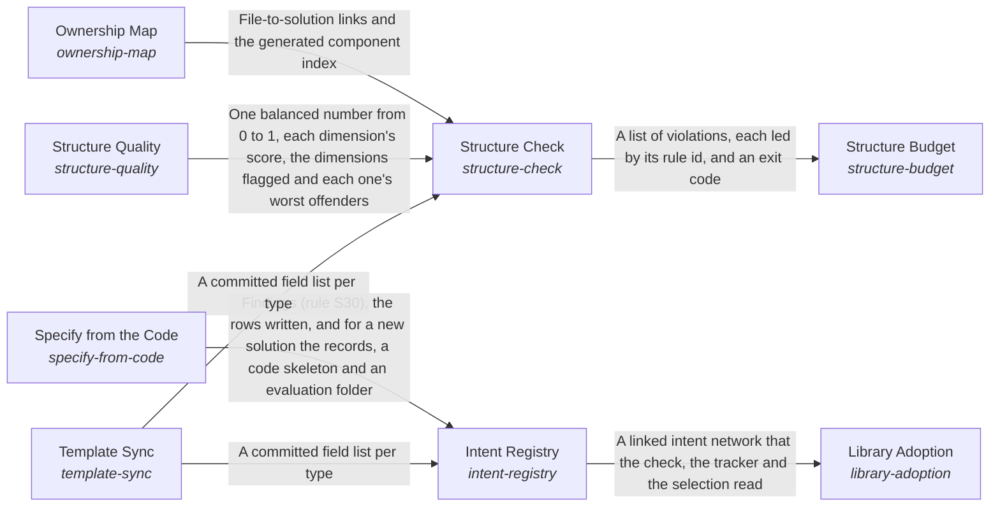

# A Project's Records and Code as One Structure

**Vision statement:** A project's structure enables the continuous evolution of interdependent parts to optimize its intent.

Breadcrumb: [Top](../../../../esoi/README.md) > A Project's Records and Code as One Structure

This sub-intent arises as the implementation `esoi-structure:composition` of its parent intent [`esoi`](../../../../esoi/README.md). Opportunities: The structure can keep itself in any language (records beside the code, rules that prune themselves, a template refinement that reaches every record), so adopting ESOI costs a repository less each year it is used. This creative space goes beyond one repository's layout and is what the ideal Self-evolving structure names.

## How the solutions fit together

Structure keeps a project's records and code one true and lean whole. The Intent Registry holds every problem, solution, implementation, ideal and metric as linked records beside the code they describe. It takes its fields from the author's template through Template Sync and fills the rows the code already declares through Specify from the Code, leaving a person's words untouched. The Ownership Map ties every file to the solution it serves, so code that serves nothing has nowhere to hide. Structure Check runs every rule on each change, reading the files the Ownership Map assigns and the fields Template Sync reads from the template, and reports each finding by rule and path with the next action. Structure Check also hands the code and records to Structure Quality, which scores how well the work is divided into solutions (one job each, small and simple parts, connections only through declared entry points or the project's shared kernel, no copied code, a used public surface, behavior kept) as one balanced number with the worst offenders named, and Structure Check reports each part that scores low as an advisory finding. Library Adoption lets a repository refer to a solution another library's records define instead of copying them, resolving each reference through the Intent Registry's records so no job is described twice. Structure Budget weighs what the rules that Structure Check runs cost each change against the real mistakes they catch, admits a new rule only with the mistake that justifies it, and prunes what stops paying.

## Diagram

An arrow runs from the solution that provides to the solution that builds on it; its label is what the provider outputs.

## One level below

This intent is implemented by the sub-intents and solutions below it; each shows whether it goes deeper.

- [Intent Registry](intent_registry/README.md) (solution with implementations and parts below it): Record every problem, solution, implementation, ideal and metric of a project as linked records that people and checks both read.
- [Library Adoption](library_adoption/README.md) (solution with implementations): Let a repository refer to a solution that another library's records define, and tell the adopted, the specialized and its own solutions apart, so no job is described twice.
- [Ownership Map](ownership_map/README.md) (solution with implementations): Assign every file to exactly one component and every component to the solutions it serves, so code with no purpose cannot hide.
- [Structure Budget](structure_budget/README.md) (solution with implementations): Keep the structure's own cost in view: admit a rule, record or sub-intent only with what it prevents, and prune what stops paying.
- [Structure Check](structure_check/README.md) (solution with implementations): Run every structural rule on each change and report each finding by rule and path with its next action, quickly enough that nobody skips it.
- [Structure Quality](structure_quality/README.md) (solution with implementations): Measure how well a project divides its work into solutions and parts, as one balanced number with the worst offenders named, before and after code exists.

## Solutions at a glance

| Solution | Handle | Entry call | Selected implementation | Metric |
|---|---|---|---|---|
| Intent Registry | `intent-registry` | `esoi.run("intent-registry", '.')` | Records beside the code (`beside_code`) | Navigable records, Record completeness |
| Library Adoption | `library-adoption` | `esoi.run("library-adoption", '.')` | Reference column (`reference-column`) | Adoption clarity |
| Ownership Map | `ownership-map` | `esoi.run("ownership-map", '.')` | Component rows (`component-rows`) | Trace completeness |
| Structure Budget | `structure-budget` | `esoi.run("structure-budget", '.')` | Written weighing rule (`written-weighing-rule`) | Structure cost against catches |
| Structure Check | `structure-check` | `esoi.run("structure-check", '.')` | Rule script (`rule-script`) | Violation detection, Check dependability |
| Structure Quality | `structure-quality` | `esoi.run("structure-quality", 'docs')` | Balanced static scorer (`balanced_static`) | Structure quality agreement |
| Specify from the Code | `specify-from-code` | `esoi.run("specify-from-code", '.')` | Declarations read from the code, rows synced (`declarations-and-sync`) | Declaration sync |
| Template Sync | `template-sync` | `esoi.run("template-sync", '.')` | Template parser (`template-parser`) | Template agreement |

## Problems and ideals

**Problems**

- Purposeless, oversized code (`prob-purposeless-oversized-code`): Files that cannot be traced to a purpose stay because deleting them feels risky, and modules grow until they are too long to read whole (one adapter file reached thousands of lines).
- Specification far from the code (`prob-spec-far-from-code`): A person reading the code of a solution cannot find its specification without leaving the code tree: the records sit in a separate folder, a code folder carries no page that says what it is for, and a change to the code and to its spec happen in two places.
- Who reviewed a record is not recorded (`prob-review-not-recorded`): A record does not say whether a person reviewed it or the AI kept it, so a program that changes structure is told by its caller which records a person owns, and a record nobody told it about may be changed as if it were the AI's.
- Copies of a library's solutions in an application (`prob-copied-library-solutions`): An application that needs jobs a shared library already defines tends to copy the library's solution records into its own.
- Structure costs more than it returns (`prob-structure-costs-more-than-it-returns`): Every rule, record and check adds work to each change, and past a point contributors spend more time satisfying the structure than improving the code.
- Rules unjustified (`prob-rules-unjustified`): A rule is kept in code with no record of the mistake that justified it or of what it has caught since, so whether it still earns its place, or why its limit has its value, cannot be told without asking its author.
- Structure rules decay (`prob-structure-rules-decay`): Rules written in prose (where files go, which way imports point, what must be documented) are followed by whoever read them and broken by the next agent, and generated documents drift from what they describe.
- Scope and modularity drift (`prob-scope-and-modularity-drift`): Code and records that were divided well when written lose their shape as people and AI add to them: a package tree reached about a thousand files in one folder, a solution list of 74 records held 33 functions over 150 lines, a merge left a family of arms that define no method of their solution's interface, a library came to name its one consumer, and the same due-date arithmetic was written out in six places.
- Records copy the code (`prob-records-copy-the-code`): The records repeat what the code already says: which alternatives of a solution exist, the file each lives in, and an interface's signature.
- Template copies drift (`prob-template-copies-drift`): The intent template is being refined in the skill, and every registry and checker that copied its fields falls out of date.

**Ideals**

- Purposeful code (`ideal-purposeful-code`): Nothing exists that serves no solution, and every part is small enough to understand in one reading.
- Navigable records (`ideal-navigable-records`): A person opening a code folder finds the specification of what it holds beside it, and a person opening a specification finds its code one folder away.
- An application's records say only what is its own (`ideal-own-records-only`): An application's records describe what only the application has, and a reader sees at once which jobs it borrows from a library and which it defines.
- Proportionate structure (`ideal-proportionate-structure`): The structure costs less than it returns, and a small change carries a small cost.
- Rules earn their place (`ideal-rules-earn-their-place`): Every rule can say which mistake it prevents, and is removed when it stops catching any.
- Self-evolving structure (`ideal-self-evolving-structure`): The structure notices where it falls short and improves itself at the moment a change makes it worse.
- Well-divided work (`ideal-well-divided-work`): Each solution has one job, each part is small enough to read whole, and parts connect only through what they declare.
- Living template (`ideal-living-template`): When the template's author refines it, every record and every tool that reads records follows.

## Metrics and their leaders

- Record completeness (`metric-record-completeness`): leader `live_checker`, 11 of 14 cases
- Navigable records (`metric-navigable-records`): leader `beside_code`, 23 of 50 cases
- Adoption clarity (`metric-adoption-clarity`)
- Trace completeness (`metric-trace-completeness`): leader `live_checker`, 16 of 16 cases
- Structure cost against catches (`metric-structure-cost-against-catches`)
- Violation detection (`metric-violation-detection`): leader `live_checker`, 76 of 76 cases
- Check dependability (`metric-check-dependability`): leader `live_checker`, 76 of 76 cases
- Structure quality agreement (`metric-structure-quality-agreement`): leader `balanced_static`, 49 of 49 cases
- Declaration sync (`metric-declaration-sync`): leader `live_declarations`, 14 of 14 cases
- Template agreement (`metric-template-agreement`): leader `live_parser`, 11 of 11 cases

## Where to go next

- Parent intent: [Evolvable Structure that Optimizes Intent (ESOI)](../../../../esoi/README.md)
- Repository: [top README](../../../../README.md)
- Records beside the code: [implementations/python/esoi/structure/intent_registry](intent_registry/README.md), [implementations/python/esoi/structure/library_adoption](library_adoption/README.md), [implementations/python/esoi/structure/ownership_map](ownership_map/README.md), [implementations/python/esoi/structure/structure_budget](structure_budget/README.md), [implementations/python/esoi/structure/structure_check](structure_check/README.md), [implementations/python/esoi/structure/structure_quality](structure_quality/README.md), [implementations/python/esoi/structure/intent_registry/specify_from_code](intent_registry/specify_from_code/README.md), [implementations/python/esoi/structure/intent_registry/template_sync](intent_registry/template_sync/README.md)
- Records: [intent.csv](intent.csv), [problems.csv](problems.csv), [ideals.csv](ideals.csv)
- Diagram page: [diagram.md](diagram.md)

---

## The full record

### Problems

- Purposeless, oversized code (`prob-purposeless-oversized-code`): Files that cannot be traced to a purpose stay because deleting them feels risky, and modules grow until they are too long to read whole (one adapter file reached thousands of lines).
- Specification far from the code (`prob-spec-far-from-code`): A person reading the code of a solution cannot find its specification without leaving the code tree: the records sit in a separate folder, a code folder carries no page that says what it is for, and a change to the code and to its spec happen in two places.
- Who reviewed a record is not recorded (`prob-review-not-recorded`): A record does not say whether a person reviewed it or the AI kept it, so a program that changes structure is told by its caller which records a person owns, and a record nobody told it about may be changed as if it were the AI's.
- Copies of a library's solutions in an application (`prob-copied-library-solutions`): An application that needs jobs a shared library already defines tends to copy the library's solution records into its own.
- Structure costs more than it returns (`prob-structure-costs-more-than-it-returns`): Every rule, record and check adds work to each change, and past a point contributors spend more time satisfying the structure than improving the code.
- Rules unjustified (`prob-rules-unjustified`): A rule is kept in code with no record of the mistake that justified it or of what it has caught since, so whether it still earns its place, or why its limit has its value, cannot be told without asking its author.
- Structure rules decay (`prob-structure-rules-decay`): Rules written in prose (where files go, which way imports point, what must be documented) are followed by whoever read them and broken by the next agent, and generated documents drift from what they describe.
- Scope and modularity drift (`prob-scope-and-modularity-drift`): Code and records that were divided well when written lose their shape as people and AI add to them: a package tree reached about a thousand files in one folder, a solution list of 74 records held 33 functions over 150 lines, a merge left a family of arms that define no method of their solution's interface, a library came to name its one consumer, and the same due-date arithmetic was written out in six places.
- Records copy the code (`prob-records-copy-the-code`): The records repeat what the code already says: which alternatives of a solution exist, the file each lives in, and an interface's signature.
- Template copies drift (`prob-template-copies-drift`): The intent template is being refined in the skill, and every registry and checker that copied its fields falls out of date.

### Ideals

- Purposeful code (`ideal-purposeful-code`): Nothing exists that serves no solution, and every part is small enough to understand in one reading.
- Navigable records (`ideal-navigable-records`): A person opening a code folder finds the specification of what it holds beside it, and a person opening a specification finds its code one folder away.
- An application's records say only what is its own (`ideal-own-records-only`): An application's records describe what only the application has, and a reader sees at once which jobs it borrows from a library and which it defines.
- Proportionate structure (`ideal-proportionate-structure`): The structure costs less than it returns, and a small change carries a small cost.
- Rules earn their place (`ideal-rules-earn-their-place`): Every rule can say which mistake it prevents, and is removed when it stops catching any.
- Self-evolving structure (`ideal-self-evolving-structure`): The structure notices where it falls short and improves itself at the moment a change makes it worse.
- Well-divided work (`ideal-well-divided-work`): Each solution has one job, each part is small enough to read whole, and parts connect only through what they declare.
- Living template (`ideal-living-template`): When the template's author refines it, every record and every tool that reads records follows.

### Solutions

| Solution | Handle | Selected | Metric |
|---|---|---|---|
| Intent Registry | `intent-registry` | Records beside the code (`beside_code`) | Navigable records, Record completeness |
| Library Adoption | `library-adoption` | Reference column (`reference-column`) | Adoption clarity |
| Ownership Map | `ownership-map` | Component rows (`component-rows`) | Trace completeness |
| Structure Budget | `structure-budget` | Written weighing rule (`written-weighing-rule`) | Structure cost against catches |
| Structure Check | `structure-check` | Rule script (`rule-script`) | Violation detection, Check dependability |
| Structure Quality | `structure-quality` | Balanced static scorer (`balanced_static`) | Structure quality agreement |
| Specify from the Code | `specify-from-code` | Declarations read from the code, rows synced (`declarations-and-sync`) | Declaration sync |
| Template Sync | `template-sync` | Template parser (`template-parser`) | Template agreement |

### Implementations

| Implementation | Handle | Where | Sub-intent |
|---|---|---|---|
| Records in the esoi folder | `intent-registry:esoi_folder` | [implementations/python/esoi/structure/intent_registry/interface.py::CsvRecords](intent_registry/interface.py) |  |
| Records beside the code | `intent-registry:beside_code` | [implementations/python/esoi/structure/intent_registry/interface.py::BesideCodeRecords](intent_registry/interface.py) |  |
| Sheet as source | `intent-registry:sheet-as-source` |  |  |
| Reference column | `library-adoption:reference-column` | [implementations/python/esoi/structure/library_adoption/interface.py::ReferenceColumn](library_adoption/interface.py) |  |
| Copied records | `library-adoption:copied-records` |  |  |
| Component rows | `ownership-map:component-rows` | [implementations/python/esoi/structure/ownership_map/interface.py::ComponentRows](ownership_map/interface.py) |  |
| Ownership inferred from imports and declarations | `ownership-map:inferred-from-imports` |  |  |
| Written weighing rule | `structure-budget:written-weighing-rule` | [implementations/python/esoi/structure/structure_budget/interface.py::WrittenWeighingRule](structure_budget/interface.py) |  |
| Measured cost and catches | `structure-budget:measured-cost-and-catches` |  |  |
| Rule script | `structure-check:rule-script` | [implementations/python/esoi/structure/structure_check/interface.py::RuleScript](structure_check/interface.py) |  |
| Rules as linter plugins | `structure-check:linter-plugins` |  |  |
| Rules in prose | `structure-check:prose-rules` |  |  |
| Balanced static scorer | `structure-quality:balanced_static` | [implementations/python/esoi/structure/structure_quality/interface.py::BalancedStatic](structure_quality/interface.py) |  |
| File size only | `structure-quality:file_size_only` | [implementations/python/esoi/structure/structure_quality/interface.py::FileSizeOnly](structure_quality/interface.py) |  |
| Expert scoping review | `structure-quality:expert_review` | [implementations/python/esoi/structure/structure_quality/interface.py::ExpertScopingReview](structure_quality/interface.py) |  |
| Declarations read from the code, rows synced | `specify-from-code:declarations-and-sync` | [implementations/python/esoi/structure/intent_registry/specify_from_code/interface.py::DeclarationsAndSync](intent_registry/specify_from_code/interface.py) |  |
| Records kept by hand | `specify-from-code:hand-kept-records` |  |  |
| Template parser | `template-sync:template-parser` | [implementations/python/esoi/structure/intent_registry/template_sync/interface.py::TemplateParser](intent_registry/template_sync/interface.py) |  |
| Hand-kept field list | `template-sync:hand-kept-field-list` |  |  |

### Metrics

- Record completeness (`metric-record-completeness`): `esoi run record_intent --impl live_checker`
- Navigable records (`metric-navigable-records`): `esoi run navigable_records --impl beside_code; esoi run navigable_records --impl esoi_folder`
- Adoption clarity (`metric-adoption-clarity`): `none`
- Trace completeness (`metric-trace-completeness`): `esoi run own_every_file --impl live_checker`
- Structure cost against catches (`metric-structure-cost-against-catches`): `none`
- Violation detection (`metric-violation-detection`): `esoi run check_the_structure --impl live_checker`
- Check dependability (`metric-check-dependability`): `esoi run check_the_structure --impl live_checker`
- Structure quality agreement (`metric-structure-quality-agreement`): `esoi run score_structure_quality --impl balanced_static; esoi run score_structure_quality --impl file_size_only; esoi run score_structure_quality --impl expert_review`
- Declaration sync (`metric-declaration-sync`): `esoi run specify_from_code --impl live_declarations`
- Template agreement (`metric-template-agreement`): `esoi run sync_the_template --impl live_parser`

*Generated from the CSV files beside this page by `esoi readmes`. Edit the CSV files, not this page.*
