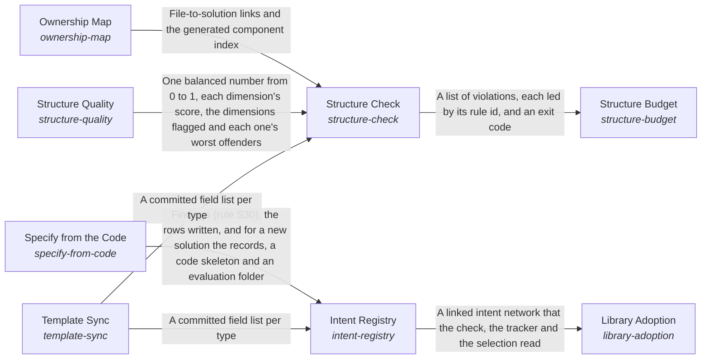

These are ESOI records rendered as a diagram (evolvable structure that optimizes intent). This page is generated from the solutions' outputs and the implementations' `uses_solution_ids` by `esoi diagram`; edit those records, not this page.

# Solution diagram: A Project's Records and Code as One Structure

Structure keeps a project's records and code one true and lean whole. The Intent Registry holds every problem, solution, implementation, ideal and metric as linked records beside the code they describe. It takes its fields from the author's template through Template Sync and fills the rows the code already declares through Specify from the Code, leaving a person's words untouched. The Ownership Map ties every file to the solution it serves, so code that serves nothing has nowhere to hide. Structure Check runs every rule on each change, reading the files the Ownership Map assigns and the fields Template Sync reads from the template, and reports each finding by rule and path with the next action. Structure Check also hands the code and records to Structure Quality, which scores how well the work is divided into solutions (one job each, small and simple parts, connections only through declared entry points or the project's shared kernel, no copied code, a used public surface, behavior kept) as one balanced number with the worst offenders named, and Structure Check reports each part that scores low as an advisory finding. Library Adoption lets a repository refer to a solution another library's records define instead of copying them, resolving each reference through the Intent Registry's records so no job is described twice. Structure Budget weighs what the rules that Structure Check runs cost each change against the real mistakes they catch, admits a new rule only with the mistake that justifies it, and prunes what stops paying.

An arrow runs from the solution that provides to the solution that builds on it; its label is what the provider outputs.

