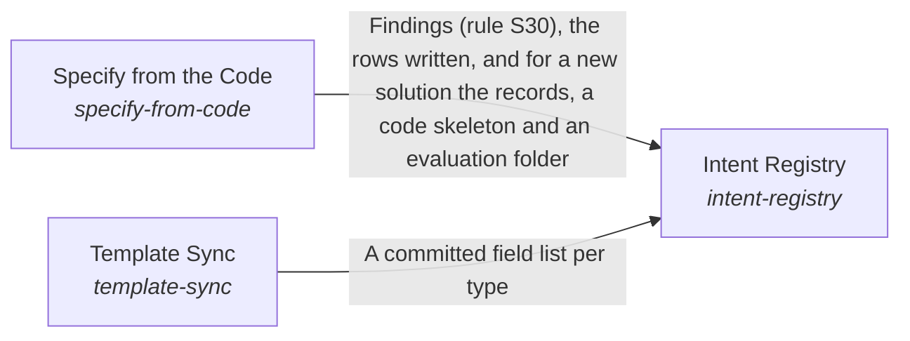

# Intent Registry

**Purpose:** Record every problem, solution, implementation, ideal and metric of a project as linked records that people and checks both read.

Breadcrumb: [Top](../../../../../esoi/README.md) > [A Project's Records and Code as One Structure](../README.md) > Intent Registry

Part of [A Project's Records and Code as One Structure](../README.md)

## Intent Registry (`intent-registry`)

- Out of scope: Measured results; pages for readers.
- Delegates to: measurement-harness, readable-records
- Entry call: `esoi.run("intent-registry", '.')`
- Selected implementation: Records beside the code (`beside_code`)
- Metric: Navigable records, Record completeness
- Implemented by: [`esoi/COMPONENTS.md`](../../../../../esoi/COMPONENTS.md), [`esoi/components.csv`](../../../../../esoi/components.csv), [`esoi/esoi_template.csv`](../../../../../esoi/esoi_template.csv), [`esoi/metric-run-policy.md`](../../../../../esoi/metric-run-policy.md), [`esoi/network.md`](../../../../../esoi/network.md), [`esoi/standards/naming.md`](../../../../../esoi/standards/naming.md), [`esoi/standards/no-em-dash.md`](../../../../../esoi/standards/no-em-dash.md), [`esoi/standards/restructure-by-structure-quality.md`](../../../../../esoi/standards/restructure-by-structure-quality.md) and 71 more

## One level below

- [Specify from the Code](specify_from_code/README.md) (solution with implementations): Keep the records of a solution and its alternatives in step with the code that declares them, and create a new solution in one command.
- [Template Sync](template_sync/README.md) (solution with implementations): Derive the registry's fields from the intent template in the skill so the author's wording stays the single definition.

## Diagram

An arrow runs from the solution that provides to the solution that builds on it; its label is what the provider outputs.

## Implementations

| Implementation | Handle | Purpose | Code | Selected |
|---|---|---|---|---|
| Records in the esoi folder | `intent-registry:esoi_folder` | Every record of the top intent in one CSV per type under the project's `esoi/` folder, edited by hand and read by the check, the tracker and the selection; a sub-intent is a folder of its own inside it. | [`implementations/python/esoi/structure/intent_registry/interface.py`](interface.py) |  |
| Records beside the code | `intent-registry:beside_code` | Each solution's records live once, in the folder that holds its code (the lowest folder that holds all of its implementations), next to that code; the folders are named in `[records] beside_code` in esoi.toml, the library reads them as part of the same tree, and each folder gets a generated README. The top intent stays in `esoi/` with its intent.csv; a sub-intent is a folder with its own intent.csv beside its code. `esoi records place` moves the records there. | [`implementations/python/esoi/structure/intent_registry/interface.py`](interface.py) | selected |
| Sheet as source | `intent-registry:sheet-as-source` | The Google Sheet holds the records and the repository pulls a copy. | no code yet |  |

## Metrics

- Record completeness (`metric-record-completeness`): leader `live_checker`, 11 of 14 cases
- Navigable records (`metric-navigable-records`): leader `beside_code`, 23 of 50 cases

## Problems

- Specification far from the code (`prob-spec-far-from-code`): A person reading the code of a solution cannot find its specification without leaving the code tree: the records sit in a separate folder, a code folder carries no page that says what it is for, and a change to the code and to its spec happen in two places.

## Ideals

- Navigable records (`ideal-navigable-records`): A person opening a code folder finds the specification of what it holds beside it, and a person opening a specification finds its code one folder away.

## Where to go next

- Up: [implementations/python/esoi](../../README.md)
- Intent: [A Project's Records and Code as One Structure](../README.md)
- Down: [implementations/python/esoi/structure/intent_registry/specify_from_code](specify_from_code/README.md)
- Down: [implementations/python/esoi/structure/intent_registry/template_sync](template_sync/README.md)
- Repository: [top README](../../../../../README.md)

*Generated from the CSV files in this folder by `esoi readmes`. Edit the CSV files, not this page.*
