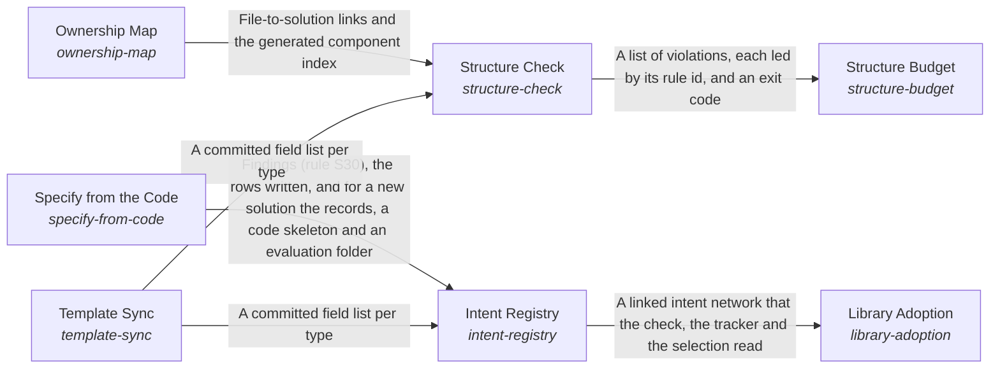

# Specify from the Code

*ESOI records kept beside the code in `implementations/python/esoi/structure/intent_registry/specify_from_code`, generated from the CSV files in this folder by `esoi readmes`. Edit the CSV files, not this page.*

A project's structure enables the continuous evolution of interdependent parts to optimize its intent.

These are the solutions of [A Project's Records and Code as One Structure](../../README.md).

## How the solutions fit together

Structure keeps a project's records and code one true and lean whole. The Intent Registry holds every problem, solution, implementation, ideal and metric as linked records beside the code they describe. It takes its fields from the author's template through Template Sync and fills the rows the code already declares through Specify from the Code, leaving a person's words untouched. The Ownership Map ties every file to the solution it serves, so code that serves nothing has nowhere to hide. Structure Check runs every rule on each change, reading the files the Ownership Map assigns and the fields Template Sync reads from the template, and reports each finding by rule and path with the next action. Library Adoption lets a repository refer to a solution another library's records define instead of copying them, resolving each reference through the Intent Registry's records so no job is described twice. Structure Budget weighs what the rules that Structure Check runs cost each change against the real mistakes they catch, admits a new rule only with the mistake that justifies it, and prunes what stops paying.

## Overview diagram

An arrow runs from the solution that provides to the solution that builds on it; its label is what the provider outputs.

## Specify from the Code (`specify-from-code`)

Keep the records of a solution and its alternatives in step with the code that declares them, and create a new solution in one command.

- Entry call: `esoi.run("specify-from-code", '.')`
- Selected implementation: Declarations read from the code, rows synced (`declarations-and-sync`)
- Metric: Declaration sync
- Implemented by: [`implementations/python/esoi/__main__.py`](../../../__main__.py), [`implementations/python/esoi/structure/intent_registry/admit.py`](../admit.py), [`implementations/python/esoi/structure/intent_registry/specify_from_code/declarations.py`](declarations.py), [`implementations/python/esoi/structure/intent_registry/specify_from_code/interface.py`](interface.py), [`implementations/python/esoi/structure/intent_registry/specify_from_code/newsolution.py`](newsolution.py), [`implementations/python/esoi/structure/structure_check/rules/declarations.py`](../../structure_check/rules/declarations.py), [`implementations/python/evaluation/components/assemble_fixture.py`](../../../../evaluation/components/assemble_fixture.py), [`implementations/python/evaluation/components/consumer_fixture.py`](../../../../evaluation/components/consumer_fixture.py) and 18 more

## Implementations

| Implementation | Handle | Code | Selected |
|---|---|---|---|
| Declarations read from the code, rows synced | `specify-from-code:declarations-and-sync` | [`implementations/python/esoi/structure/intent_registry/specify_from_code/interface.py`](interface.py) | selected |
| Records kept by hand | `specify-from-code:hand-kept-records` | no code yet |  |

## Metrics

- Declaration sync (`metric-declaration-sync`): leader `live_declarations`, 14 of 14 cases

## Problems

- Records copy the code (`prob-records-copy-the-code`): The records repeat what the code already says: which alternatives of a solution exist, the file each lives in, and an interface's signature.

## Where to go next

- Up: [implementations/python/esoi/structure/intent_registry](../README.md)
- Intent: [A Project's Records and Code as One Structure](../../README.md)
- Repository: [top README](../../../../../../README.md)
