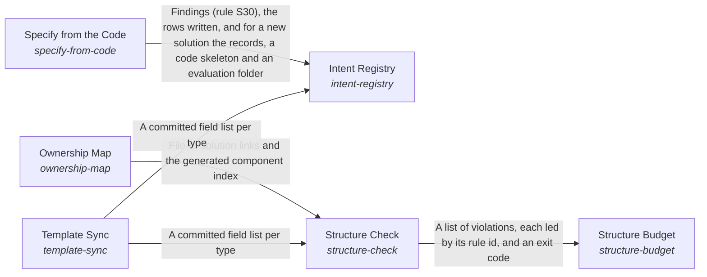

# Template Sync

*ESOI records kept beside the code in `implementations/python/esoi/structure/intent_registry/template_sync`, generated from the CSV files in this folder by `esoi readmes`. Edit the CSV files, not this page.*

A project's structure enables the continuous evolution of interdependent parts to optimize its intent.

These are the solutions of [A Project's Records and Code as One Structure](../../README.md).

## How the solutions fit together

Structure keeps a project's records and code one true and lean whole. The Intent Registry holds every problem, solution, implementation, ideal and metric as linked records beside the code they describe. It takes its fields from the author's template through Template Sync and fills the rows the code already declares through Specify from the Code, leaving a person's words untouched. The Ownership Map ties every file to the solution it serves, so code that serves nothing has nowhere to hide. Structure Check runs every rule on each change, reading the files the Ownership Map assigns and the fields Template Sync reads from the template, and reports each finding by rule and path with the next action. Structure Budget weighs what the rules that Structure Check runs cost each change against the real mistakes they catch, admits a new rule only with the mistake that justifies it, and prunes what stops paying.

## Overview diagram

An arrow runs from the solution that provides to the solution that builds on it; its label is what the provider outputs.

## Template Sync (`template-sync`)

Derive the registry's fields from the intent template in the skill so the author's wording stays the single definition.

- Entry call: `esoi.run("template-sync", '.')`
- Selected implementation: Template parser (`template-parser`)
- Metric: Template agreement
- Implemented by: [`implementations/python/esoi/__main__.py`](../../../__main__.py), [`implementations/python/esoi/data/esoi_template.csv`](../../../data/esoi_template.csv), [`implementations/python/esoi/data/skill_version.json`](../../../data/skill_version.json), [`implementations/python/esoi/structure/intent_registry/template_sync/interface.py`](interface.py), [`implementations/python/esoi/structure/intent_registry/template_sync/template.py`](template.py), [`implementations/python/esoi/structure/intent_registry/template_sync/templates.py`](templates.py), [`implementations/python/esoi/structure/intent_registry/template_sync/versioning.py`](versioning.py), [`implementations/python/esoi/structure/structure_check/rules/generated.py`](../../structure_check/rules/generated.py) and 9 more

## Implementations

| Implementation | Handle | Code | Selected |
|---|---|---|---|
| Template parser | `template-sync:template-parser` | [`implementations/python/esoi/structure/intent_registry/template_sync/interface.py`](interface.py) | selected |
| Hand-kept field list | `template-sync:hand-kept-field-list` | no code yet |  |

## Metrics

- Template agreement (`metric-template-agreement`): leader `live_parser`, 11 of 11 cases

## Problems

- Template copies drift (`prob-template-copies-drift`): The intent template is being refined in the skill, and every registry and checker that copied its fields falls out of date.

## Ideals

- Living template (`ideal-living-template`): When the template's author refines it, every record and every tool that reads records follows.

## Where to go next

- Up: [implementations/python/esoi/structure/intent_registry](../README.md)
- Intent: [A Project's Records and Code as One Structure](../../README.md)
- Repository: [top README](../../../../../../README.md)
