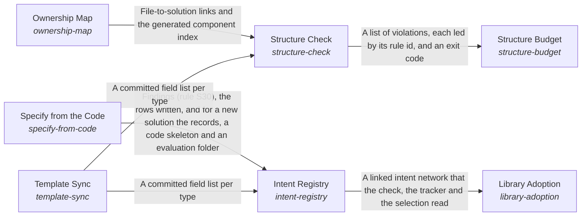

# Structure Budget

*ESOI records kept beside the code in `implementations/python/esoi/structure/structure_budget`, generated from the CSV files in this folder by `esoi readmes`. Edit the CSV files, not this page.*

A project's structure enables the continuous evolution of interdependent parts to optimize its intent.

These are the solutions of [A Project's Records and Code as One Structure](../README.md).

## How the solutions fit together

Structure keeps a project's records and code one true and lean whole. The Intent Registry holds every problem, solution, implementation, ideal and metric as linked records beside the code they describe. It takes its fields from the author's template through Template Sync and fills the rows the code already declares through Specify from the Code, leaving a person's words untouched. The Ownership Map ties every file to the solution it serves, so code that serves nothing has nowhere to hide. Structure Check runs every rule on each change, reading the files the Ownership Map assigns and the fields Template Sync reads from the template, and reports each finding by rule and path with the next action. Library Adoption lets a repository refer to a solution another library's records define instead of copying them, resolving each reference through the Intent Registry's records so no job is described twice. Structure Budget weighs what the rules that Structure Check runs cost each change against the real mistakes they catch, admits a new rule only with the mistake that justifies it, and prunes what stops paying.

## Overview diagram

An arrow runs from the solution that provides to the solution that builds on it; its label is what the provider outputs.

## Structure Budget (`structure-budget`)

Keep the structure's own cost in view: admit a rule, record or sub-intent only with what it prevents, and prune what stops paying.

- Entry call: `esoi.run("structure-budget", '.')`
- Selected implementation: Written weighing rule (`written-weighing-rule`)
- Metric: Structure cost against catches
- Implemented by: [`implementations/python/esoi/structure/structure_budget/interface.py`](interface.py)

## Implementations

| Implementation | Handle | Code | Selected |
|---|---|---|---|
| Written weighing rule | `structure-budget:written-weighing-rule` | [`implementations/python/esoi/structure/structure_budget/interface.py`](interface.py) | selected |
| Measured cost and catches | `structure-budget:measured-cost-and-catches` | no code yet |  |

## Metrics

- Structure cost against catches (`metric-structure-cost-against-catches`)

## Problems

- Structure costs more than it returns (`prob-structure-costs-more-than-it-returns`): Every rule, record and check adds work to each change, and past a point contributors spend more time satisfying the structure than improving the code.
- Rules unjustified (`prob-rules-unjustified`): A rule is kept in code with no record of the mistake that justified it or of what it has caught since, so whether it still earns its place, or why its limit has its value, cannot be told without asking its author.

## Ideals

- Proportionate structure (`ideal-proportionate-structure`): The structure costs less than it returns, and a small change carries a small cost.
- Rules earn their place (`ideal-rules-earn-their-place`): Every rule can say which mistake it prevents, and is removed when it stops catching any.

## Where to go next

- Up: [implementations/python/esoi](../../README.md)
- Intent: [A Project's Records and Code as One Structure](../README.md)
- Repository: [top README](../../../../../README.md)
