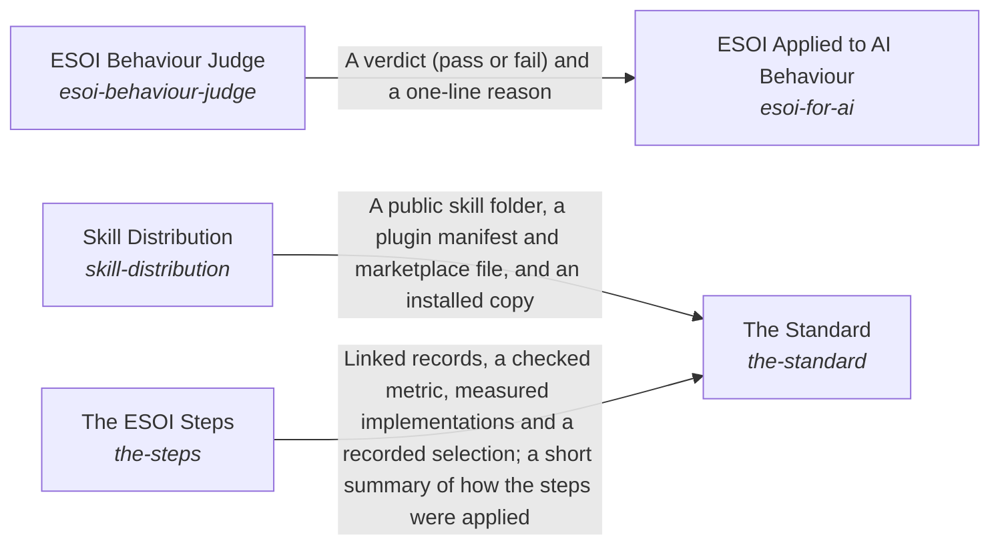

# How People and Agents Come to Apply ESOI

**Vision statement:** Documentation ensures that an intent is optimally carried out.

Breadcrumb: [Top](../../../../esoi/README.md) > How People and Agents Come to Apply ESOI

This sub-intent arises as the implementation `esoi-understanding:composition` of its parent intent [`esoi`](../../../../esoi/README.md). Opportunities: ESOI can be taught and guided in many media (documents, an installable skill, a questionnaire, standing instructions for agents, generated pages, a course) for people who never install the tools. This creative space goes beyond any one tool, and it is where every adopter first meets ESOI.

## How the solutions fit together

Understanding is how ESOI reaches the people and agents who apply it. The Standard teaches anyone how a solution is shaped and how a project adopts it, with templates to fill in by hand, and for the order of the work it relies on The ESOI Steps. The Standard also ships the author's skill through Skill Distribution, which publishes a complete public copy that cannot leak or go stale. ESOI Applied to AI Behaviour gives an agent the principles as standing instructions and measures, case by case, whether its replies act on them, asking the ESOI Behaviour Judge to grade what a pattern cannot settle. When a reader needs one part of a project, three parts help. Readable Records gives every intent folder a page made from its records. Spec Search finds the records and standards a request concerns. The Local ESOI Index says which projects apply ESOI and where to look first in each. The Review Tracker puts the whole intent network and its latest results in front of a reviewer and carries the reviewer's edits back to the records, so people steer by metrics without reading the code.

## Diagram

An arrow runs from the solution that provides to the solution that builds on it; its label is what the provider outputs.

## One level below

This intent is implemented by the sub-intents and solutions below it; each shows whether it goes deeper.

- [ESOI Applied to AI Behaviour](esoi_for_ai/README.md) (solution with implementations and parts below it): Make an AI agent act by the evolvable-structure principles when designing, building, writing and advising.
- [Local ESOI Index](local_application_index/README.md) (solution with implementations): Find which projects ESOI is applied to, how they relate and where to look first in each.
- [Readable Records](readable_records/README.md) (solution with implementations): Give every intent folder a page, made from its records, that says at a glance what the intent is and how its parts fit.
- [Review Tracker](review_tracker/README.md) (solution with implementations): Put the whole intent network and its current results in front of a reviewer, and carry their edits back to the records.
- [Spec Search](spec_search/README.md) (solution with implementations): Find the records, standards and product items that a request concerns, cheapest first, each with the records it links to.
- [The Standard](the_standard/README.md) (solution with implementations and parts below it): Teach anyone, person or AI, how a solution is shaped and how a project adopts it, with explanation and fill-in templates that need no code.

## Solutions at a glance

| Solution | Handle | Entry call | Selected implementation | Metric |
|---|---|---|---|---|
| ESOI Applied to AI Behaviour | `esoi-for-ai` | `esoi.run("esoi-for-ai", '.')` | Skill as standing instructions (`skill-as-standing-instructions`) | Behaviour adherence |
| Local ESOI Index | `local-application-index` | `esoi.run("local-application-index", '.')` | Index folder in the user's home (`live_index`) | Local index lookup cases |
| Readable Records | `readable-records` | `esoi.run("readable-records", '.')` | At a glance, full record below (`at_a_glance`) | README glanceability, README fidelity |
| Review Tracker | `review-tracker` | `esoi.run("review-tracker", '.')` | Tracker and sheet (`tracker-and-sheet`) | Review coverage |
| Spec Search | `spec-search` | `esoi.run("spec-search", ...)` | Lexical vector gated (`lexical-vector-gated`) | Spec search correctness, Specification recall at k |
| The Standard | `the-standard` | `esoi.run("the-standard", '.')` | Standard document (`standard-document`) | Adoption effort, Newcomer effort |
| ESOI Behaviour Judge | `esoi-behaviour-judge` | `esoi.run("esoi-behaviour-judge", '.')` | Model judge on the rubric (`model-judge-on-the-rubric`) | Judge agreement |
| Skill Distribution | `skill-distribution` | `esoi.run("skill-distribution", '.')` | Generated public copy (`generated-public-copy`) | Skill copy agreement and leaks |
| The ESOI Steps | `the-steps` | `esoi.run("the-steps", '.')` | The ESOI steps (`esoi-steps`) | Steps followed |

## Problems and ideals

**Problems**

- AI behaviour drifts from the principles (`prob-ai-behaviour-drifts-from-principles`): An AI agent asked to do work applies the principles inconsistently, and how often is rarely measured.
- Applied structure is rediscovered (`prob-applied-structure-is-rediscovered`): Where ESOI is already applied, how those projects relate and where to look in each is rediscovered in every session.
- Records unreadable at a glance (`prob-records-unreadable-at-a-glance`): An intent's folder of CSV files states it completely, but a person clicking into it cannot tell at a glance what the intent is for, how its solutions fit or where to go next: that takes opening several files and following ids between them.
- Review needs implementations (`prob-review-needs-implementations`): A person who wants to steer quality has to read implementations, because ideals, metrics and current results are not gathered anywhere they can read and correct.
- Specifications not found for new input (`prob-intent-specs-not-found-for-new-input`): A new use case or input arrives, and it is hard for a person or an AI to tell which of a project's problems, ideals, solutions, implementations and metrics apply without reading most of them.
- Specifications hard to search (`prob-spec-search`): A system that finds a repository's records for a request, or finds them together with its own notes or documents, rebuilds the same stages inside its own code: lexical scoring, a semantic search, rank fusion, a confidence gate, one judging call and the way a ranked record brings its links.
- Others cannot adopt (`prob-others-cannot-adopt`): There is no worked, checked example of evolvable structure in code, so each team that wants it designs its own from prose.
- Behaviour verdicts uncalibrated (`prob-behaviour-verdicts-uncalibrated`): A model that grades whether a reply acts by the principles can disagree with the people whose intent the principles express, can favour its own phrasing when it wrote the reply, and can pass a reply that uses the right words while doing the opposite.
- Skill cannot be reached safely (`prob-skill-cannot-be-reached-safely`): A person who wants to use the author's skill cannot get it in a form that is both complete and safe to publish.
- No order to follow (`prob-no-order-to-follow`): People who want to apply ESOI have the five record types and the principles but no order to follow.

**Ideals**

- Principled behaviour (`ideal-principled-behaviour`): An AI agent acts by the principles in its own work, including holding back where structure costs more than it returns, and keeps every qualifier when it restates one.
- Found structure (`ideal-found-structure`): Structure that already exists is found and reused instead of rediscovered.
- Glanceable intent (`ideal-glanceable-intent`): Anyone clicking into an intent folder sees on the first screen what the intent is, how its solutions fit together and where to go next.
- Right specification at the right time (`ideal-right-spec-at-the-right-time`): For any new use case or input, whoever applies a project's specifications works from the few that bear on it, at a small fraction of the cost of reading them all.
- Shared specification search (`ideal-spec-search`): An application that finds specifications for a request writes only what is its own, and every improvement to finding them reaches it without a change on its side.
- Adoptable structure (`ideal-adoptable-structure`): Another team can apply the same structure to its own code by following one standard and reusing this library's tools.
- Calibrated judging (`ideal-calibrated-judging`): A judge's verdicts agree with the human verdicts they stand in for, and where they disagree is known.
- Installable skill (`ideal-installable-skill`): A stranger gets the author's current skill, complete and public-safe, in one step, while the author keeps one source of truth.
- Followable process (`ideal-followable-process`): Anyone applying ESOI can follow one stated order from purpose to selection by metric, sized to the work, and knows where to return when something changes.

## Metrics and their leaders

- Behaviour adherence (`metric-esoi-behaviour-adherence`): leader `reference_good`, 52 of 52 cases
- Local index lookup cases (`metric-local-index-lookup`): leader `live_index`, 10 of 10 cases
- README fidelity (`metric-readme-fidelity`): leader `live_readme`, 10 of 10 cases
- README glanceability (`metric-readme-glanceability`): leader `at_a_glance`, 2 of 4 cases
- Review coverage (`metric-review-coverage`): leader `live_tracker`, 10 of 10 cases
- Specification recall at k (`metric-spec-index-recall`): leader `weighted_tfidf`, 31 of 35 cases
- Spec search correctness (`metric-spec-search`): leader `gated`, 6 of 6 cases
- Newcomer effort (`metric-docs-and-templates`)
- Judge agreement (`metric-esoi-judge-agreement`): leader `regex_only`, 100 of 100 cases
- Skill copy agreement and leaks (`metric-skill-copy-agreement`): leader `live_skill`, 26 of 26 cases
- and 1 more: all 11 are in [metrics](#metrics) of the full record below

## Where to go next

- Parent intent: [Evolvable Structure that Optimizes Intent (ESOI)](../../../../esoi/README.md)
- Repository: [top README](../../../../README.md)
- Records beside the code: [implementations/python/esoi/understanding/esoi_for_ai](esoi_for_ai/README.md), [implementations/python/esoi/understanding/local_application_index](local_application_index/README.md), [implementations/python/esoi/understanding/readable_records](readable_records/README.md), [implementations/python/esoi/understanding/review_tracker](review_tracker/README.md), [implementations/python/esoi/understanding/spec_search](spec_search/README.md), [implementations/python/esoi/understanding/the_standard](the_standard/README.md), [implementations/python/esoi/understanding/esoi_for_ai/esoi_behaviour_judge](esoi_for_ai/esoi_behaviour_judge/README.md), [implementations/python/esoi/understanding/the_standard/skill_distribution](the_standard/skill_distribution/README.md), [implementations/python/esoi/understanding/the_standard/the_steps](the_standard/the_steps/README.md)
- Records: [intent.csv](intent.csv)
- Diagram page: [diagram.md](diagram.md)

---

## The full record

### Problems

- AI behaviour drifts from the principles (`prob-ai-behaviour-drifts-from-principles`): An AI agent asked to do work applies the principles inconsistently, and how often is rarely measured.
- Applied structure is rediscovered (`prob-applied-structure-is-rediscovered`): Where ESOI is already applied, how those projects relate and where to look in each is rediscovered in every session.
- Records unreadable at a glance (`prob-records-unreadable-at-a-glance`): An intent's folder of CSV files states it completely, but a person clicking into it cannot tell at a glance what the intent is for, how its solutions fit or where to go next: that takes opening several files and following ids between them.
- Review needs implementations (`prob-review-needs-implementations`): A person who wants to steer quality has to read implementations, because ideals, metrics and current results are not gathered anywhere they can read and correct.
- Specifications not found for new input (`prob-intent-specs-not-found-for-new-input`): A new use case or input arrives, and it is hard for a person or an AI to tell which of a project's problems, ideals, solutions, implementations and metrics apply without reading most of them.
- Specifications hard to search (`prob-spec-search`): A system that finds a repository's records for a request, or finds them together with its own notes or documents, rebuilds the same stages inside its own code: lexical scoring, a semantic search, rank fusion, a confidence gate, one judging call and the way a ranked record brings its links.
- Others cannot adopt (`prob-others-cannot-adopt`): There is no worked, checked example of evolvable structure in code, so each team that wants it designs its own from prose.
- Behaviour verdicts uncalibrated (`prob-behaviour-verdicts-uncalibrated`): A model that grades whether a reply acts by the principles can disagree with the people whose intent the principles express, can favour its own phrasing when it wrote the reply, and can pass a reply that uses the right words while doing the opposite.
- Skill cannot be reached safely (`prob-skill-cannot-be-reached-safely`): A person who wants to use the author's skill cannot get it in a form that is both complete and safe to publish.
- No order to follow (`prob-no-order-to-follow`): People who want to apply ESOI have the five record types and the principles but no order to follow.

### Ideals

- Principled behaviour (`ideal-principled-behaviour`): An AI agent acts by the principles in its own work, including holding back where structure costs more than it returns, and keeps every qualifier when it restates one.
- Found structure (`ideal-found-structure`): Structure that already exists is found and reused instead of rediscovered.
- Glanceable intent (`ideal-glanceable-intent`): Anyone clicking into an intent folder sees on the first screen what the intent is, how its solutions fit together and where to go next.
- Right specification at the right time (`ideal-right-spec-at-the-right-time`): For any new use case or input, whoever applies a project's specifications works from the few that bear on it, at a small fraction of the cost of reading them all.
- Shared specification search (`ideal-spec-search`): An application that finds specifications for a request writes only what is its own, and every improvement to finding them reaches it without a change on its side.
- Adoptable structure (`ideal-adoptable-structure`): Another team can apply the same structure to its own code by following one standard and reusing this library's tools.
- Calibrated judging (`ideal-calibrated-judging`): A judge's verdicts agree with the human verdicts they stand in for, and where they disagree is known.
- Installable skill (`ideal-installable-skill`): A stranger gets the author's current skill, complete and public-safe, in one step, while the author keeps one source of truth.
- Followable process (`ideal-followable-process`): Anyone applying ESOI can follow one stated order from purpose to selection by metric, sized to the work, and knows where to return when something changes.

### Solutions

| Solution | Handle | Selected | Metric |
|---|---|---|---|
| ESOI Applied to AI Behaviour | `esoi-for-ai` | Skill as standing instructions (`skill-as-standing-instructions`) | Behaviour adherence |
| Local ESOI Index | `local-application-index` | Index folder in the user's home (`live_index`) | Local index lookup cases |
| Readable Records | `readable-records` | At a glance, full record below (`at_a_glance`) | README glanceability, README fidelity |
| Review Tracker | `review-tracker` | Tracker and sheet (`tracker-and-sheet`) | Review coverage |
| Spec Search | `spec-search` | Lexical vector gated (`lexical-vector-gated`) | Spec search correctness, Specification recall at k |
| The Standard | `the-standard` | Standard document (`standard-document`) | Adoption effort, Newcomer effort |
| ESOI Behaviour Judge | `esoi-behaviour-judge` | Model judge on the rubric (`model-judge-on-the-rubric`) | Judge agreement |
| Skill Distribution | `skill-distribution` | Generated public copy (`generated-public-copy`) | Skill copy agreement and leaks |
| The ESOI Steps | `the-steps` | The ESOI steps (`esoi-steps`) | Steps followed |

### Implementations

| Implementation | Handle | Where | Sub-intent |
|---|---|---|---|
| Skill as standing instructions | `esoi-for-ai:skill-as-standing-instructions` | [implementations/python/esoi/understanding/esoi_for_ai/interface.py::SkillAsStandingInstructions](esoi_for_ai/interface.py) |  |
| Skill on request | `esoi-for-ai:skill-on-request` | [implementations/python/evaluation/components/behave_by_esoi/impls/skill_on_request.py](../../evaluation/components/behave_by_esoi/impls/skill_on_request.py) |  |
| No skill | `esoi-for-ai:no-skill` | [implementations/python/evaluation/components/behave_by_esoi/impls/no_skill.py](../../evaluation/components/behave_by_esoi/impls/no_skill.py) |  |
| Perspective review | `esoi-for-ai:perspective-review` |  |  |
| Index folder in the user's home | `local-application-index:live_index` | [implementations/python/esoi/understanding/local_application_index/interface.py::LiveIndex](local_application_index/interface.py) |  |
| Routing rows in the skill's index | `local-application-index:skill_rows` | [implementations/python/evaluation/components/index_projects/impls/skill_rows.py](../../evaluation/components/index_projects/impls/skill_rows.py) |  |
| Each project's own records only | `local-application-index:records_only` | [implementations/python/evaluation/components/index_projects/impls/records_only.py](../../evaluation/components/index_projects/impls/records_only.py) |  |
| Record tables only | `readable-records:full_page` | [implementations/python/esoi/understanding/readable_records/interface.py::FullPageReadme](readable_records/interface.py) |  |
| At a glance, full record below | `readable-records:at_a_glance` | [implementations/python/esoi/understanding/readable_records/interface.py::AtAGlanceReadme](readable_records/interface.py) |  |
| Compact page of links | `readable-records:links_page` | [implementations/python/esoi/understanding/readable_records/interface.py::LinksPageReadme](readable_records/interface.py) |  |
| README written by hand | `readable-records:hand-written-readme` |  |  |
| Tracker and sheet | `review-tracker:tracker-and-sheet` | [implementations/python/esoi/understanding/review_tracker/interface.py::TrackerAndSheet](review_tracker/interface.py) |  |
| Review in the pull request | `review-tracker:pull-request-review` |  |  |
| Lexical only | `spec-search:lexical-only` | [implementations/python/esoi/understanding/spec_search/spec_search.py](spec_search/spec_search.py) |  |
| Lexical vector gated | `spec-search:lexical-vector-gated` | [implementations/python/esoi/understanding/spec_search/spec_search.py](spec_search/spec_search.py) |  |
| Field-weighted TF-IDF over the index | `spec-search:weighted-tfidf` | [implementations/python/esoi/understanding/spec_search/spec_index.py](spec_search/spec_index.py) |  |
| Plain term overlap | `spec-search:term-overlap` | [implementations/python/esoi/understanding/spec_search/spec_index.py](spec_search/spec_index.py) |  |
| Standard document | `the-standard:standard-document` | [implementations/python/esoi/understanding/the_standard/interface.py::StandardDocument](the_standard/interface.py) |  |
| Worked example repository | `the-standard:worked-example-repository` |  |  |
| Documentation folder | `the-standard:documentation-folder` | [implementations/python/esoi/understanding/the_standard/interface.py::DocumentationFolder](the_standard/interface.py) |  |
| Guided questionnaire | `the-standard:guided-questionnaire` |  |  |
| Model judge on the rubric | `esoi-behaviour-judge:model-judge-on-the-rubric` | [implementations/python/esoi/understanding/esoi_for_ai/esoi_behaviour_judge/interface.py::ModelJudgeOnTheRubric](esoi_for_ai/esoi_behaviour_judge/interface.py) |  |
| Regex checks only | `esoi-behaviour-judge:regex-checks-only` | [implementations/python/evaluation/components/judge_esoi_behaviour/impls/regex_only.py](../../evaluation/components/judge_esoi_behaviour/impls/regex_only.py) |  |
| Human review of every reply | `esoi-behaviour-judge:human-review-of-every-reply` |  |  |
| Generated public copy | `skill-distribution:generated-public-copy` | [implementations/python/esoi/understanding/the_standard/skill_distribution/interface.py::GeneratedPublicCopy](the_standard/skill_distribution/interface.py) |  |
| Hand-copied folder | `skill-distribution:hand-copied-folder` |  |  |
| Publish the private folder | `skill-distribution:publish-the-private-folder` |  |  |
| The ESOI steps | `the-steps:esoi-steps` | [implementations/python/esoi/understanding/the_standard/the_steps/interface.py::EsoiSteps](the_standard/the_steps/interface.py) |  |
| Project Documentation board checklist | `the-steps:board-checklist` |  |  |
| One-hour first pass | `the-steps:one-hour-pass` |  |  |
| No stated order | `the-steps:no-stated-order` |  |  |

### Metrics

- Behaviour adherence (`metric-esoi-behaviour-adherence`): `esoi run behave_by_esoi --impl standing_instructions`
- Local index lookup cases (`metric-local-index-lookup`): `esoi run index_projects --impl live_index; esoi run index_projects --impl skill_rows; esoi run index_projects --impl records_only`
- README fidelity (`metric-readme-fidelity`): `esoi run readable_records --impl live_readme`
- README glanceability (`metric-readme-glanceability`): `esoi run readme_at_a_glance --impl at_a_glance; esoi run readme_at_a_glance --impl full_page; esoi run readme_at_a_glance --impl links_page`
- Review coverage (`metric-review-coverage`): `esoi run review_tracker --impl live_tracker`
- Specification recall at k (`metric-spec-index-recall`): `esoi run spec_index --impl weighted_tfidf; esoi run spec_index --impl term_overlap`
- Spec search correctness (`metric-spec-search`): `esoi run spec_search --impl gated; esoi run spec_search --impl lexical_only`
- Newcomer effort (`metric-docs-and-templates`): `none`
- Judge agreement (`metric-esoi-judge-agreement`): `esoi run judge_esoi_behaviour --impl model_judge`
- Skill copy agreement and leaks (`metric-skill-copy-agreement`): `esoi run sync_the_skill --impl live_skill`
- Steps followed (`metric-steps-followed`): `none`

*Generated from the CSV files beside this page by `esoi readmes`. Edit the CSV files, not this page.*
