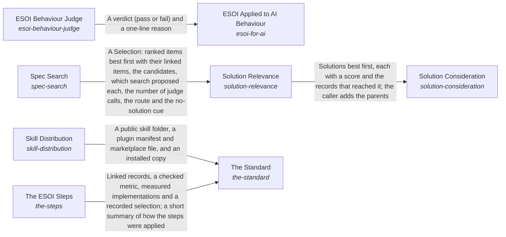

These are ESOI records rendered as a diagram (evolvable structure that optimizes intent). This page is generated from the solutions' outputs and the implementations' `uses_solution_ids` by `esoi diagram`; edit those records, not this page.

# Solution diagram: How People and Agents Come to Apply ESOI

Understanding is how ESOI reaches the people and agents who apply it. The Standard teaches anyone how a solution is shaped and how a project adopts it, with templates to fill in by hand, and for the order of the work it relies on The ESOI Steps. The Standard also ships the author's skill through Skill Distribution, which publishes a complete public copy that cannot leak or go stale. ESOI Applied to AI Behaviour gives an agent the principles as standing instructions and measures, case by case, whether its replies act on them, asking the ESOI Behaviour Judge to grade what a pattern cannot settle. When a reader needs one part of a project, three parts help. Readable Records gives every intent folder a page made from its records. Spec Search finds the records and standards a request concerns. The Local ESOI Index says which projects apply ESOI and where to look first in each. When a matter concerns several solutions, Solution Consideration forms one prompt per solution and per parent level from the records each connects to, so every solution gets its own consideration. Solution Consideration asks Solution Relevance which solutions a matter concerns, and Solution Relevance ranks them with the records Spec Search finds. The Review Tracker puts the whole intent network and its latest results in front of a reviewer and carries the reviewer's edits back to the records, so people steer by metrics without reading the code.

An arrow runs from the solution that provides to the solution that builds on it; its label is what the provider outputs.

