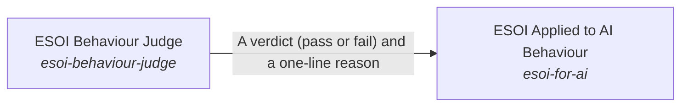

# ESOI Applied to AI Behaviour

**Purpose:** Make an AI agent act by the evolvable-structure principles when designing, building, writing and advising.

Breadcrumb: [Top](../../../../../esoi/README.md) > [How People and Agents Come to Apply ESOI](../README.md) > ESOI Applied to AI Behaviour

Part of [How People and Agents Come to Apply ESOI](../README.md)

## ESOI Applied to AI Behaviour (`esoi-for-ai`)

- Out of scope: Teaching people; finding which records or standards bear on a task; general agent ability.
- Delegates to: the-standard, spec-search
- Entry call: `esoi.run("esoi-for-ai", '.')`
- Selected implementation: Skill as standing instructions (`skill-as-standing-instructions`)
- Metric: Behaviour adherence
- Implemented by: [`.claude-plugin/marketplace.json`](../../../../../.claude-plugin/marketplace.json), [`implementations/python/esoi/data/skill/evolvable-structure/INDEX.md`](../../data/skill/evolvable-structure/INDEX.md), [`implementations/python/esoi/data/skill/evolvable-structure/SKILL.md`](../../data/skill/evolvable-structure/SKILL.md), [`implementations/python/esoi/data/skill/evolvable-structure/coding.md`](../../data/skill/evolvable-structure/coding.md), [`implementations/python/esoi/data/skill/evolvable-structure/coding/components.md`](../../data/skill/evolvable-structure/coding/components.md), [`implementations/python/esoi/data/skill/evolvable-structure/coding/concept_ai_quest_qar.md`](../../data/skill/evolvable-structure/coding/concept_ai_quest_qar.md), [`implementations/python/esoi/data/skill/evolvable-structure/coding/pipelines_and_experiments.md`](../../data/skill/evolvable-structure/coding/pipelines_and_experiments.md), [`implementations/python/esoi/data/skill/evolvable-structure/coding/registry_and_templates.md`](../../data/skill/evolvable-structure/coding/registry_and_templates.md) and 85 more

## One level below

- [ESOI Behaviour Judge](esoi_behaviour_judge/README.md) (solution with implementations): Grade whether one reply acts by the principles when a pattern match cannot tell, and show how far the grading agrees with people.

## Diagram

An arrow runs from the solution that provides to the solution that builds on it; its label is what the provider outputs.

## Implementations

| Implementation | Handle | Purpose | Code | Selected |
|---|---|---|---|---|
| Skill as standing instructions | `esoi-for-ai:skill-as-standing-instructions` | The author's skill is loaded as the system text of every session, so the agent reads the principles before any task and ends its work with a short summary of how it applied them. | [`implementations/python/esoi/understanding/esoi_for_ai/interface.py`](interface.py) | selected |
| Skill on request | `esoi-for-ai:skill-on-request` | The agent sees only the skill's name and description and loads the full text when it judges that the task is about design, reuse or how it should behave; the measurement includes that loading decision. | [`implementations/python/evaluation/components/behave_by_esoi/impls/skill_on_request.py`](../../../evaluation/components/behave_by_esoi/impls/skill_on_request.py) |  |
| No skill | `esoi-for-ai:no-skill` | The agent works from its general training and the person's corrections in conversation; measured with the same model and a plain assistant instruction, so what the skill adds is a number. | [`implementations/python/evaluation/components/behave_by_esoi/impls/no_skill.py`](../../../evaluation/components/behave_by_esoi/impls/no_skill.py) |  |
| Perspective review | `esoi-for-ai:perspective-review` | After drafting, the agent asks named perspectives, each an implementation of what good looks like, to review the draft against the principles, and revises it. | no code yet |  |

## Metrics

- Behaviour adherence (`metric-esoi-behaviour-adherence`): leader `reference_good`, 52 of 52 cases

## Problems

- AI behaviour drifts from the principles (`prob-ai-behaviour-drifts-from-principles`): An AI agent asked to do work applies the principles inconsistently, and how often is rarely measured.

## Ideals

- Principled behaviour (`ideal-principled-behaviour`): An AI agent acts by the principles in its own work, including holding back where structure costs more than it returns, and keeps every qualifier when it restates one.

## Where to go next

- Up: [implementations/python/esoi](../../README.md)
- Intent: [How People and Agents Come to Apply ESOI](../README.md)
- Down: [implementations/python/esoi/understanding/esoi_for_ai/esoi_behaviour_judge](esoi_behaviour_judge/README.md)
- Repository: [top README](../../../../../README.md)

*Generated from the CSV files in this folder by `esoi readmes`. Edit the CSV files, not this page.*
