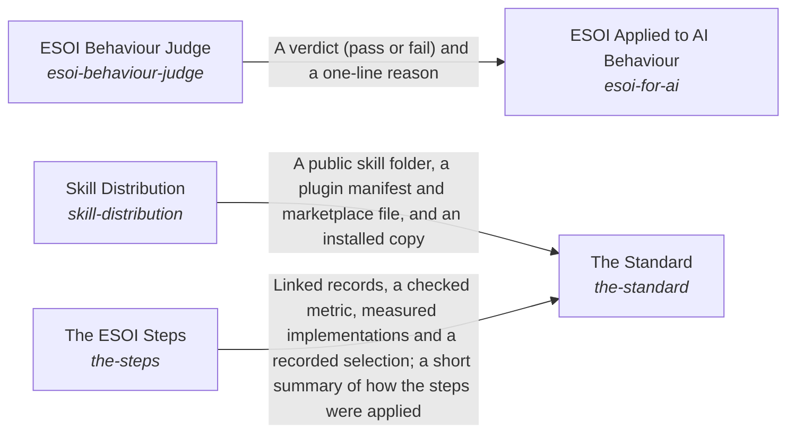

# ESOI Behaviour Judge

*ESOI records kept beside the code in `implementations/python/esoi/understanding/esoi_for_ai/esoi_behaviour_judge`, generated from the CSV files in this folder by `esoi readmes`. Edit the CSV files, not this page.*

Documentation ensures that an intent is optimally carried out.

These are the solutions of [How People and Agents Come to Apply ESOI](../../README.md).

## How the solutions fit together

Understanding is how ESOI reaches the people and agents who apply it. The Standard teaches anyone how a solution is shaped and how a project adopts it, with templates to fill in by hand, and for the order of the work it relies on The ESOI Steps. The Standard also ships the author's skill through Skill Distribution, which publishes a complete public copy that cannot leak or go stale. ESOI Applied to AI Behaviour gives an agent the principles as standing instructions and measures, case by case, whether its replies act on them, asking the ESOI Behaviour Judge to grade what a pattern cannot settle. When a reader needs one part of a project, three parts help. Readable Records gives every intent folder a page made from its records. Spec Search finds the records and standards a request concerns. The Local ESOI Index says which projects apply ESOI and where to look first in each. The Review Tracker puts the whole intent network and its latest results in front of a reviewer and carries the reviewer's edits back to the records, so people steer by metrics without reading the code.

## Overview diagram

An arrow runs from the solution that provides to the solution that builds on it; its label is what the provider outputs.

## ESOI Behaviour Judge (`esoi-behaviour-judge`)

Grade whether one reply acts by the principles when a pattern match cannot tell, and show how far the grading agrees with people.

- Entry call: `esoi.run("esoi-behaviour-judge", '.')`
- Selected implementation: Model judge on the rubric (`model-judge-on-the-rubric`)
- Metric: Judge agreement
- Implemented by: [`implementations/python/esoi/understanding/esoi_for_ai/behaviour.py`](../behaviour.py), [`implementations/python/esoi/understanding/esoi_for_ai/command_provider.py`](../command_provider.py), [`implementations/python/esoi/understanding/esoi_for_ai/esoi_behaviour_judge/behaviour_judge.py`](behaviour_judge.py), [`implementations/python/esoi/understanding/esoi_for_ai/esoi_behaviour_judge/interface.py`](interface.py), [`implementations/python/esoi/understanding/esoi_for_ai/interface.py`](../interface.py), [`implementations/python/evaluation/components/assemble_fixture.py`](../../../../evaluation/components/assemble_fixture.py), [`implementations/python/evaluation/components/consumer_fixture.py`](../../../../evaluation/components/consumer_fixture.py), [`implementations/python/evaluation/components/glance_fixture.py`](../../../../evaluation/components/glance_fixture.py) and 18 more

## Implementations

| Implementation | Handle | Code | Selected |
|---|---|---|---|
| Model judge on the rubric | `esoi-behaviour-judge:model-judge-on-the-rubric` | [`implementations/python/esoi/understanding/esoi_for_ai/esoi_behaviour_judge/interface.py`](interface.py) | selected |
| Regex checks only | `esoi-behaviour-judge:regex-checks-only` | [`implementations/python/evaluation/components/judge_esoi_behaviour/impls/regex_only.py`](../../../../evaluation/components/judge_esoi_behaviour/impls/regex_only.py) |  |
| Human review of every reply | `esoi-behaviour-judge:human-review-of-every-reply` | no code yet |  |

## Metrics

- Judge agreement (`metric-esoi-judge-agreement`): leader `regex_only`, 100 of 100 cases

## Problems

- Behaviour verdicts uncalibrated (`prob-behaviour-verdicts-uncalibrated`): A model that grades whether a reply acts by the principles can disagree with the people whose intent the principles express, can favour its own phrasing when it wrote the reply, and can pass a reply that uses the right words while doing the opposite.

## Ideals

- Calibrated judging (`ideal-calibrated-judging`): A judge's verdicts agree with the human verdicts they stand in for, and where they disagree is known.

## Where to go next

- Up: [implementations/python/esoi/understanding/esoi_for_ai](../README.md)
- Intent: [How People and Agents Come to Apply ESOI](../../README.md)
- Repository: [top README](../../../../../../README.md)
