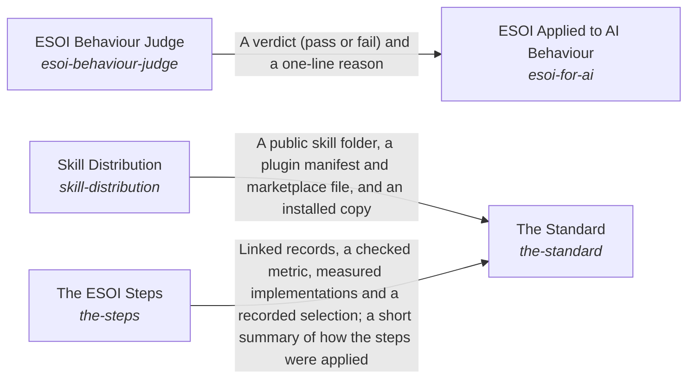

# Readable Records

*ESOI records kept beside the code in `implementations/python/esoi/understanding/readable_records`, generated from the CSV files in this folder by `esoi readmes`. Edit the CSV files, not this page.*

Documentation ensures that an intent is optimally carried out.

These are the solutions of [How People and Agents Come to Apply ESOI](../README.md).

## How the solutions fit together

Understanding is how ESOI reaches the people and agents who apply it. The Standard teaches anyone how a solution is shaped and how a project adopts it, with templates to fill in by hand, and for the order of the work it relies on The ESOI Steps. The Standard also ships the author's skill through Skill Distribution, which publishes a complete public copy that cannot leak or go stale. ESOI Applied to AI Behaviour gives an agent the principles as standing instructions and measures, case by case, whether its replies act on them, asking the ESOI Behaviour Judge to grade what a pattern cannot settle. When a reader needs one part of a project, three parts help. Readable Records gives every intent folder a page made from its records. Spec Search finds the records and standards a request concerns. The Local ESOI Index says which projects apply ESOI and where to look first in each. The Review Tracker puts the whole intent network and its latest results in front of a reviewer and carries the reviewer's edits back to the records, so people steer by metrics without reading the code.

## Overview diagram

An arrow runs from the solution that provides to the solution that builds on it; its label is what the provider outputs.

## Readable Records (`readable-records`)

Give every intent folder a page, made from its records, that says at a glance what the intent is and how its parts fit.

- Entry call: `esoi.run("readable-records", '.')`
- Selected implementation: At a glance, full record below (`at_a_glance`)
- Metric: README glanceability, README fidelity
- Implemented by: [`implementations/python/esoi/structure/structure_budget/ratchet.py`](../../structure/structure_budget/ratchet.py), [`implementations/python/esoi/structure/structure_check/check.py`](../../structure/structure_check/check.py), [`implementations/python/esoi/structure/structure_check/coherence.py`](../../structure/structure_check/coherence.py), [`implementations/python/esoi/structure/structure_check/coherence_code_evidence.py`](../../structure/structure_check/coherence_code_evidence.py), [`implementations/python/esoi/structure/structure_check/coherence_paragraph.py`](../../structure/structure_check/coherence_paragraph.py), [`implementations/python/esoi/structure/structure_check/coherence_records.py`](../../structure/structure_check/coherence_records.py), [`implementations/python/esoi/structure/structure_check/rules/entry_rules.py`](../../structure/structure_check/rules/entry_rules.py), [`implementations/python/esoi/structure/structure_check/rules/generated.py`](../../structure/structure_check/rules/generated.py) and 38 more

## Implementations

| Implementation | Handle | Code | Selected |
|---|---|---|---|
| Record tables only | `readable-records:full_page` | [`implementations/python/esoi/understanding/readable_records/interface.py`](interface.py) |  |
| At a glance, full record below | `readable-records:at_a_glance` | [`implementations/python/esoi/understanding/readable_records/interface.py`](interface.py) | selected |
| Compact page of links | `readable-records:links_page` | [`implementations/python/esoi/understanding/readable_records/interface.py`](interface.py) |  |
| README written by hand | `readable-records:hand-written-readme` | no code yet |  |

## Metrics

- README fidelity (`metric-readme-fidelity`): leader `live_readme`, 10 of 10 cases
- README glanceability (`metric-readme-glanceability`): leader `at_a_glance`, 1 of 4 cases

## Problems

- Records unreadable at a glance (`prob-records-unreadable-at-a-glance`): An intent's folder of CSV files states it completely, but a person clicking into it cannot tell at a glance what the intent is for, how its solutions fit or where to go next: that takes opening several files and following ids between them.

## Ideals

- Glanceable intent (`ideal-glanceable-intent`): Anyone clicking into an intent folder sees on the first screen what the intent is, how its solutions fit together and where to go next.

## Where to go next

- Up: [implementations/python/esoi](../../README.md)
- Intent: [How People and Agents Come to Apply ESOI](../README.md)
- Repository: [top README](../../../../../README.md)
