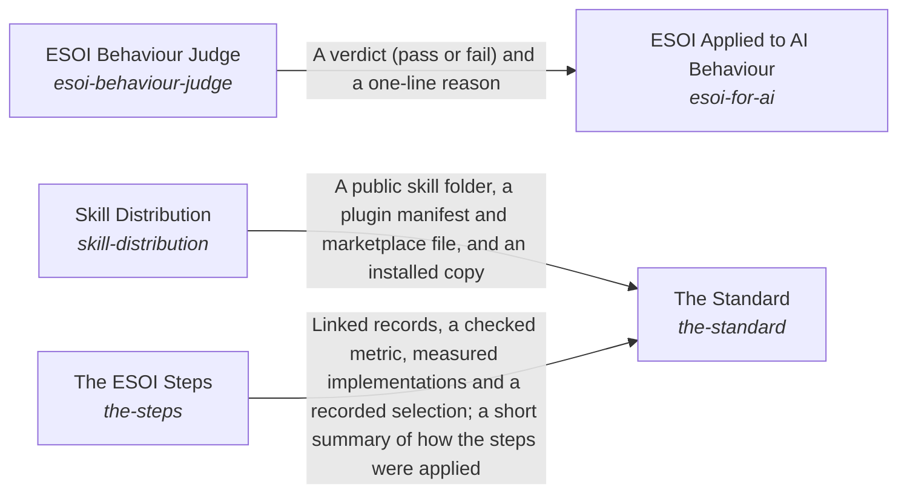

# Spec Search

*ESOI records kept beside the code in `implementations/python/esoi/understanding/spec_search`, generated from the CSV files in this folder by `esoi readmes`. Edit the CSV files, not this page.*

Documentation ensures that an intent is optimally carried out.

These are the solutions of [How People and Agents Come to Apply ESOI](../README.md).

## How the solutions fit together

Understanding is how ESOI reaches the people and agents who apply it. The Standard teaches anyone how a solution is shaped and how a project adopts it, with templates to fill in by hand, and for the order of the work it relies on The ESOI Steps. The Standard also ships the author's skill through Skill Distribution, which publishes a complete public copy that cannot leak or go stale. ESOI Applied to AI Behaviour gives an agent the principles as standing instructions and measures, case by case, whether its replies act on them, asking the ESOI Behaviour Judge to grade what a pattern cannot settle. When a reader needs one part of a project, three parts help. Readable Records gives every intent folder a page made from its records. Spec Search finds the records and standards a request concerns. The Local ESOI Index says which projects apply ESOI and where to look first in each. The Review Tracker puts the whole intent network and its latest results in front of a reviewer and carries the reviewer's edits back to the records, so people steer by metrics without reading the code.

## Overview diagram

An arrow runs from the solution that provides to the solution that builds on it; its label is what the provider outputs.

## Spec Search (`spec-search`)

Find the records, standards and product items that a request concerns, cheapest first, each with the records it links to.

- Entry call: `esoi.run("spec-search", ...)`
- Selected implementation: Lexical vector gated (`lexical-vector-gated`)
- Metric: Spec search correctness, Specification recall at k
- Implemented by: [`implementations/python/esoi/understanding/spec_search/spec_index.py`](spec_index.py), [`implementations/python/esoi/understanding/spec_search/spec_search.py`](spec_search.py), [`implementations/python/evaluation/components/spec_index/__init__.py`](../../../evaluation/components/spec_index/__init__.py), [`implementations/python/evaluation/components/spec_index/cases.json`](../../../evaluation/components/spec_index/cases.json), [`implementations/python/evaluation/components/spec_index/impls/__init__.py`](../../../evaluation/components/spec_index/impls/__init__.py), [`implementations/python/evaluation/components/spec_index/impls/live.py`](../../../evaluation/components/spec_index/impls/live.py), [`implementations/python/evaluation/components/spec_index/impls/term_overlap.py`](../../../evaluation/components/spec_index/impls/term_overlap.py), [`implementations/python/evaluation/components/spec_index/impls/weighted_tfidf.py`](../../../evaluation/components/spec_index/impls/weighted_tfidf.py) and 12 more

## Implementations

| Implementation | Handle | Code | Selected |
|---|---|---|---|
| Lexical only | `spec-search:lexical-only` | [`implementations/python/esoi/understanding/spec_search/spec_search.py`](spec_search.py) |  |
| Lexical vector gated | `spec-search:lexical-vector-gated` | [`implementations/python/esoi/understanding/spec_search/spec_search.py`](spec_search.py) | selected |
| Field-weighted TF-IDF over the index | `spec-search:weighted-tfidf` | [`implementations/python/esoi/understanding/spec_search/spec_index.py`](spec_index.py) |  |
| Plain term overlap | `spec-search:term-overlap` | [`implementations/python/esoi/understanding/spec_search/spec_index.py`](spec_index.py) |  |

## Metrics

- Specification recall at k (`metric-spec-index-recall`): leader `weighted_tfidf`, 31 of 35 cases
- Spec search correctness (`metric-spec-search`): leader `gated`, 6 of 6 cases

## Problems

- Specifications not found for new input (`prob-intent-specs-not-found-for-new-input`): A new use case or input arrives, and it is hard for a person or an AI to tell which of a project's problems, ideals, solutions, implementations and metrics apply without reading most of them.
- Specifications hard to search (`prob-spec-search`): A system that finds a repository's records for a request, or finds them together with its own notes or documents, rebuilds the same stages inside its own code: lexical scoring, a semantic search, rank fusion, a confidence gate, one judging call and the way a ranked record brings its links.

## Ideals

- Right specification at the right time (`ideal-right-spec-at-the-right-time`): For any new use case or input, whoever applies a project's specifications works from the few that bear on it, at a small fraction of the cost of reading them all.
- Shared specification search (`ideal-spec-search`): An application that finds specifications for a request writes only what is its own, and every improvement to finding them reaches it without a change on its side.

## Where to go next

- Up: [implementations/python/esoi](../../README.md)
- Intent: [How People and Agents Come to Apply ESOI](../README.md)
- Repository: [top README](../../../../../README.md)
