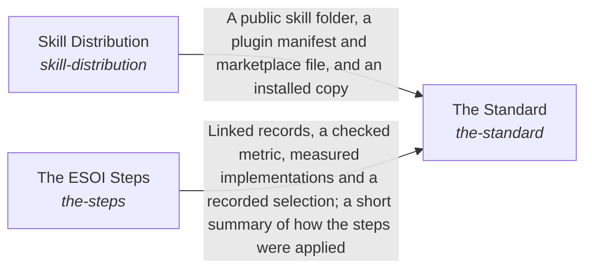

# The Standard

**Purpose:** Teach anyone, person or AI, how a solution is shaped and how a project adopts it, with explanation and fill-in templates that need no code.

Breadcrumb: [Top](../../../../../esoi/README.md) > [How People and Agents Come to Apply ESOI](../README.md) > The Standard

Part of [How People and Agents Come to Apply ESOI](../README.md)

## The Standard (`the-standard`)

- Out of scope: What the automated checks already enforce; making an agent act by the principles.
- Delegates to: structure-check, esoi-for-ai
- Entry call: `esoi.run("the-standard", '.')`
- Selected implementation: Standard document (`standard-document`)
- Metric: Adoption effort, Newcomer effort
- Implemented by: [`.gitignore`](../../../../../.gitignore), [`CHANGELOG.md`](../../../../../CHANGELOG.md), [`CLAUDE.md`](../../../../../CLAUDE.md), [`CONTRIBUTING.md`](../../../../../CONTRIBUTING.md), [`LICENSE`](../../../../../LICENSE), [`NOTICE`](../../../../../NOTICE), [`SECURITY.md`](../../../../../SECURITY.md), [`docs/explanation/a-cascade-runs-one-criterion.md`](../../../../../docs/explanation/a-cascade-runs-one-criterion.md) and 97 more

## One level below

- [Skill Distribution](skill_distribution/README.md) (solution with implementations): Publish an author's skill from the private folder where it is maintained as a complete public folder that people install without anything else.
- [The ESOI Steps](the_steps/README.md) (solution with implementations): Give the order in which to define and apply ESOI to anything new or changed, and say where to loop back when something changes.

## Diagram

An arrow runs from the solution that provides to the solution that builds on it; its label is what the provider outputs.

## Implementations

| Implementation | Handle | Purpose | Code | Selected |
|---|---|---|---|---|
| Standard document | `the-standard:standard-document` | `docs/explanation/intent-types.md` gives the shape of a solution and the other four record types, and `docs/how-to/apply-with-tools.md` the steps to adopt them; `esoi rules` lists what is checked. | [`implementations/python/esoi/understanding/the_standard/interface.py`](interface.py) | selected |
| Worked example repository | `the-standard:worked-example-repository` | A small repository that applies the standard end to end, read and copied instead of a document. | no code yet |  |
| Documentation folder | `the-standard:documentation-folder` | Hand-written explanation and guides beside templates generated from the skill. | [`implementations/python/esoi/understanding/the_standard/interface.py`](interface.py) |  |
| Guided questionnaire | `the-standard:guided-questionnaire` | Asks the template's questions one at a time and writes the records from the answers. | no code yet |  |

## Metrics

- Newcomer effort (`metric-docs-and-templates`)

## Problems

- Others cannot adopt (`prob-others-cannot-adopt`): There is no worked, checked example of evolvable structure in code, so each team that wants it designs its own from prose.

## Ideals

- Adoptable structure (`ideal-adoptable-structure`): Another team can apply the same structure to its own code by following one standard and reusing this library's tools.

## Where to go next

- Up: [implementations/python/esoi](../../README.md)
- Intent: [How People and Agents Come to Apply ESOI](../README.md)
- Down: [implementations/python/esoi/understanding/the_standard/skill_distribution](skill_distribution/README.md)
- Down: [implementations/python/esoi/understanding/the_standard/the_steps](the_steps/README.md)
- Repository: [top README](../../../../../README.md)

*Generated from the CSV files in this folder by `esoi readmes`. Edit the CSV files, not this page.*
