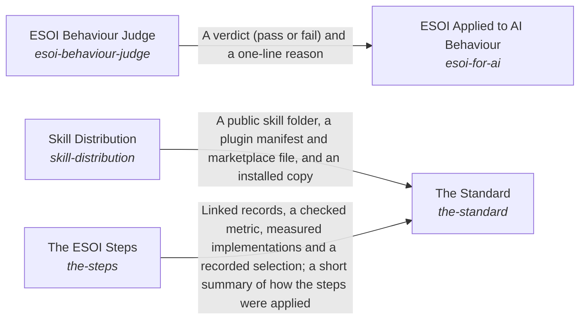
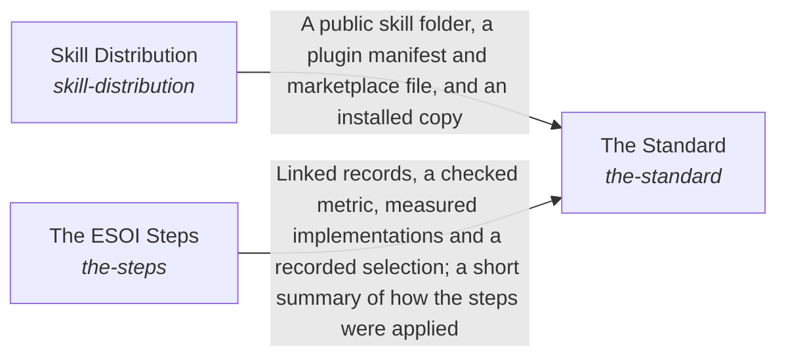

# The Standard

*ESOI records kept beside the code in `implementations/python/esoi/understanding/the_standard`, generated from the CSV files in this folder by `esoi readmes`. Edit the CSV files, not this page.*

Documentation ensures that an intent is optimally carried out.

These are the solutions of [How People and Agents Come to Apply ESOI](../README.md).

## How the solutions fit together

Understanding is how ESOI reaches the people and agents who apply it. The Standard teaches anyone how a solution is shaped and how a project adopts it, with templates to fill in by hand, and for the order of the work it relies on The ESOI Steps. The Standard also ships the author's skill through Skill Distribution, which publishes a complete public copy that cannot leak or go stale. ESOI Applied to AI Behaviour gives an agent the principles as standing instructions and measures, case by case, whether its replies act on them, asking the ESOI Behaviour Judge to grade what a pattern cannot settle. When a reader needs one part of a project, three parts help. Readable Records gives every intent folder a page made from its records. Spec Search finds the records and standards a request concerns. The Local ESOI Index says which projects apply ESOI and where to look first in each. The Review Tracker puts the whole intent network and its latest results in front of a reviewer and carries the reviewer's edits back to the records, so people steer by metrics without reading the code.

## Overview diagram

An arrow runs from the solution that provides to the solution that builds on it; its label is what the provider outputs.

## The Standard (`the-standard`)

Teach anyone, person or AI, how a solution is shaped and how a project adopts it, with explanation and fill-in templates that need no code.

- Entry call: `esoi.run("the-standard", '.')`
- Selected implementation: Standard document (`standard-document`)
- Metric: Adoption effort, Newcomer effort
- Implemented by: [`.gitignore`](../../../../../.gitignore), [`CHANGELOG.md`](../../../../../CHANGELOG.md), [`CLAUDE.md`](../../../../../CLAUDE.md), [`CONTRIBUTING.md`](../../../../../CONTRIBUTING.md), [`LICENSE`](../../../../../LICENSE), [`NOTICE`](../../../../../NOTICE), [`SECURITY.md`](../../../../../SECURITY.md), [`docs/explanation/a-cascade-runs-one-criterion.md`](../../../../../docs/explanation/a-cascade-runs-one-criterion.md) and 92 more

## Diagram

An arrow runs from the solution that provides to the solution that builds on it; its label is what the provider outputs.

## Implementations

| Implementation | Handle | Code | Selected |
|---|---|---|---|
| Standard document | `the-standard:standard-document` | [`implementations/python/esoi/understanding/the_standard/interface.py`](interface.py) | selected |
| Worked example repository | `the-standard:worked-example-repository` | no code yet |  |
| Documentation folder | `the-standard:documentation-folder` | [`implementations/python/esoi/understanding/the_standard/interface.py`](interface.py) |  |
| Guided questionnaire | `the-standard:guided-questionnaire` | no code yet |  |

## Metrics

- Newcomer effort (`metric-docs-and-templates`)

## Problems

- Others cannot adopt (`prob-others-cannot-adopt`): There is no worked, checked example of evolvable structure in code, so each team that wants it designs its own from prose.

## Ideals

- Adoptable structure (`ideal-adoptable-structure`): Another team can apply the same structure to its own code by following one standard and reusing this library's tools.

## Where to go next

- Up: [implementations/python/esoi](../../README.md)
- Intent: [How People and Agents Come to Apply ESOI](../README.md)
- Down: [implementations/python/esoi/understanding/the_standard/skill_distribution](skill_distribution/README.md)
- Down: [implementations/python/esoi/understanding/the_standard/the_steps](the_steps/README.md)
- Repository: [top README](../../../../../README.md)
