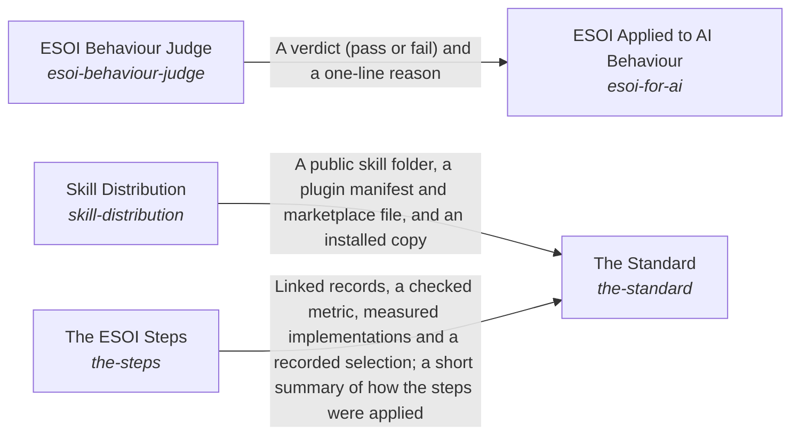

# The ESOI Steps

*ESOI records kept beside the code in `implementations/python/esoi/understanding/the_standard/the_steps`, generated from the CSV files in this folder by `esoi readmes`. Edit the CSV files, not this page.*

Documentation ensures that an intent is optimally carried out.

These are the solutions of [How People and Agents Come to Apply ESOI](../../README.md).

## How the solutions fit together

Understanding is how ESOI reaches the people and agents who apply it. The Standard teaches anyone how a solution is shaped and how a project adopts it, with templates to fill in by hand, and for the order of the work it relies on The ESOI Steps. The Standard also ships the author's skill through Skill Distribution, which publishes a complete public copy that cannot leak or go stale. ESOI Applied to AI Behaviour gives an agent the principles as standing instructions and measures, case by case, whether its replies act on them, asking the ESOI Behaviour Judge to grade what a pattern cannot settle. When a reader needs one part of a project, three parts help. Readable Records gives every intent folder a page made from its records. Spec Search finds the records and standards a request concerns. The Local ESOI Index says which projects apply ESOI and where to look first in each. The Review Tracker puts the whole intent network and its latest results in front of a reviewer and carries the reviewer's edits back to the records, so people steer by metrics without reading the code.

## Overview diagram

An arrow runs from the solution that provides to the solution that builds on it; its label is what the provider outputs.

## The ESOI Steps (`the-steps`)

Give the order in which to define and apply ESOI to anything new or changed, and say where to loop back when something changes.

- Entry call: `esoi.run("the-steps", '.')`
- Selected implementation: The ESOI steps (`esoi-steps`)
- Metric: Steps followed
- Implemented by: [`.claude-plugin/marketplace.json`](../../../../../../.claude-plugin/marketplace.json), [`docs/explanation/a-cascade-runs-one-criterion.md`](../../../../../../docs/explanation/a-cascade-runs-one-criterion.md), [`docs/explanation/a-metric-builds-on-its-foundation.md`](../../../../../../docs/explanation/a-metric-builds-on-its-foundation.md), [`docs/explanation/a-problem-says-what-is-true.md`](../../../../../../docs/explanation/a-problem-says-what-is-true.md), [`docs/explanation/a-solution-holds-alternatives-of-one-job.md`](../../../../../../docs/explanation/a-solution-holds-alternatives-of-one-job.md), [`docs/explanation/admitting-a-technology.md`](../../../../../../docs/explanation/admitting-a-technology.md), [`docs/explanation/adopting-solutions-from-a-library.md`](../../../../../../docs/explanation/adopting-solutions-from-a-library.md), [`docs/explanation/beyond-code.md`](../../../../../../docs/explanation/beyond-code.md) and 139 more

## Implementations

| Implementation | Handle | Code | Selected |
|---|---|---|---|
| The ESOI steps | `the-steps:esoi-steps` | [`implementations/python/esoi/understanding/the_standard/the_steps/interface.py`](interface.py) | selected |
| Project Documentation board checklist | `the-steps:board-checklist` | no code yet |  |
| One-hour first pass | `the-steps:one-hour-pass` | no code yet |  |
| No stated order | `the-steps:no-stated-order` | no code yet |  |

## Metrics

- Steps followed (`metric-steps-followed`)

## Problems

- No order to follow (`prob-no-order-to-follow`): People who want to apply ESOI have the five record types and the principles but no order to follow.

## Ideals

- Followable process (`ideal-followable-process`): Anyone applying ESOI can follow one stated order from purpose to selection by metric, sized to the work, and knows where to return when something changes.

## Where to go next

- Up: [implementations/python/esoi/understanding/the_standard](../README.md)
- Intent: [How People and Agents Come to Apply ESOI](../../README.md)
- Repository: [top README](../../../../../../README.md)
